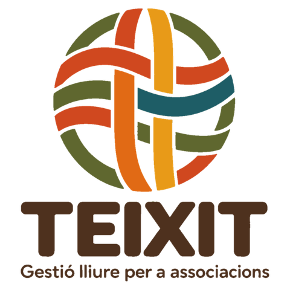

<p align="center"></p>

<p align="center">
  <a href="../../releases/latest"></a>
  <a href="LICENSE"></a>
  
  
</p>

# Teixit

**Gestió lliure per a associacions.** Teixit és un programa per a un ordinador amb Windows o Linux que porta en un sol lloc la gestió interna d'una associació o entitat sense ànim de lucre: les persones i els socis, la junta directiva i les actes, les quotes, els rebuts i les remeses bancàries, la loteria, el llibre de caixa, els documents, els comunicats, les seccions o equips, les activitats i cursos, l'inventari i la roba.

Està pensat per a associacions culturals, **falles, gaiates i fogueres**, **clubs esportius** i **AMPA/AFA**, i per a qui porta la secretaria o la tresoreria encara que no siga informàtic: s'instal·la com qualsevol altre programa, funciona sense Internet i les dades es queden a l'ordinador de l'entitat.

> 🔒 **La privacitat és el centre del projecte.** Teixit **no té servidor, no demana registrar-se ni pagar una subscripció i no recull cap dada**: ni de l'entitat, ni dels socis, ni dels menors. Tot es queda en un fitxer de l'ordinador de l'entitat, que en controla les còpies. No hi ha telemetria, ni publicitat, ni comptes en el núvol de ningú.

> ⚠ **Avís de responsabilitat.** Teixit és programari lliure i es distribueix tal com és, sense cap garantia (llicència AGPL-3.0). L'autor no es fa responsable de la pèrdua de dades ni de cap altre dany, directe o indirecte, que puga derivar-se de l'ús del programa, d'una errada, d'una actualització o d'una configuració incorrecta. Cada entitat és responsable de les seues dades i de fer-ne còpies de seguretat periòdiques en un lloc extern (USB o núvol).
>
> *Aviso de responsabilidad: Teixit es software libre y se distribuye tal cual, sin ninguna garantía (licencia AGPL-3.0). El autor no se hace responsable de la pérdida de datos ni de ningún otro daño, directo o indirecto, que pueda derivarse del uso del programa, de un error, de una actualización o de una configuración incorrecta. Cada entidad es responsable de sus datos y de hacer copias de seguridad periódicas en un lugar externo (USB o nube).*

*Teixit es un programa libre para la gestión interna de asociaciones culturales, fallas, gaiatas y hogueras, clubes deportivos y AMPA/AFA desde un ordenador con Windows o Linux: personas, socios, junta directiva y actas, cuotas, recibos y remesas, lotería, caja, documentos, comunicados, secciones o equipos, actividades e inventario. Funciona en valenciano y castellano, sin Internet, sin servidores y sin recoger ningún dato. [Manual de usuario en castellano](docs/manual-usuario.md).*

Un projecte de **José Vicente Sanjuan**, germà de [Compàs](https://github.com/jossanmar9/compas), el programa per a societats musicals.

⬇️ **Descàrrega:** [última versió](../../releases/latest) · 📖 **Manual:** [en línia](docs/manual-usuari.md) · 🔒 [Privacitat](PRIVACITAT.md)

## Contingut

- [Un programa, quatre tipus d'entitat](#un-programa-quatre-tipus-dentitat)
- [Què fa](#què-fa)
- [Per què sense núvol](#per-què-sense-núvol)
- [Instal·lació](#installació)
- [Primers passos](#primers-passos)
- [Usuaris i permisos](#usuaris-i-permisos)
- [Dades i còpies de seguretat](#dades-i-còpies-de-seguretat)
- [Documentació](#documentació)
- [Per a desenvolupar](#per-a-desenvolupar)
- [Publicar una versió](#publicar-una-versió)
- [Pròximes versions](#pròximes-versions)
- [Col·laborar](#col·laborar)
- [Autoria i ús d'intel·ligència artificial](#autoria-i-ús-dintel·ligència-artificial)
- [Avís de responsabilitat](#avís-de-responsabilitat)
- [Llicència](#llicència)

## Un programa, quatre tipus d'entitat

Teixit parteix d'un **nucli comú** de gestió associativa i l'adapta al tipus d'entitat que es tria en instal·lar-lo. El tipus canvia el vocabulari, els mòduls que s'activen i els tipus de soci inicials; es pot canviar després sense perdre res.

| Tipus | Què hi canvia |
|---|---|
| **Associació cultural** (culturals, veïnals, juvenils, de gent gran, colles…) | Socis (ordinari, juvenil, protector, d'honor), **seccions** (teatre, ball…) i **tallers i cursos**, amb qualificacions si cal. |
| **Falla, gaiata o foguera** | El **cens** amb categories (adult, juvenil, infantil, d'honor), seccions (teatre, playback, infantil…), **roba** (brusons, mocadors…), **loteria** i les despeses del **monument** i del **casal**. |
| **Club esportiu** | **Equips** amb categoria, esportistes i tècnics amb la seua posició, **llicències federatives** amb avís de caducitat, **equipacions**, escola esportiva i arbitratges. |
| **AMPA o AFA** | **Famílies associades**, **comissions** (menjador, festes…) i **activitats extraescolars** amb monitors, horaris i rebuts per família. |

## Què fa

| Mòdul | Què fa |
|---|---|
| **Persones** | Registre únic: cada persona s'introdueix una sola vegada i pot ser sòcia, membre d'una secció, monitora, alumna, tutora o càrrec de la junta alhora sense duplicar dades. Nom, cognoms i data de naixement són obligatoris; DNI i telèfon, només per als majors d'edat. Quan un menor fa 18 anys sense eixes dades, la seua fila es marca en groc. |
| **Drets d'imatge** | Si cada persona autoritza fotos i vídeos, amb la data de la signatura. Fulls de consentiment per a imprimir i llistat de qui pot eixir en les fotos. |
| **Socis (o cens)** | Número, tipus de soci (els defineix cada entitat segons els seus estatuts), altes i baixes, full d'alta per a imprimir. Llistat per número, etiquetes per a les circulars i antiguitat per a les insígnies de 25 i 50 anys. |
| **Junta directiva i actes** | Càrrecs amb data d'inici i de fi i l'historial de totes les juntes. Avís quan s'acosta la renovació. Llibre d'actes de juntes i assemblees: convocatòria, acta i certificat d'un acord per a imprimir. |
| **Quotes i rebuts** | Tarifes per tipus de soci i periodicitat, i de les activitats. Rebuts generats per període (un per soci, i un per família en les activitats), amb descomptes. Cobrament en efectiu, transferència o domiciliació, rebuts retornats i qui deu diners. |
| **Remeses bancàries** | Domiciliacions (mandats SEPA) amb l'IBAN validat i l'ordre per a signar. Fitxer XML d'adeutaments directes SEPA (pain.008) per a pujar a la banca electrònica. |
| **Loteria** | Sorteigs, talonaris repartits, participacions per a imprimir i liquidació. |
| **Llibre de caixa** | Ingressos i despeses amb saldo, per banc i caixa. Els rebuts, les remeses i la loteria hi entren sols. Resum per categories per a l'assemblea. |
| **Documents** | Estatuts, reglament, actes signades, CIF, pòlisses, contractes… guardats dins de Teixit i, per tant, en les còpies. Avís de caducitat. Registre d'activitats de tractament (RGPD) generat amb les dades reals. |
| **Comunicats** | Llistes de correu (socis, junta, monitors, famílies, una secció…) per a copiar en CCO, i registre del que s'ha enviat. Teixit no envia res. |
| **Seccions, equips o comissions** | Els grups estables de l'entitat amb els seus membres, la funció de cadascú i qui n'és responsable. En els clubs, la categoria de cada equip i les **llicències federatives**. |
| **Activitats i cursos** | Tallers, cursos, extraescolars o escola esportiva: cursos, activitats, aules, monitors (amb el certificat de delictes sexuals), grups amb horari, matrícules i tutors legals. Assistent per a passar al curs següent. |
| **Qualificacions i butlletins** | Opcional, per a les entitats que avaluen: notes per avaluació i butlletins per a imprimir. |
| **Inventari** | El material de l'entitat (carpes, equips de so, porteries…), manteniments i préstecs amb avís de devolucions vençudes. |
| **Roba i articles** | Samarretes, brusons, mocadors, equipacions… per talla: compres, vendes, préstecs i el que queda. |
| **Llistats i certificats** | Socis per número, membres per funció, alumnes d'un grup amb els telèfons dels tutors, dades per a la memòria anual i les subvencions, certificats de soci, de secció i de matrícula. Tot s'imprimeix, es guarda en PDF o s'exporta a CSV. |
| **Importació** | Porta des d'Excel o CSV les persones, els socis i l'alumnat (amb els tutors), amb revisió prèvia i sense duplicar qui ja hi és. |
| **A la mida** | Cada entitat activa o desactiva els mòduls i els avisos de l'inici. Les dades no s'esborren. |
| **Administració** | Dos comptes (administrador/a i administratiu/va), configuració i logotip, registre d'activitat i còpies de seguretat (les externes, xifrades amb contrasenya si es vol). |

Tot el programa està en **valencià i castellà**, i cada usuari pot triar el seu idioma.

Teixit fa **rebuts**, no factures: les factures han de complir el reglament dels sistemes de facturació (Verifactu) i s'han de fer amb un programa preparat per a això.

## Per què sense núvol

| | Teixit | Plataformes en línia |
|---|---|---|
| On són les dades | A l'ordinador de l'entitat | Al servidor de l'empresa |
| Qui les pot vore | Només qui fa servir l'ordinador | L'empresa i els seus proveïdors |
| Recollida de dades i analítica | Cap | Habitual (ús, dispositius, cookies) |
| Funciona sense Internet | Sí | No |
| Cost | Gratuït i lliure (AGPL) | Subscripció anual |
| Si el projecte desapareix | El programa i les dades continuen | Depens que el servei continue |

Les plataformes en línia tenen avantatges reals (una app per al mòbil, accés des de qualsevol lloc), però les dades de socis, famílies i menors passen a mans d'un tercer. Teixit tria l'altre camí: menys comoditat i cap dada fora.

## Instal·lació

**Requisits:** Windows 10 o 11 de 64 bits, o Linux amb PHP 8.1 o posterior, i uns 100 MB de disc. No cal Internet ni servidor. A Windows tampoc no cal instal·lar PHP ni bases de dades: tot va dins.

1. Baixa l'[última versió](../../releases/latest):
   - **`Teixit-X.Y.Z-installador.exe`**: l'instal·lador recomanat per a Windows. No demana permisos d'administrador; s'instal·la a `%LOCALAPPDATA%\Programs\Teixit` i crea l'accés al menú Inici i a l'escriptori.
   - **`Teixit-X.Y.Z-portable.zip`**: la mateixa versió sense instal·lar. Descomprimeix-la on vulgues (també en un llapis USB) i obri `Teixit.exe`.
   - **`teixit_X.Y.Z_all.deb`**: per a Debian, Ubuntu, Linux Mint i semblants. S'instal·la amb `sudo apt install ./teixit_X.Y.Z_all.deb`, que porta també PHP.
   - **`Teixit-X.Y.Z-linux.tar.gz`**: per a altres Linux. Descomprimeix-lo i executa `./installa.sh` (cal PHP 8.1 o posterior amb `pdo_sqlite` i `mbstring`).
2. El programa **encara no està signat digitalment**. Windows SmartScreen pot avisar: prem **Més informació → Executa igualment**. En ordinadors amb el **Control intel·ligent d'aplicacions** de Windows 11 activat, Windows el bloqueja (també la versió portable) i cal desactivar-lo: vegeu la [guia d'instal·lació](docs/guia-installacio.md#si-windows-no-et-deixa-obrir-lo).
3. Obri **Teixit**. S'obri en la seua pròpia finestra, sense cap navegador. En tancar-la, fa una còpia de seguretat i s'atura.

Teixit i Compàs es poden tindre instal·lats en el mateix ordinador: cadascun té la seua carpeta, les seues dades i el seu port.

**Actualitzar:** executa l'instal·lador de la versió nova amb Teixit tancat. Les dades i la configuració es conserven. En desinstal·lar, la carpeta de dades no s'esborra.

Més detalls i solució de problemes a la [guia d'instal·lació](docs/guia-installacio.md).

## Primers passos

La primera vegada, Teixit demana el **tipus d'entitat** i el nom, i crea el compte d'administrador (i, si vols, el d'administratiu). També pot carregar **dades d'exemple**, adaptades al tipus d'entitat, per a provar-lo.

Ordre recomanat per a començar:

1. **Configuració**: dades de l'entitat i logotip. A **Mòduls i avisos**, activa o desactiva el que no faça falta.
2. **Còpies de seguretat**: tria una carpeta externa (USB o núvol).
3. **Persones** i **socis** (o importa'ls des d'Excel).
4. **Junta directiva**: els càrrecs actuals i els anys de mandat.
5. **Economia**: tarifes, dades del banc i domiciliacions.
6. Si cal: **seccions o equips**, **activitats i cursos**, **inventari** i **roba**.

El [manual d'usuari](docs/manual-usuari.md) explica cada procés pas a pas amb captures.

## Usuaris i permisos

| Compte | Pot fer |
|---|---|
| **Administrador/a** | Tot, incloent-hi usuaris, configuració, registre d'activitat i restauració de còpies. |
| **Administratiu/va** | Tota la gestió diària (persones, socis, junta, actes, economia, documents, comunicats, seccions, activitats, inventari i roba) i fer còpies. |

Les contrasenyes es guarden xifrades, hi ha un bloqueig temporal després de cinc intents fallits i el **registre d'activitat** anota qui ha creat, modificat o eliminat cada cosa.

Si l'administrador/a oblida la contrasenya, la pot canviar des de la pantalla d'entrada amb el **codi de recuperació** que es mostra en la configuració inicial (i que es pot tornar a generar a **Usuaris**). Si s'ha perdut el codi, hi ha una alternativa amb un fitxer a la carpeta de dades, que només pot fer qui té accés a l'ordinador.

## Dades i còpies de seguretat

- Totes les dades estan en un sol fitxer: `data\teixit.db`, dins de la carpeta del programa.
- Teixit **només escolta en el mateix ordinador** (`127.0.0.1`): no és accessible des de la xarxa ni des d'Internet, i no envia cap dada fora: ni estadístiques, ni informes d'errors, ni comprovacions d'actualitzacions. Vegeu la [declaració de privacitat](PRIVACITAT.md).
- **Còpies automàtiques:** la primera vegada que s'utilitza cada dia i en tancar el programa si hi ha hagut canvis. Es guarden totes les dels últims 7 dies, una per setmana de l'últim mes i una per mes de l'últim any (configurable).
- **Carpeta externa:** cada còpia es guarda també en un USB o en una carpeta sincronitzada amb el núvol. L'inici avisa si no està configurada o si fa més de 7 dies que no s'hi guarda res.
- **Còpies xifrades:** les de la carpeta externa es poden xifrar amb contrasenya, perquè un USB perdut no expose dades de menors.
- **Restaurar** una còpia es fa amb un clic. Abans, Teixit guarda una còpia de les dades actuals, de manera que sempre es pot tornar arrere.
- Els **documents** de l'entitat (PDF, imatges, fulls de càlcul…) es guarden dins de `teixit.db`, de manera que entren en totes les còpies.
- Res no s'elimina si té historial: les baixes es marquen amb estat i data de baixa.

> Les dades contenen informació personal, també de menors. L'entitat és la responsable de tractar-les d'acord amb la normativa de protecció de dades.

## Documentació

| Document | Valencià | Castellano |
|---|---|---|
| Manual d'usuari, pas a pas amb captures | [MD](docs/manual-usuari.md) · [PDF](https://github.com/jossanmar9/teixit/releases/latest/download/manual-usuari.pdf) | [MD](docs/manual-usuario.md) · [PDF](https://github.com/jossanmar9/teixit/releases/latest/download/manual-usuario.pdf) |
| Guia d'instal·lació | [MD](docs/guia-installacio.md) · [PDF](https://github.com/jossanmar9/teixit/releases/latest/download/guia-installacio.pdf) | [MD](docs/guia-instalacion.md) · [PDF](https://github.com/jossanmar9/teixit/releases/latest/download/guia-instalacion.pdf) |
| Declaració de privacitat | [PRIVACITAT](PRIVACITAT.md) | [PRIVACITAT](PRIVACITAT.md#privacidad-de-teixit) |
| Arquitectura i detalls tècnics | [MD](docs/arquitectura.md) | |
| Registre de canvis de cada versió | [CHANGELOG](CHANGELOG.md) | |

El manual també es pot consultar dins del programa, al menú **Ajuda**.

## Per a desenvolupar

### Tecnologia

- **PHP 8** sense dependències ni frameworks, servit pel servidor integrat de PHP.
- **SQLite** a través de PDO, amb consultes preparades.
- **HTML, CSS i JavaScript** propis, sense biblioteques externes.
- **Llançador per a Windows** en C# (.NET Framework 4, inclòs en Windows), amb la finestra de Teixit feta amb el component **WebView2** de Windows (`launcher/Visor.cs`).
- **Llançador per a Linux** en Bash, amb la finestra de Teixit feta amb **WebKitGTK** (`launcher/linux/teixit-visor.py`).
- **Instal·lador** amb Inno Setup; **PHP portable** baixat de windows.php.net en cada construcció.

### Estructura

```
app/          punt d'entrada (index.php) i recursos web (CSS, JS, logotip i icona)
src/          lògica: base de dades, permisos, entitats, tipus d'entitat, pantalles i traduccions
  lang/       textos en valencià (ca.php) i castellà (es.php), amb els propis de cada tipus d'entitat («clau@tipus»)
  pages/      pantalles específiques (inici, economia, junta, documents, còpies…)
launcher/     llançador de Windows (Teixit.cs), php.ini, script de l'instal·lador i, a linux/, el llançador i l'instal·lador per a Linux
docs/         manuals, guies i captures (imatges/)
eines/        generació de captures, PDF i web, i els logotips originals (logo/)
tests/        proves automàtiques i d'integració
.github/      proves, construcció de l'instal·lador (publica.yml) i de la web (web.yml)
```

La majoria de pantalles es generen a partir de la definició declarativa de `src/entitats.php` (camps, relacions i validacions). Els tipus d'entitat es defineixen a `src/tipus.php`, i el vocabulari propi de cada tipus va als fitxers de `src/lang/` amb claus com `ent.agrupacions@club`. Més detalls a [arquitectura](docs/arquitectura.md).

### Executar-lo sense Windows

Amb PHP 8.1 o posterior (extensions `pdo_sqlite` i `mbstring`):

```
php -S 127.0.0.1:8750 -t app app/index.php
```

i obri `http://127.0.0.1:8750`. Les dades es guarden a `data/` o a la carpeta que indique la variable d'entorn `TEIXIT_DADES`.

### Eines

| Ordre | Què fa |
|---|---|
| `python3 eines/captures.py [números]` | Torna a fer les captures dels manuals (`docs/imatges/ca` i `es`) recorrent cada procés amb dades d'exemple. Requereix Pillow i Playwright. |
| `bash eines/pdf.sh` | Fa els manuals i les guies en PDF (`docs/pdf/`) amb Chrome o Chromium. No es guarden al repositori: els fa GitHub Actions en publicar cada versió i la web. |
| `php eines/web.php _site` | Genera la web de presentació en valencià i castellà. |
| `php tests/run.php` | Proves automàtiques (IBAN, SEPA, còpies xifrades, rotació de còpies). Vegeu [tests/README.md](tests/README.md). |
| `python3 tests/integracio.py` | Proves d'integració: arranquen Teixit amb dades d'exemple i recorren totes les funcions, amb cada tipus d'entitat i en valencià i castellà. |
| `php tests/performance.php` | Prova de rendiment de SQLite amb 100.000 rebuts. |

## Publicar una versió

1. Actualitza `TEIXIT_VERSIO` a `src/bootstrap.php`.
2. Al [CHANGELOG](CHANGELOG.md), apunta els canvis en un apartat nou a dalt amb el número i la data de la versió, per exemple `## [1.0.1] - 2026-11-05`.
3. Puja els canvis i crea una etiqueta en minúscula:
   ```
   git tag v1.0.1
   git push origin v1.0.1
   ```
4. GitHub Actions (`publica.yml`) comprova el codi, baixa PHP portable, compila el llançador, genera els manuals en PDF, construeix l'instal·lador i el zip portable per a Windows i els paquets .deb i .tar.gz per a Linux, els prova, i ho publica tot en una *release*. Les notes de la *release* es prenen de l'apartat d'eixa versió al CHANGELOG.

La web es torna a publicar sola amb cada canvi a `main` (`web.yml`).

Les versions segueixen el format `MAJOR.MENOR.CORRECCIÓ`: `v1.0.1` per a correccions i `v1.1.0` per a funcionalitats noves.

## Pròximes versions

- Calendari d'actes i activitats, amb els espais que cal demanar a l'ajuntament.
- Falles: la presentació, la cavalcada, l'ofrena i els representants de la comissió (fallera major, president infantil…).
- Clubs: calendari de partits i convocatòries.
- AMPA: menjador i beques.
- Subvencions: sol·licituds, terminis i justificacions.

Les propostes de qui porta de veritat una entitat decidiran l'ordre.

## Col·laborar

Has trobat una errada o tens una proposta? Obri una [incidència](../../issues/new/choose) i tria **He trobat una errada** o **Tinc una proposta**: un formulari et guia pas a pas. No poses dades reals de persones en el text ni en les captures.

## Autoria i ús d'intel·ligència artificial

Teixit és un projecte de **José Vicente Sanjuan**, que n'ha definit les funcions, n'ha revisat el funcionament i el manté. Naix de [Compàs](https://github.com/jossanmar9/compas), el programa per a societats musicals del mateix autor.

Este projecte s'ha desenvolupat amb l'ajuda d'una intel·ligència artificial (Claude, d'Anthropic), que ha generat bona part del codi i de la documentació a partir de les especificacions i les revisions del projecte.

## Avís de responsabilitat

Teixit és programari lliure i es distribueix tal com és, sense cap garantia (llicència AGPL-3.0). L'autor no es fa responsable de la pèrdua de dades ni de cap altre dany, directe o indirecte, que puga derivar-se de l'ús del programa, d'una errada, d'una actualització o d'una configuració incorrecta. Cada entitat és responsable de les seues dades i de fer-ne còpies de seguretat periòdiques en un lloc extern (USB o núvol).

En la configuració inicial, Teixit demana acceptar este avís.

## Llicència

Copyright © 2026 José Vicente Sanjuan.

Teixit és programari lliure distribuït sota la llicència **GNU Affero General Public License v3 o posterior (AGPL-3.0-or-later)**. El pots utilitzar, estudiar, modificar i redistribuir d'acord amb els termes de la llicència.

El text vàlid de la llicència és l'original en anglés ([LICENSE](LICENSE)). En [LLICENCIA.md](LLICENCIA.md) n'hi ha un resum orientatiu en valencià i castellà.

Si es modifica Teixit i s'ofereix als usuaris a través d'una xarxa, la llicència AGPL exigeix que estos usuaris tinguen accés al codi font de la versió modificada.

Les versions per a Windows inclouen [PHP](https://www.php.net/license/), distribuït sota la PHP License, [SQLite](https://www.sqlite.org/copyright.html), de domini públic, i les biblioteques del [SDK de Microsoft WebView2](https://www.nuget.org/packages/Microsoft.Web.WebView2), distribuïdes sota la llicència BSD (`WebView2-LICENSE.txt`).
