# Manual d'administració de Teixit

## 1. Abans de començar

Teixit és un programa de gestió per a associacions i entitats sense ànim de lucre: persones, socis, junta directiva i actes, quotes i rebuts, remeses bancàries, loteria, llibre de caixa, documents, comunicats, seccions o equips, activitats i cursos, inventari, roba i còpies de seguretat. Funciona en **un sol ordinador amb Windows o Linux**, sense Internet, i té dos comptes. Esta taula resumeix què pot fer cadascun:

| Què es pot fer | Administrador/a | Usuari/ària |
|---|:---:|:---:|
| Persones, socis i tipus de soci | ✔ | ✔ |
| Seccions o equips, activitats i cursos, monitors i matrícules | ✔ | ✔ |
| Inventari, préstecs i roba | ✔ | ✔ |
| Quotes, rebuts, domiciliacions, remeses i loteria | ✔ | ✔ |
| Llibre de caixa | ✔ | ✔ |
| Junta, actes, documents i comunicats | ✔ | ✔ |
| Llistats, certificats i importació des d'Excel | ✔ | ✔ |
| Fer i baixar còpies de seguretat | ✔ | ✔ |
| Canviar la pròpia contrasenya | ✔ | ✔ |
| Configuració de l'entitat, tipus d'entitat, logotip, mòduls i avisos | ✔ | — |
| Dades bancàries i descomptes de les activitats | ✔ | — |
| Crear i gestionar els comptes | ✔ | — |
| Registre d'activitat | ✔ | — |
| Restaurar i eliminar còpies, carpeta externa i xifrat | ✔ | — |
| Recuperar l'accés amb el codi de recuperació | ✔ | — |

Este manual és per a l'administrador/a de Teixit: la persona que el posa en marxa, el configura, gestiona els comptes i les còpies de seguretat i l'actualitza. Per a la gestió diària (persones, socis, junta, economia, seccions, activitats…), vegeu el **Manual d'usuari**.

> En este manual, el botó o el camp que cal utilitzar en cada pas apareix **marcat en taronja** a les captures.

> ⚠ **Avís de responsabilitat.** Teixit és programari lliure i es distribueix tal com és, sense cap garantia (llicència AGPL-3.0). L'autor no es fa responsable de la pèrdua de dades ni de cap altre dany, directe o indirecte, que puga derivar-se de l'ús del programa, d'una errada, d'una actualització o d'una configuració incorrecta. Cada entitat és responsable de les seues dades i de fer-ne còpies de seguretat periòdiques en un lloc extern (USB o núvol).

### Tipus d'entitat

En instal·lar-lo, Teixit pregunta quin tipus d'entitat és. El tipus canvia **els noms d'alguns apartats**, **els mòduls que s'activen** i **els tipus de soci inicials**. Tot es pot canviar després.

| Tipus | Per a qui | Com es diuen les coses |
|---|---|---|
| **Associació cultural** | Associacions culturals, veïnals, juvenils, de gent gran, colles… | Socis, **seccions** (teatre, ball…), activitats i cursos. |
| **Falla, gaiata o foguera** | Comissions falleres, gaiates, fogueres, comparses i filaes. | El **cens** (amb categories: adult, juvenil, infantil…), seccions, roba (brusons, mocadors…) i loteria. |
| **Club esportiu** | Clubs i escoles esportives. | Socis, **equips** amb categories, esportistes i tècnics, **llicències federatives**, equipacions i escola esportiva. |
| **AMPA o AFA** | Associacions de mares i pares de l'alumnat. | **Famílies associades**, **comissions** (menjador, festes…) i **extraescolars**. |
| **Penya d'un club** | Penyes d'aficionats d'un club de futbol o d'un altre esport. | Socis, **comissions** (viatges, festes, animació…), roba i marxandatge (samarretes, bufandes…), loteria i desplaçaments a la caixa. |

### Obrir, tancar i entrar

Com s'obri, es tanca i s'entra a Teixit és igual per a tots els comptes: ho explica l'apartat 1 del **Manual d'usuari**.

### La primera vegada: configuració inicial

La primera vegada que s'obri Teixit apareix la **Configuració inicial**:

1. Tria el **tipus d'entitat**: associació cultural, falla (gaiata o foguera), club esportiu, AMPA/AFA o penya d'un club.
2. Escriu el **nom de l'entitat**.
3. Tria l'**idioma** per defecte.
4. Crea l'**usuari administrador** i la seua contrasenya (almenys 8 caràcters). Apunta-la en un lloc segur.
5. Si vols, crea també el compte d'**usuari/ària** (es pot fer després).
6. Marca **Carrega dades d'exemple** només si vols provar el programa amb dades inventades. Les dades d'exemple s'adapten al tipus d'entitat.
7. Llig l'**avís de responsabilitat** i marca que l'acceptes.
8. Prem **Comença**.

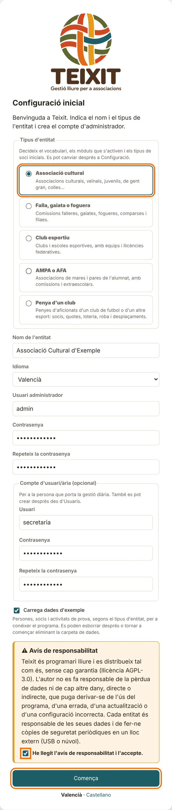

Tot seguit, Teixit mostra el **codi de recuperació**. Serveix per a posar una contrasenya nova si l'administrador/a l'oblida, i **només es mostra esta vegada**. Prem **Imprimeix** (o apunta'l) i guarda'l amb els papers de l'entitat, no a l'ordinador. Després prem **Ja l'he guardat, continua**.

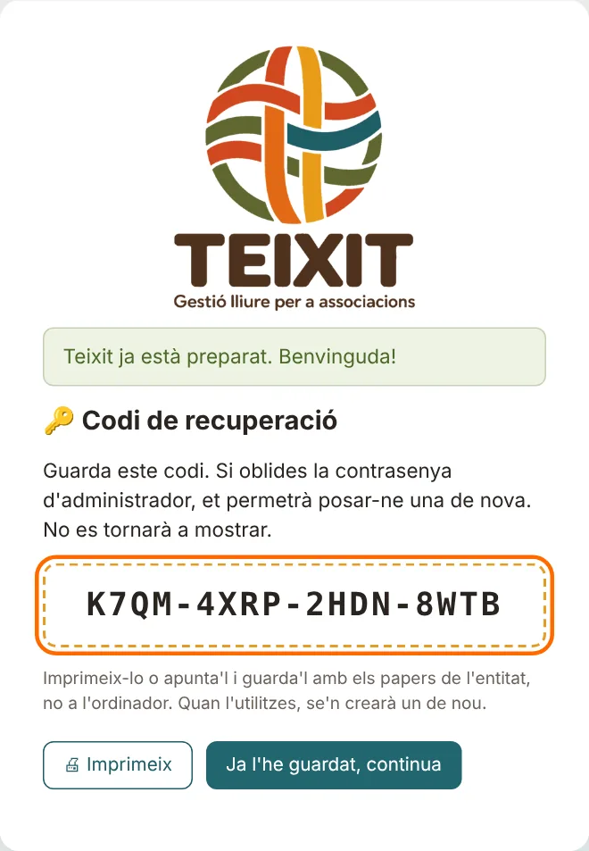

> Per a començar a treballar de veres sense les dades d'exemple, tanca Teixit, esborra la carpeta `data` del programa i torna a obrir-lo.

## 2. Configuració de l'entitat i logotip

Menú **Administració → Configuració** (només l'administrador/a).

1. Omple les dades de l'entitat: nom, CIF, adreça, telèfon, correu i web. Ixen als certificats, les actes i els rebuts.
2. **Tipus d'entitat**: el que es va triar en instal·lar. Si es canvia, canvien els noms d'alguns apartats; els mòduls actius es queden com estaven.
3. A **Logotip de l'entitat**, prem el botó de triar fitxer i selecciona la imatge del logotip (PNG, JPG o WEBP, fins a 3 MB).
4. Prem **Desa**. El logotip apareix al menú i als documents per a imprimir.

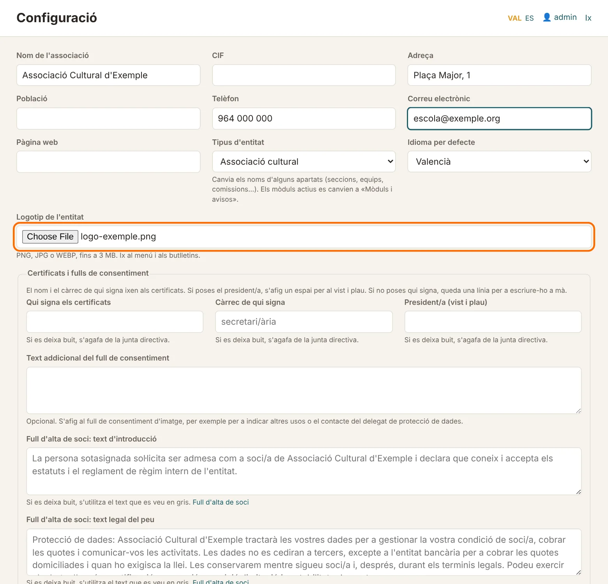

### Mòduls i avisos

No totes les entitats fan servir tot: n'hi ha que no fan activitats amb inscripció, que no venen loteria o que porten la comptabilitat en un altre lloc. Al menú **Administració → Mòduls i avisos** es pot activar o desactivar cada apartat: activitats i cursos, qualificacions i butlletins, seccions, inventari, roba i articles, quotes i rebuts, loteria, llibre de caixa, junta i actes, documents i comunicats.

En instal·lar, Teixit deixa desactivats els que normalment no fan falta a cada tipus d'entitat:

| Tipus | Desactivats en instal·lar |
|---|---|
| Associació cultural | Roba i articles, loteria |
| Falla, gaiata o foguera | Activitats i cursos, qualificacions |
| Club esportiu | Escola esportiva (activitats i cursos), qualificacions |
| AMPA o AFA | Qualificacions, inventari, roba i articles |
| Penya d'un club | Activitats i cursos, qualificacions |

Un mòdul desactivat desapareix del menú, de l'inici, dels llistats i de les fitxes de les persones, però **no s'esborra cap dada**: si es torna a activar, tot està com estava. Persones, socis, llistats, importació i administració sempre estan actius. **Qualificacions i butlletins** només funciona si també està actiu **Activitats i cursos**.

A la mateixa pantalla es poden amagar els **avisos de l'inici** que l'entitat no vol vore: la carpeta externa de les còpies, la renovació de la junta, els documents que caduquen, el certificat de delictes dels monitors, el material per tornar, el curs actual i les llicències federatives.

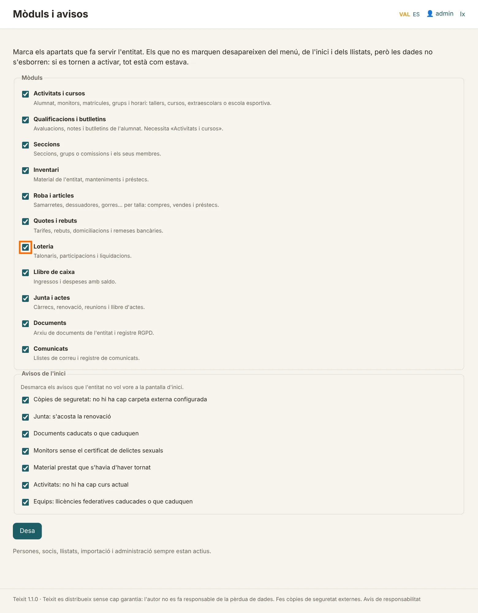

### Dades dels certificats

La primera vegada, a **Configuració → Certificats i fulls de consentiment**, posa qui signa (normalment el secretari/ària), el càrrec i, si voleu el vist i plau, el president/a. Si es deixa buit, s'agafa de la junta actual. Posa també la **població** de l'entitat, que ix al final del certificat.

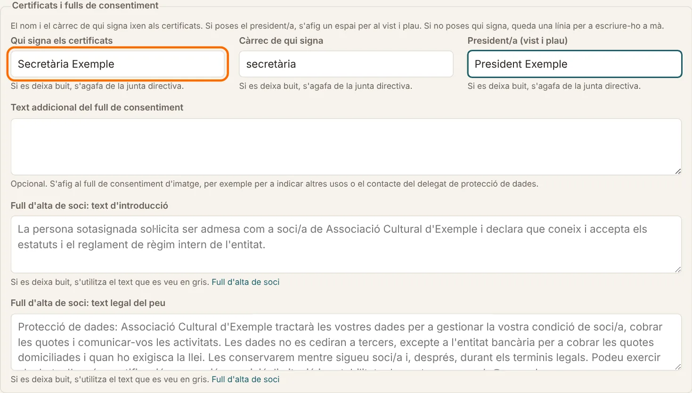

## 3. Dades del banc i descomptes

L'administrador/a ho configura una sola vegada a **Resum econòmic → Configuració d'Economia**:

- **Dades bancàries de l'entitat**: el NIF i l'IBAN on es cobren els rebuts. Les dona el banc quan es contracta el servei d'adeutaments directes SEPA («remeses» o «quadern 19»). Teixit calcula l'**identificador de creditor**: comprova que és el mateix que t'ha donat el banc.
- **Descomptes de les activitats**: un percentatge per a qui és soci (l'alumne o qui paga) i un altre per a cada germà a partir del segon. S'apliquen a les quotes de les activitats, no a la matrícula. A la fitxa de l'alumne es pot posar, a més, un **descompte propi** (família nombrosa, beca…) i **qui paga** les activitats, si no és el tutor principal.
- **Text al peu dels rebuts**, si l'entitat en vol posar un.

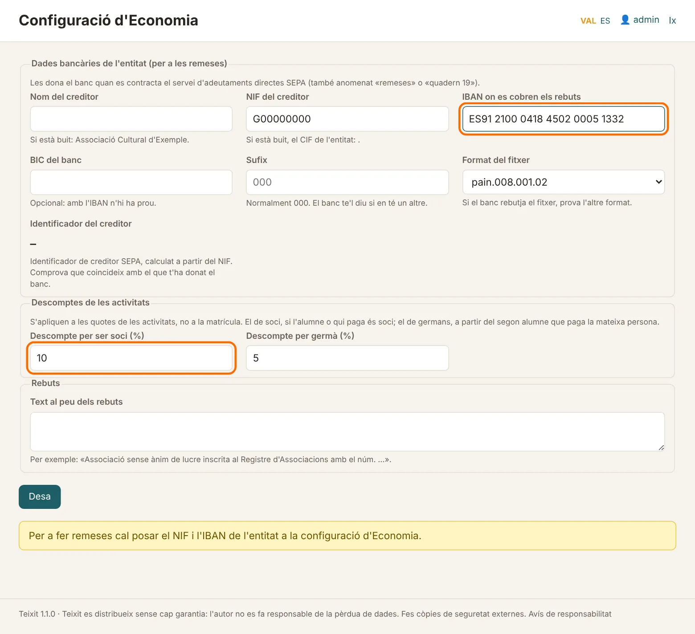

## 4. Còpies de seguretat

Totes les dades estan en un sol fitxer. Teixit en fa còpies automàticament:

| Quan | Tipus |
|---|---|
| La primera vegada que s'utilitza cada dia | Automàtica (diària) |
| En tancar Teixit, si hi ha hagut canvis | Automàtica (en tancar) |
| Quan prems **Fes una còpia ara** | Manual |
| Just abans de restaurar | Abans de restaurar |
| Just abans d'importar dades | Abans d'importar |
| En obrir per primera vegada una versió nova de Teixit | Abans d'actualitzar |

Menú **Administració → Còpies de seguretat**:

### Quantes còpies es guarden

Les còpies automàtiques no s'acumulen sense fi. Teixit guarda:

- **totes** les dels últims 7 dies;
- **una per setmana** de les últimes 5 setmanes;
- **una per mes** fins al límit que tries a **Quant de temps es guarden les còpies automàtiques** (1 any si no es canvia).

Amb una còpia cada dia, això són unes vint còpies que arriben a un any arrere. Les manuals i les d'«abans de restaurar» o «abans d'importar» no s'esborren soles. La mateixa rotació es fa a la carpeta externa.

La pantalla diu quant ocupa la base de dades (i quant d'això són documents) i quant ocupen totes les còpies. Si la base de dades passa de 200 MB, normalment pels documents arxivats, Teixit avisa: cada còpia ocupa el mateix, així que cal comprovar que hi ha prou espai a l'ordinador i a la carpeta externa.

### Configurar la carpeta externa (molt important)

Si l'ordinador s'espatlla o el roben, les còpies que hi ha dins es perden amb ell. Cal guardar-les també fora:

1. Connecta un **disc o llapis USB**, o tria una carpeta **sincronitzada amb el núvol** (OneDrive, Google Drive…).
2. Crea-hi una carpeta, per exemple `Copies Teixit`, i copia'n la ruta des de l'Explorador de Windows (per exemple `E:\Copies Teixit`).
3. A **Configuració de les còpies**, enganxa la ruta a **Carpeta externa**.
4. Prem **Desa**.

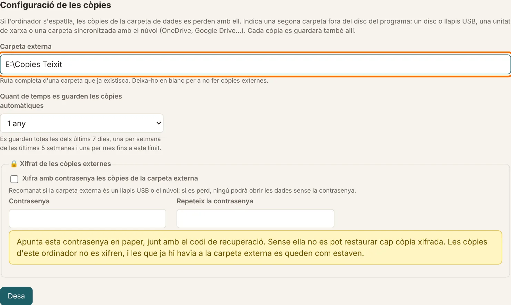

A partir d'ara, cada còpia es guarda també en esta carpeta. Si no està disponible (per exemple, el USB no està connectat) o fa més de 7 dies que no s'hi guarda res, l'inici ho avisa.

### Llista de còpies, restaurar i eliminar

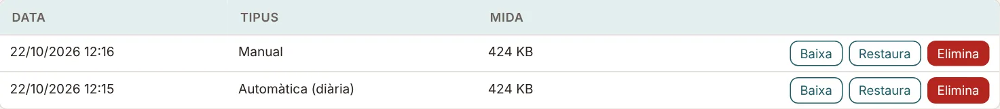

- **Baixa**: descarrega aquella còpia.
- **Restaura** (només l'administrador/a): substitueix totes les dades actuals per les de la còpia. Abans, Teixit guarda una còpia de les dades actuals («Abans de restaurar»), de manera que sempre es pot tornar arrere. Després cal tornar a entrar.
- **Elimina** (només l'administrador/a): esborra la còpia.

Per a restaurar una còpia guardada fora (per exemple, des del USB), utilitza **Restaura des d'un fitxer**, al final de la pàgina.

> Les còpies contenen dades personals, també de menors. Guarda-les en un lloc segur.

### Còpies externes xifrades

Si la carpeta externa és un llapis USB o el núvol, convé xifrar-les: si es perd el USB, ningú podrà obrir les dades sense la contrasenya.

1. A **Configuració de les còpies**, marca **Xifra amb contrasenya les còpies de la carpeta externa**.
2. Escriu una contrasenya (almenys 8 caràcters) dues vegades i prem **Desa**.

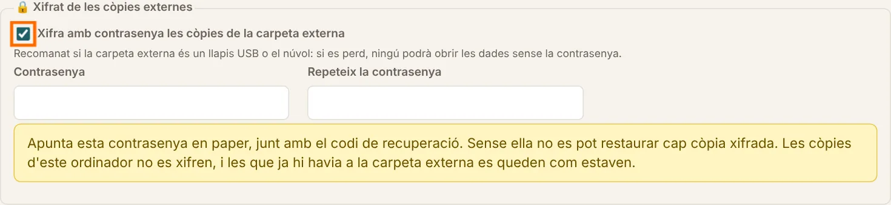

A partir d'ara, les còpies de la carpeta externa acaben en `.xifrat`. Les de l'ordinador no es xifren. Per a restaurar-ne una, a **Restaura des d'un fitxer** tria el fitxer `.xifrat` i escriu la contrasenya.

> **Apunta la contrasenya en paper** junt amb el codi de recuperació. Si s'oblida, les còpies xifrades no es poden recuperar.

## 5. Usuaris i contrasenyes

### Canviar la teua contrasenya

Cada usuari pot canviar la seua quan vulga:

1. Al menú, a baix de tot, prem **Compte i contrasenya** (o fes clic en el teu nom d'usuari, dalt a la dreta).
2. Escriu la **contrasenya actual**.
3. Escriu la **contrasenya nova** dues vegades (almenys 8 caràcters).
4. Prem **Desa**.

Si no recordes l'actual, no la pots canviar ací: l'usuari/ària ha de demanar-ne una de nova a l'administrador/a, i l'administrador/a pot recuperar l'accés des de l'entrada (vegeu més avall).

### Gestionar els comptes (administrador/a)

Menú **Administració → Usuaris**. Obri un compte per a:

- canviar-li el **rol** (administrador/a o usuari/ària);
- posar-li una **contrasenya nova** si l'ha oblidada (deixa-la en blanc per a no canviar-la);
- desactivar-lo (desmarca **Actiu**) o eliminar-lo.

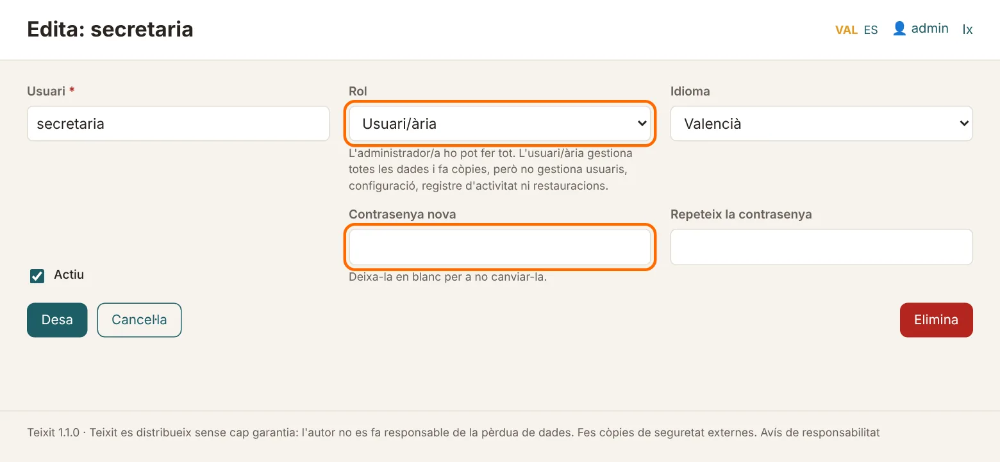

Sempre ha de quedar almenys un administrador actiu.

### Si l'administrador/a oblida la contrasenya

1. A la pantalla d'entrada, prem **Eres l'administrador/a? Recupera l'accés**.
2. Escriu el teu **usuari**, el **codi de recuperació** que vas guardar i la **contrasenya nova** dues vegades.
3. Prem **Canvia la contrasenya**. Entraràs directament al programa.
4. Teixit mostra un **codi de recuperació nou**, perquè l'anterior ja no val. Imprimeix-lo i guarda'l en lloc de l'antic.

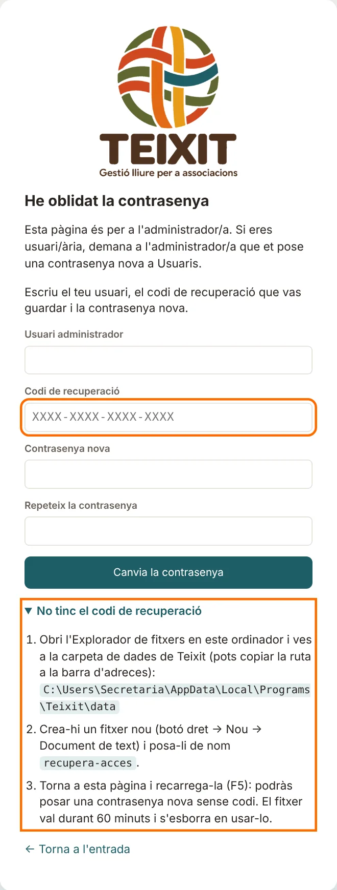

**Si no trobes el codi**, prem **No tinc el codi de recuperació** a la mateixa pàgina i segueix els passos:

1. Obri l'Explorador de fitxers i ves a la carpeta de dades de Teixit. La pàgina mostra la ruta exacta: copia-la a la barra d'adreces de l'Explorador.
2. Crea-hi un fitxer nou (botó dret → **Nou → Document de text**) i posa-li de nom `recupera-acces`.
3. Torna a la pàgina de Teixit i recarrega-la (tecla **F5**). Ja no demanarà el codi: escriu l'usuari i la contrasenya nova.

El fitxer només val durant una hora i s'esborra sol en usar-lo. Este sistema és segur perquè només pot crear el fitxer qui ja té accés a l'ordinador i a les dades.

### Codi de recuperació

Si has perdut el codi o creus que algú l'ha vist, ves a **Administració → Usuaris** i, a baix, prem **Genera un codi nou**. L'anterior deixa de valdre.

Totes les recuperacions, també les que fallen, queden al **Registre d'activitat**.

### Registre d'activitat

Menú **Administració → Registre d'activitat** (només l'administrador/a): qui ha creat, modificat o eliminat cada cosa, les entrades al programa, els documents impresos, els canvis de configuració i les còpies.

## 6. Actualitzar Teixit

1. A **Ajuda**, prem **Hi ha versió nova?**. S'obri al navegador la pàgina de l'última versió (Teixit no es connecta a Internet ni comprova res sol). Davall del botó es veu la versió que tens.
2. Si la de la pàgina és més alta, baixa l'instal·lador (a Linux, el paquet `.deb` o el `.tar.gz`) i instal·la'l damunt, sense desinstal·lar l'anterior. Les dades i la configuració es conserven.
3. Obri Teixit. La primera vegada, abans de preparar la base de dades per a la versió nova, Teixit en fa una còpia («Abans d'actualitzar»). Si alguna cosa fallara, les dades es quedarien com estaven i la còpia estaria a la llista.

Què porta cada versió es pot vore a **Ajuda → Què canvia en cada versió**.

## 7. Preguntes freqüents

**Ens hem equivocat de tipus d'entitat. Cal tornar a instal·lar?** No. Canvia'l a **Configuració** i, si cal, activa o desactiva els mòduls a **Mòduls i avisos** (apartat 2). Les dades no es perden.

**L'administrador/a ha oblidat la contrasenya.** Prem **Recupera l'accés** a la pantalla d'entrada i utilitza el codi de recuperació. Si no el trobes, també hi ha una manera sense codi (apartat 5).

**Teixit envia les nostres dades a algun lloc?** No. Tot es queda a l'ordinador i, si la configureu, a la carpeta externa de còpies. Ho explica la declaració de privacitat: menú **Ajuda → Privacitat**.

**Com passe Teixit a un altre ordinador?** Instal·la Teixit a l'ordinador nou i, a **Còpies de seguretat → Restaura des d'un fitxer**, carrega l'última còpia.

**On estan les dades?** A la carpeta `data` del programa (`data\teixit.db`). La ruta exacta es veu a **Configuració**, a baix.
