# Manual de administración de Teixit

## 1. Antes de empezar

Teixit es un programa de gestión para asociaciones y entidades sin ánimo de lucro: personas, socios, junta directiva y actas, cuotas y recibos, remesas bancarias, lotería, libro de caja, documentos, comunicados, secciones o equipos, actividades y cursos, inventario, ropa y copias de seguridad. Funciona en **un solo ordenador con Windows o Linux**, sin Internet, y tiene dos cuentas. Esta tabla resume qué puede hacer cada una:

| Qué se puede hacer | Administrador/a | Usuario/a |
|---|:---:|:---:|
| Personas, socios y tipos de socio | ✔ | ✔ |
| Secciones o equipos, actividades y cursos, monitores y matrículas | ✔ | ✔ |
| Inventario, préstamos y ropa | ✔ | ✔ |
| Cuotas, recibos, domiciliaciones, remesas y lotería | ✔ | ✔ |
| Libro de caja | ✔ | ✔ |
| Junta, actas, documentos y comunicados | ✔ | ✔ |
| Listados, certificados e importación desde Excel | ✔ | ✔ |
| Hacer y descargar copias de seguridad | ✔ | ✔ |
| Cambiar la propia contraseña | ✔ | ✔ |
| Configuración de la entidad, tipo de entidad, logotipo, módulos y avisos | ✔ | — |
| Datos bancarios y descuentos de las actividades | ✔ | — |
| Crear y gestionar las cuentas | ✔ | — |
| Registro de actividad | ✔ | — |
| Restaurar y eliminar copias, carpeta externa y cifrado | ✔ | — |
| Recuperar el acceso con el código de recuperación | ✔ | — |

Este manual es para el administrador/a de Teixit: la persona que lo pone en marcha, lo configura, gestiona las cuentas y las copias de seguridad y lo actualiza. Para la gestión diaria (personas, socios, junta, economía, secciones, actividades…), ver el **Manual de usuario**.

> En este manual, el botón o el campo que hay que usar en cada paso aparece **marcado en naranja** en las capturas.

> ⚠ **Aviso de responsabilidad.** Teixit es software libre y se distribuye tal cual, sin ninguna garantía (licencia AGPL-3.0). El autor no se hace responsable de la pérdida de datos ni de ningún otro daño, directo o indirecto, que pueda derivarse del uso del programa, de un error, de una actualización o de una configuración incorrecta. Cada entidad es responsable de sus datos y de hacer copias de seguridad periódicas en un lugar externo (USB o nube).

### Tipo de entidad

Al instalarlo, Teixit pregunta qué tipo de entidad es. El tipo cambia **los nombres de algunos apartados**, **los módulos que se activan** y **los tipos de socio iniciales**. Todo se puede cambiar después.

| Tipo | Para quién | Cómo se llaman las cosas |
|---|---|---|
| **Asociación cultural** | Asociaciones culturales, vecinales, juveniles, de mayores, comparsas… | Socios, **secciones** (teatro, baile…), actividades y cursos. |
| **Falla, gaiata u hoguera** | Comisiones falleras, gaiatas, hogueras, comparsas y filaes. | El **censo** (con categorías: adulto, juvenil, infantil…), secciones, ropa (blusones, pañuelos…) y lotería. |
| **Club deportivo** | Clubes y escuelas deportivas. | Socios, **equipos** con categorías, deportistas y técnicos, **licencias federativas**, equipaciones y escuela deportiva. |
| **AMPA o AFA** | Asociaciones de madres y padres del alumnado. | **Familias asociadas**, **comisiones** (comedor, fiestas…) y **extraescolares**. |
| **Peña de un club** | Peñas de aficionados de un club de fútbol o de otro deporte. | Socios, **comisiones** (viajes, fiestas, animación…), ropa y merchandising (camisetas, bufandas…), lotería y desplazamientos en la caja. |

### Abrir, cerrar y entrar

Cómo se abre, se cierra y se entra en Teixit es igual para todas las cuentas: lo explica el apartado 1 del **Manual de usuario**.

### La primera vez: configuración inicial

La primera vez que se abre Teixit aparece la **Configuración inicial**:

1. Elige el **tipo de entidad**: asociación cultural, falla (gaiata u hoguera), club deportivo, AMPA/AFA o peña de un club.
2. Escribe el **nombre de la entidad**.
3. Elige el **idioma** por defecto.
4. Crea el **usuario administrador** y su contraseña (al menos 8 caracteres). Apúntala en un lugar seguro.
5. Si quieres, crea también la cuenta de **usuario/a** (se puede hacer después).
6. Marca **Cargar datos de ejemplo** solo si quieres probar el programa con datos inventados. Los datos de ejemplo se adaptan al tipo de entidad.
7. Lee el **aviso de responsabilidad** y marca que lo aceptas.
8. Pulsa **Empezar**.

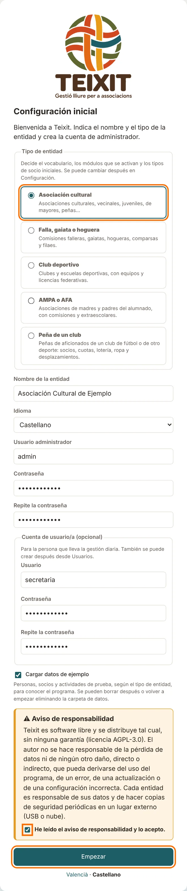

A continuación, Teixit muestra el **código de recuperación**. Sirve para poner una contraseña nueva si el administrador/a la olvida, y **solo se muestra esta vez**. Pulsa **Imprime** (o apúntalo) y guárdalo con los papeles de la entidad, no en el ordenador. Después pulsa **Ya lo he guardado, continúa**.

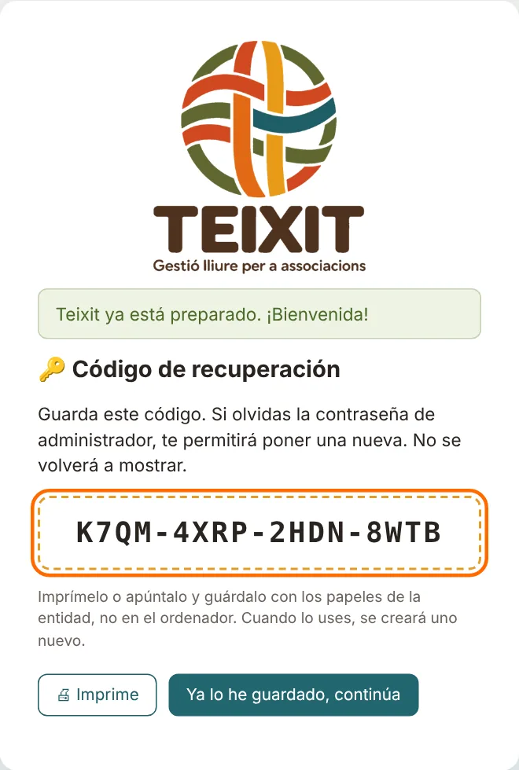

> Para empezar a trabajar de verdad sin los datos de ejemplo, cierra Teixit, borra la carpeta `data` del programa y vuelve a abrirlo.

## 2. Configuración de la entidad y logotipo

Menú **Administración → Configuración** (solo el administrador/a).

1. Rellena los datos de la entidad: nombre, CIF, dirección, teléfono, correo y web. Salen en los certificados, las actas y los recibos.
2. **Tipo de entidad**: el que se eligió al instalar. Si se cambia, cambian los nombres de algunos apartados; los módulos activos se quedan como estaban.
3. En **Logotipo de la entidad**, pulsa el botón de elegir archivo y selecciona la imagen del logotipo (PNG, JPG o WEBP, hasta 3 MB).
4. Pulsa **Guardar**. El logotipo aparece en el menú y en los documentos para imprimir.

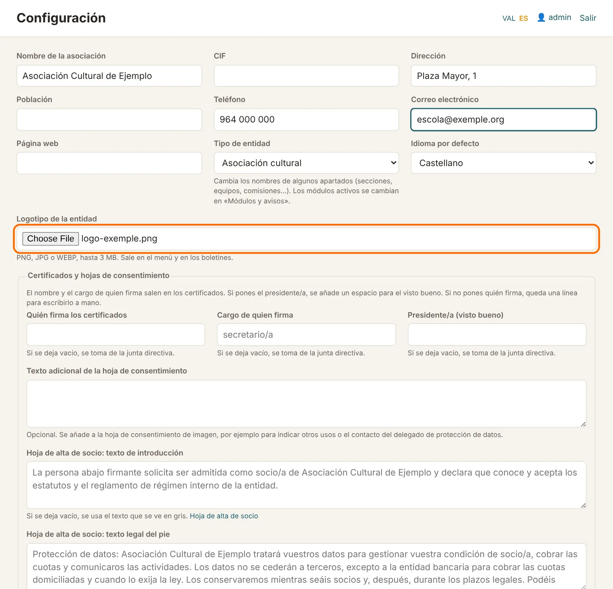

### Módulos y avisos

No todas las entidades usan todo: las hay que no hacen actividades con inscripción, que no venden lotería o que llevan la contabilidad en otro sitio. En el menú **Administración → Módulos y avisos** se puede activar o desactivar cada apartado: actividades y cursos, calificaciones y boletines, secciones, inventario, ropa y artículos, cuotas y recibos, lotería, libro de caja, junta y actas, documentos y comunicados.

Al instalar, Teixit deja desactivados los que normalmente no hacen falta en cada tipo de entidad:

| Tipo | Desactivados al instalar |
|---|---|
| Asociación cultural | Ropa y artículos, lotería |
| Falla, gaiata u hoguera | Actividades y cursos, calificaciones |
| Club deportivo | Escuela deportiva (actividades y cursos), calificaciones |
| AMPA o AFA | Calificaciones, inventario, ropa y artículos |
| Peña de un club | Actividades y cursos, calificaciones |

Un módulo desactivado desaparece del menú, del inicio, de los listados y de las fichas de las personas, pero **no se borra ningún dato**: si se vuelve a activar, todo está como estaba. Personas, socios, listados, importación y administración siempre están activos. **Calificaciones y boletines** solo funciona si también está activo **Actividades y cursos**.

En la misma pantalla se pueden ocultar los **avisos del inicio** que la entidad no quiere ver: la carpeta externa de las copias, la renovación de la junta, los documentos que caducan, el certificado de delitos de los monitores, el material por devolver, el curso actual y las licencias federativas.

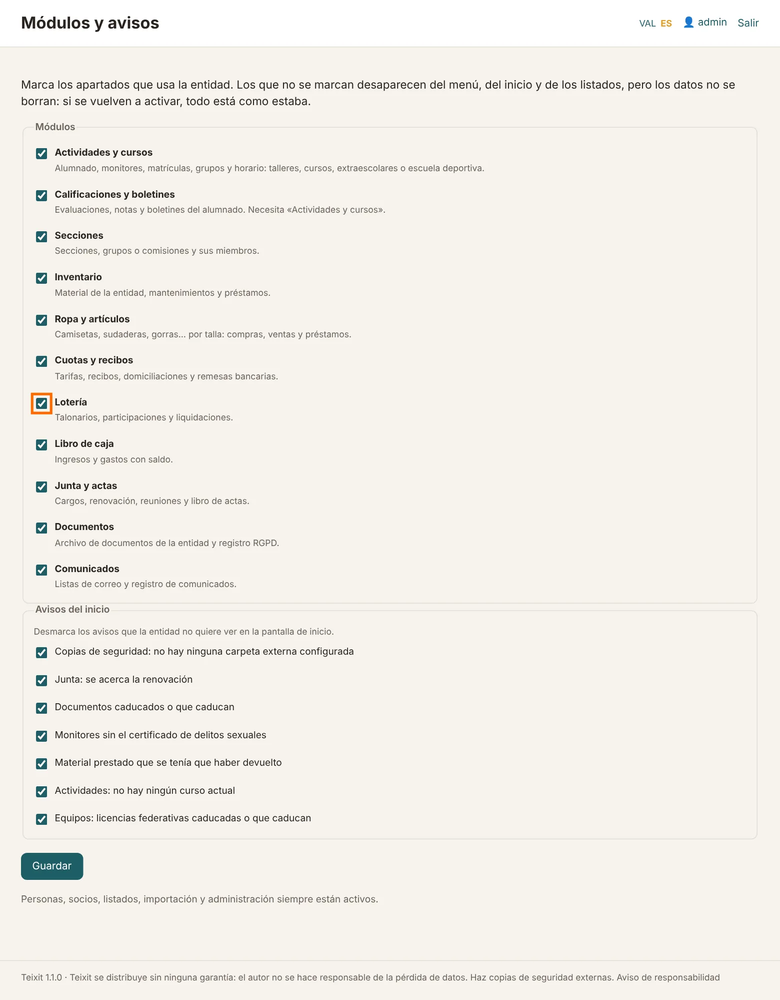

### Datos de los certificados

La primera vez, en **Configuración → Certificados y hojas de consentimiento**, pon quién firma (normalmente el secretario/a), el cargo y, si queréis el visto bueno, el presidente/a. Si se deja vacío, se toma de la junta actual. Pon también la **población** de la entidad, que sale al final del certificado.

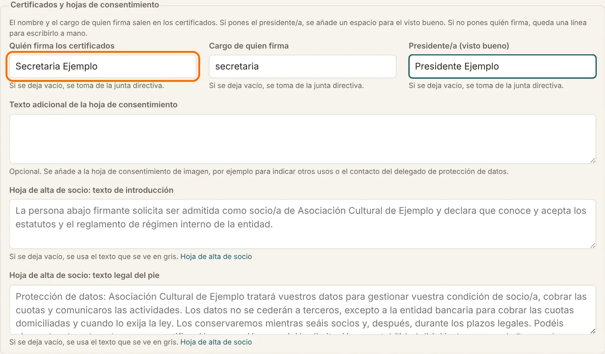

## 3. Datos del banco y descuentos

El administrador/a lo configura una sola vez en **Resumen económico → Configuración de Economía**:

- **Datos bancarios de la entidad**: el NIF y el IBAN donde se cobran los recibos. Los da el banco cuando se contrata el servicio de adeudos directos SEPA («remesas» o «cuaderno 19»). Teixit calcula el **identificador de acreedor**: comprueba que es el mismo que te ha dado el banco.
- **Descuentos de las actividades**: un porcentaje para quien es socio (el alumno o quien paga) y otro para cada hermano a partir del segundo. Se aplican a las cuotas de las actividades, no a la matrícula. En la ficha del alumno se puede poner, además, un **descuento propio** (familia numerosa, beca…) y **quién paga** las actividades, si no es el tutor principal.
- **Texto al pie de los recibos**, si la entidad quiere poner uno.

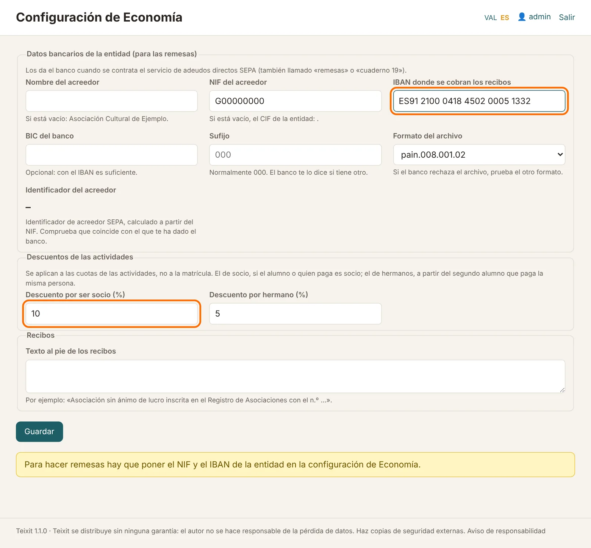

## 4. Copias de seguridad

Todos los datos están en un solo archivo. Teixit hace copias automáticamente:

| Cuándo | Tipo |
|---|---|
| La primera vez que se usa cada día | Automática (diaria) |
| Al cerrar Teixit, si ha habido cambios | Automática (al cerrar) |
| Cuando pulsas **Hacer una copia ahora** | Manual |
| Justo antes de restaurar | Antes de restaurar |
| Justo antes de importar datos | Antes de importar |
| Al abrir por primera vez una versión nueva de Teixit | Antes de actualizar |

Menú **Administración → Copias de seguridad**:

### Cuántas copias se guardan

Las copias automáticas no se acumulan sin fin. Teixit guarda:

- **todas** las de los últimos 7 días;
- **una por semana** de las últimas 5 semanas;
- **una por mes** hasta el límite que elijas en **Cuánto tiempo se guardan las copias automáticas** (1 año si no se cambia).

Con una copia cada día, eso son unas veinte copias que llegan a un año atrás. Las manuales y las de «antes de restaurar» o «antes de importar» no se borran solas. La misma rotación se hace en la carpeta externa.

La pantalla dice cuánto ocupa la base de datos (y cuánto de eso son documentos) y cuánto ocupan todas las copias. Si la base de datos pasa de 200 MB, normalmente por los documentos archivados, Teixit avisa: cada copia ocupa lo mismo, así que hay que comprobar que hay suficiente espacio en el ordenador y en la carpeta externa.

### Configurar la carpeta externa (muy importante)

Si el ordenador se estropea o lo roban, las copias que hay dentro se pierden con él. Hay que guardarlas también fuera:

1. Conecta un **disco o lápiz USB**, o elige una carpeta **sincronizada con la nube** (OneDrive, Google Drive…).
2. Crea en ella una carpeta, por ejemplo `Copias Teixit`, y copia su ruta desde el Explorador de Windows (por ejemplo `E:\Copias Teixit`).
3. En **Configuración de las copias**, pega la ruta en **Carpeta externa**.
4. Pulsa **Guardar**.

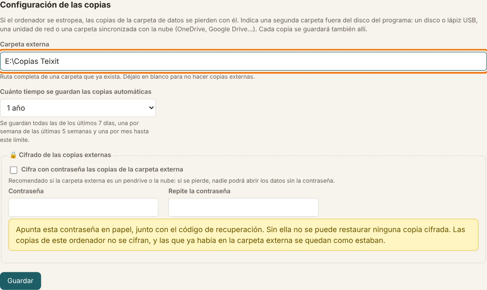

A partir de ahora, cada copia se guarda también en esta carpeta. Si no está disponible (por ejemplo, el USB no está conectado) o hace más de 7 días que no se guarda nada en ella, el inicio lo avisa.

### Lista de copias, restaurar y eliminar

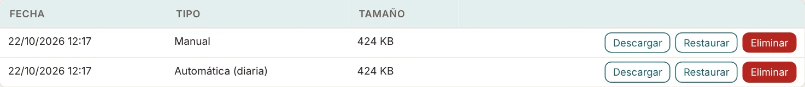

- **Descargar**: descarga esa copia.
- **Restaurar** (solo el administrador/a): sustituye todos los datos actuales por los de la copia. Antes, Teixit guarda una copia de los datos actuales («Antes de restaurar»), de manera que siempre se puede volver atrás. Después hay que volver a entrar.
- **Eliminar** (solo el administrador/a): borra la copia.

Para restaurar una copia guardada fuera (por ejemplo, desde el USB), usa **Restaurar desde un archivo**, al final de la página.

> Las copias contienen datos personales, también de menores. Guárdalas en un lugar seguro.

### Copias externas cifradas

Si la carpeta externa es un lápiz USB o la nube, conviene cifrarlas: si se pierde el USB, nadie podrá abrir los datos sin la contraseña.

1. En **Configuración de las copias**, marca **Cifra con contraseña las copias de la carpeta externa**.
2. Escribe una contraseña (al menos 8 caracteres) dos veces y pulsa **Guardar**.

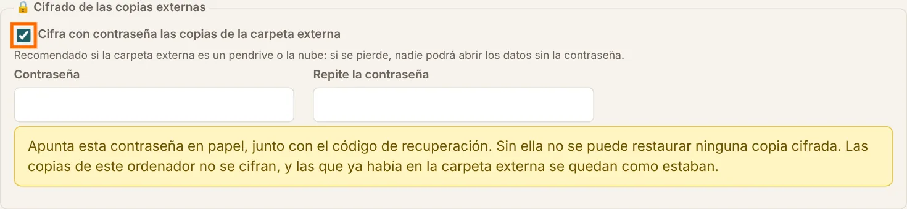

A partir de ahora, las copias de la carpeta externa acaban en `.xifrat`. Las del ordenador no se cifran. Para restaurar una, en **Restaurar desde un archivo** elige el archivo `.xifrat` y escribe la contraseña.

> **Apunta la contraseña en papel** junto con el código de recuperación. Si se olvida, las copias cifradas no se pueden recuperar.

## 5. Usuarios y contraseñas

### Cambiar tu contraseña

Cada usuario puede cambiar la suya cuando quiera:

1. En el menú, abajo del todo, pulsa **Cuenta y contraseña** (o haz clic en tu nombre de usuario, arriba a la derecha).
2. Escribe la **contraseña actual**.
3. Escribe la **contraseña nueva** dos veces (al menos 8 caracteres).
4. Pulsa **Guardar**.

Si no recuerdas la actual, no la puedes cambiar aquí: el usuario/a debe pedir una nueva al administrador/a, y el administrador/a puede recuperar el acceso desde la entrada (ver más abajo).

### Gestionar las cuentas (administrador/a)

Menú **Administración → Usuarios**. Abre una cuenta para:

- cambiarle el **rol** (administrador/a o usuario/a);
- ponerle una **contraseña nueva** si la ha olvidado (déjala en blanco para no cambiarla);
- desactivarla (desmarca **Activo**) o eliminarla.

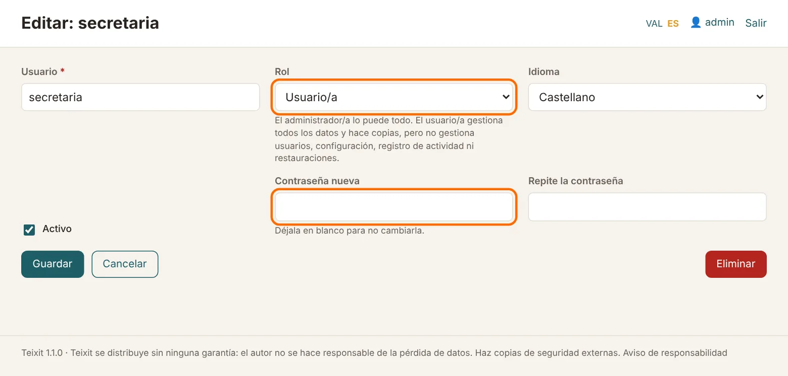

Siempre debe quedar al menos un administrador activo.

### Si el administrador/a olvida la contraseña

1. En la pantalla de entrada, pulsa **¿Eres el administrador/a? Recupera el acceso**.
2. Escribe tu **usuario**, el **código de recuperación** que guardaste y la **contraseña nueva** dos veces.
3. Pulsa **Cambia la contraseña**. Entrarás directamente en el programa.
4. Teixit muestra un **código de recuperación nuevo**, porque el anterior ya no vale. Imprímelo y guárdalo en lugar del antiguo.

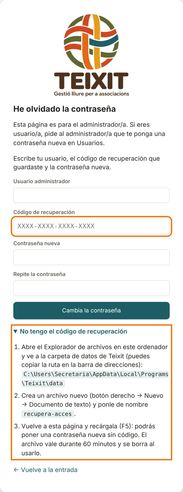

**Si no encuentras el código**, pulsa **No tengo el código de recuperación** en la misma página y sigue los pasos:

1. Abre el Explorador de archivos y ve a la carpeta de datos de Teixit. La página muestra la ruta exacta: cópiala en la barra de direcciones del Explorador.
2. Crea en ella un archivo nuevo (botón derecho → **Nuevo → Documento de texto**) y ponle de nombre `recupera-acces`.
3. Vuelve a la página de Teixit y recárgala (tecla **F5**). Ya no pedirá el código: escribe el usuario y la contraseña nueva.

El archivo solo vale durante una hora y se borra solo al usarlo. Este sistema es seguro porque solo puede crear el archivo quien ya tiene acceso al ordenador y a los datos.

### Código de recuperación

Si has perdido el código o crees que alguien lo ha visto, ve a **Administración → Usuarios** y, abajo, pulsa **Genera un código nuevo**. El anterior deja de valer.

Todas las recuperaciones, también las que fallan, quedan en el **Registro de actividad**.

### Registro de actividad

Menú **Administración → Registro de actividad** (solo el administrador/a): quién ha creado, modificado o eliminado cada cosa, las entradas al programa, los documentos impresos, los cambios de configuración y las copias.

## 6. Actualizar Teixit

1. En **Ayuda**, pulsa **¿Hay versión nueva?**. Se abre en el navegador la página de la última versión (Teixit no se conecta a Internet ni comprueba nada solo). Debajo del botón se ve la versión que tienes.
2. Si la de la página es más alta, descarga el instalador (en Linux, el paquete `.deb` o el `.tar.gz`) e instálalo encima, sin desinstalar el anterior. Los datos y la configuración se conservan.
3. Abre Teixit. La primera vez, antes de preparar la base de datos para la versión nueva, Teixit hace una copia («Antes de actualizar»). Si algo fallara, los datos se quedarían como estaban y la copia estaría en la lista.

Qué trae cada versión se puede ver en **Ayuda → Qué cambia en cada versión**.

## 7. Preguntas frecuentes

**Nos hemos equivocado de tipo de entidad. ¿Hay que volver a instalar?** No. Cámbialo en **Configuración** y, si hace falta, activa o desactiva los módulos en **Módulos y avisos** (apartado 2). Los datos no se pierden.

**El administrador/a ha olvidado la contraseña.** Pulsa **Recupera el acceso** en la pantalla de entrada y usa el código de recuperación. Si no lo encuentras, también hay una manera sin código (apartado 5).

**¿Teixit envía nuestros datos a algún sitio?** No. Todo se queda en el ordenador y, si la configuráis, en la carpeta externa de copias. Lo explica la declaración de privacidad: menú **Ayuda → Privacidad**.

**¿Cómo paso Teixit a otro ordenador?** Instala Teixit en el ordenador nuevo y, en **Copias de seguridad → Restaurar desde un archivo**, carga la última copia.

**¿Dónde están los datos?** En la carpeta `data` del programa (`data\teixit.db`). La ruta exacta se ve en **Configuración**, abajo.
