# Manual d'usuari de Teixit

## 1. Abans de començar

Teixit és un programa de gestió per a associacions i entitats sense ànim de lucre: persones, socis, junta directiva i actes, quotes i rebuts, remeses bancàries, loteria, llibre de caixa, documents, comunicats, seccions o equips, activitats i cursos, inventari, roba i còpies de seguretat. Funciona en **un sol ordinador amb Windows o Linux**, sense Internet, i té dos comptes. Esta taula resumeix què pot fer cadascun:

| Què es pot fer | Administrador/a | Usuari/ària |
|---|:---:|:---:|
| Persones, socis i tipus de soci | ✔ | ✔ |
| Seccions o equips, activitats i cursos, monitors i matrícules | ✔ | ✔ |
| Inventari, préstecs i roba | ✔ | ✔ |
| Quotes, rebuts, domiciliacions, remeses i loteria | ✔ | ✔ |
| Llibre de caixa | ✔ | ✔ |
| Junta, actes, documents i comunicats | ✔ | ✔ |
| Llistats, certificats i importació des d'Excel | ✔ | ✔ |
| Fer i baixar còpies de seguretat | ✔ | ✔ |
| Canviar la pròpia contrasenya | ✔ | ✔ |
| Configuració de l'entitat, tipus d'entitat, logotip, mòduls i avisos | ✔ | — |
| Dades bancàries i descomptes de les activitats | ✔ | — |
| Crear i gestionar els comptes | ✔ | — |
| Registre d'activitat | ✔ | — |
| Restaurar i eliminar còpies, carpeta externa i xifrat | ✔ | — |
| Recuperar l'accés amb el codi de recuperació | ✔ | — |

Este manual és per a les persones que porten la gestió diària. La configuració inicial, les dades de l'entitat, els comptes, la restauració de còpies i les actualitzacions les fa l'administrador/a: són al **Manual d'administració**.

### Tipus d'entitat

En instal·lar-lo, Teixit pregunta quin tipus d'entitat és. El tipus canvia **els noms d'alguns apartats**, **els mòduls que s'activen** i **els tipus de soci inicials**. Tot es pot canviar després.

| Tipus | Per a qui | Com es diuen les coses |
|---|---|---|
| **Associació cultural** | Associacions culturals, veïnals, juvenils, de gent gran, colles… | Socis, **seccions** (teatre, ball…), activitats i cursos. |
| **Falla, gaiata o foguera** | Comissions falleres, gaiates, fogueres, comparses i filaes. | El **cens** (amb categories: adult, juvenil, infantil…), seccions, roba (brusons, mocadors…) i loteria. |
| **Club esportiu** | Clubs i escoles esportives. | Socis, **equips** amb categories, esportistes i tècnics, **llicències federatives**, equipacions i escola esportiva. |
| **AMPA o AFA** | Associacions de mares i pares de l'alumnat. | **Famílies associades**, **comissions** (menjador, festes…) i **extraescolars**. |
| **Penya d'un club** | Penyes d'aficionats d'un club de futbol o d'un altre esport. | Socis, **comissions** (viatges, festes, animació…), roba i marxandatge (samarretes, bufandes…), loteria i desplaçaments a la caixa. |

> En este manual, el botó o el camp que cal utilitzar en cada pas apareix **marcat en taronja** a les captures. Les captures són d'una associació cultural: en altres tipus d'entitat, alguns apartats tenen un altre nom (per exemple, «Equips» en lloc de «Seccions»).

> ⚠ **Avís de responsabilitat.** Teixit és programari lliure i es distribueix tal com és, sense cap garantia (llicència AGPL-3.0). L'autor no es fa responsable de la pèrdua de dades ni de cap altre dany, directe o indirecte, que puga derivar-se de l'ús del programa, d'una errada, d'una actualització o d'una configuració incorrecta. Cada entitat és responsable de les seues dades i de fer-ne còpies de seguretat periòdiques en un lloc extern (USB o núvol).

### Obrir i tancar Teixit

1. Fes doble clic a la icona **Teixit** de l'escriptori o del menú Inici.
2. Al cap d'uns segons, s'obri **la finestra de Teixit**. És una finestra del programa, com la de qualsevol altre: no cal cap navegador.
3. Per a acabar, **tanca la finestra** (la ✕ de dalt a la dreta). Teixit farà una còpia de seguretat si hi ha hagut canvis i s'aturarà.

Si tornes a obrir Teixit mentre ja està obert, es mostra la finestra que ja tenies. Els documents per a imprimir (certificats, actes, llistats, rebuts…) s'obrin en una altra finestra de Teixit, i els fitxers que es descarreguen (CSV, còpies) van a la carpeta **Baixades**. Per a obrir la **carpeta de dades**, fes clic a la icona de dalt a l'esquerra de la finestra (o prem Alt+Espai) i tria **Carpeta de dades de Teixit**.

La finestra utilitza el component WebView2, que porten Windows 10 i 11. En l'ordinador estrany que no el tinga, Teixit s'obri amb Microsoft Edge o Google Chrome o, si tampoc, al navegador habitual amb una finestra menuda que **no has de tancar** mentre treballes.

> **A Linux**, la finestra utilitza WebKitGTK, que el paquet .deb instal·la si cal. Si no hi és, Teixit prova Chromium, Google Chrome, Microsoft Edge o Brave i, si tampoc, s'obri el navegador habitual amb una finestra de terminal: no la tanques mentre treballes, i per a acabar prem **Ctrl+C** o tanca-la.

> Teixit i Compàs (el programa per a societats musicals del mateix autor) es poden tindre instal·lats en el mateix ordinador: cadascun té les seues dades.

### Entrar

Escriu el teu usuari i la contrasenya i prem **Entra**. A baix pots triar l'idioma.

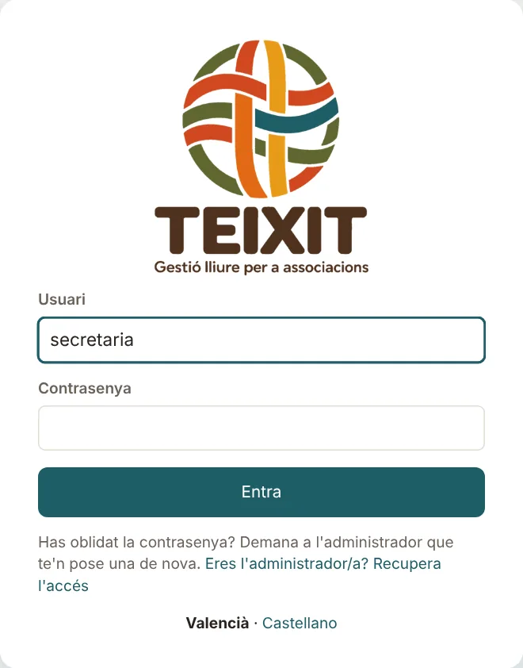

Si oblides la contrasenya, l'administrador te'n pot posar una de nova. Si qui l'ha oblidada és l'administrador/a, prem **Recupera l'accés** (vegeu el Manual d'administració).

### La primera vegada

La primera vegada que s'obri Teixit, l'administrador/a tria el tipus d'entitat, fa la **configuració inicial** i crea els comptes (**Manual d'administració**). Després, cada persona entra amb el seu usuari i la seua contrasenya.

## 2. La pantalla principal

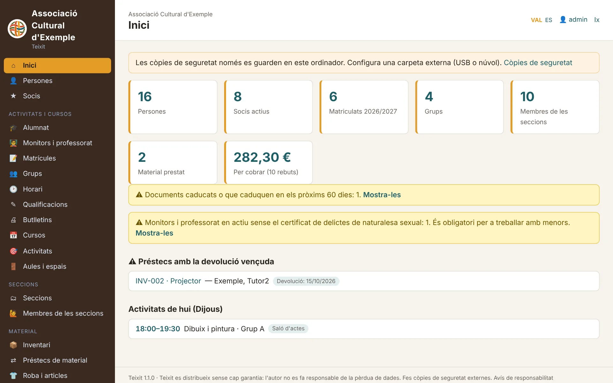

- **Menú lateral** (esquerra): totes les seccions, agrupades per Activitats i cursos, Seccions (o Equips, o Comissions), Material, Economia, l'entitat (junta, actes, documents i comunicats), Documents i dades (llistats, informes i importació) i Administració. Només hi apareixen els mòduls actius.
- **Dalt a la dreta**: canvi d'idioma (`VAL` / `ES`), el teu nom d'usuari (per a canviar la contrasenya) i **Ix** per a eixir.
- **Inici**: un resum amb el nombre de persones, socis, membres de les seccions, matriculats en les activitats, material prestat i el que hi ha per cobrar. Fes clic en qualsevol xifra per a anar a la llista.
- **Avisos**: la renovació de la junta, els documents que caduquen, els monitors sense certificat de delictes sexuals, les llicències federatives que caduquen (en els clubs), el material prestat amb la devolució vençuda, les activitats de hui i els avisos de còpies de seguretat.

## 3. Com es treballa amb Teixit

Totes les seccions funcionen igual. Si n'aprens una, les saps totes.

### Llistats

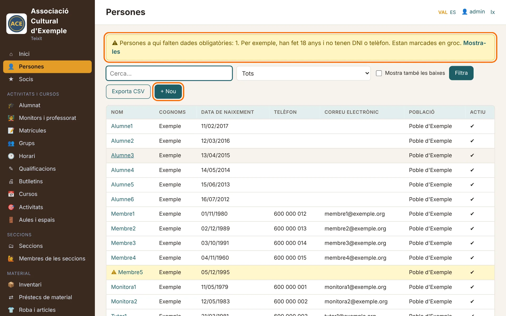

- **Cerca**: escriu un nom, cognom, telèfon… i prem **Filtra**.
- **Mostra també les baixes**: per defecte s'amaguen les persones inactives i les baixes.
- **Exporta CSV**: descarrega la llista per a obrir-la amb Excel o LibreOffice Calc.
- **+ Nou**: crea un element nou.
- Fes clic en qualsevol fila per a obrir-ne la **fitxa**.

### Fitxes

La fitxa mostra totes les dades d'un element i tot el que hi està relacionat. Per exemple, la fitxa d'una persona mostra si és sòcia, si forma part d'una secció, si és de la junta, si participa en una activitat, si és monitora o tutora d'algú…

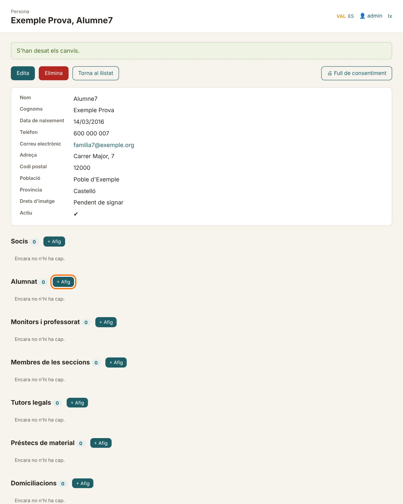

- **Edita**: canvia les dades.
- **Elimina**: només es pot si no té res relacionat (vegeu «Baixes» més avall).
- **+ Afig** de cada apartat: crea un element **ja vinculat** a esta fitxa. És la manera més ràpida de treballar.

### Formularis

- Els camps amb asterisc (*) són obligatoris.
- En els desplegables llargs (persones, grups…) hi ha una **lupa** damunt: escriu-hi per a filtrar les opcions.
- Prem **Desa** per a guardar o **Cancel·la** per a tornar sense guardar.

### Baixes: per què no s'elimina res

Teixit no deixa eliminar res que tinga historial (rebuts, matrícules, préstecs…), perquè no es perda informació. En lloc d'eliminar:

- una **persona** que ja no té relació amb l'entitat: edita-la i desmarca **Actiu**;
- un **soci, membre d'una secció, alumne o monitor**: edita'l, posa l'**estat «Baixa»** i la **data de baixa**.

Les baixes desapareixen dels llistats, però es poden tornar a vore marcant **Mostra també les baixes**.

## 4. Configuració de l'entitat

Les dades de l'entitat, el tipus d'entitat, el logotip, els mòduls que es fan servir i els avisos de l'inici els configura l'administrador/a (**Manual d'administració**). Si en la teua entitat no veus algun apartat d'este manual (les activitats, la loteria, la roba…), segurament està desactivat.

## 5. Persones

> **Una persona s'introdueix una sola vegada.** Ser soci, membre d'una secció, alumne, monitor, tutor legal o càrrec de la junta són *funcions* que s'afigen a la seua fitxa. Abans de crear-ne una, **busca-la** al llistat per si ja existeix.

1. Menú **Persones → + Nou**.
2. Omple les dades obligatòries i la resta que tingues (correu, adreça…):

| Dada | Obligatòria |
|---|---|
| Nom, cognoms i data de naixement | Sempre |
| DNI/NIE i telèfon | Només si la persona és **major d'edat** (18 anys o més) |

3. Deixa marcat **Actiu**.
4. Prem **Desa**.

En posar una data de naixement de major d'edat, els camps DNI i telèfon passen a ser obligatoris i apareix l'asterisc al costat.

Si la persona és major d'edat i pagarà rebuts pel banc (un soci, o el pare o la mare d'un alumne), escriu el seu **IBAN**. Teixit crea la domiciliació (apartat 8.4). També s'hi pot escriure el número de compte antic de 20 xifres: Teixit el converteix en IBAN.

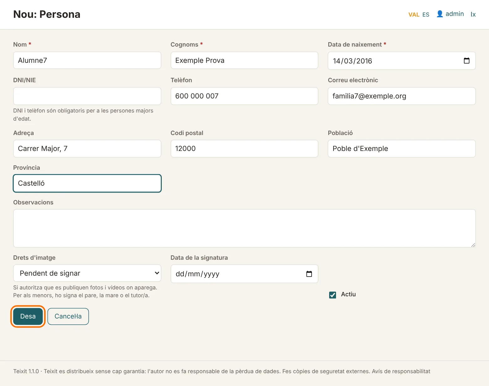

S'obri la **fitxa de la persona**, amb un apartat per a cada funció: socis, membres de les seccions, alumnat, monitors, tutors legals (quan és tutor d'algú), càrrecs de la junta, préstecs de material, rebuts…

### Quan un menor fa 18 anys

Dels menors no cal tindre el DNI ni el telèfon. Quan una persona fa 18 anys i no té eixes dades, Teixit ho avisa:

- Dalt del llistat de **Persones** apareix un **avís groc** amb el nombre de persones a qui falten dades.
- La seua fila es marca **en groc** amb el símbol ⚠. Si passes el ratolí per damunt, diu quines dades falten.
- A la seua fitxa també apareix l'avís, amb un enllaç per a editar-la.

Prem **Mostra-les** (o tria el filtre **Falten dades obligatòries**) per a vore només eixes persones. Obri cadascuna, prem **Edita**, completa el DNI i el telèfon i desa. L'avís desapareix quan ja no en falta cap.

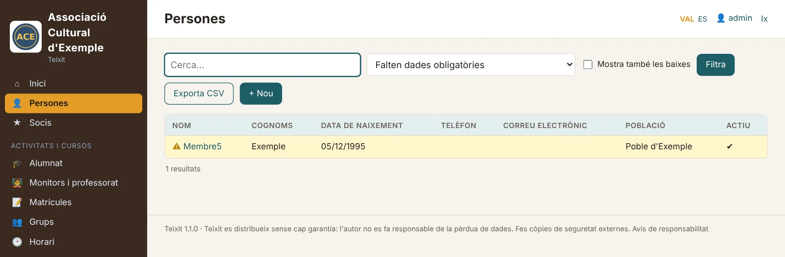

### Drets d'imatge (fotos i vídeos)

Abans de publicar fotos o vídeos en la web o les xarxes, l'entitat ha de tindre l'autorització de cada persona; per als menors, la del pare, la mare o el tutor/a.

1. Obri la fitxa de la persona i prem **🖨 Full de consentiment**. Ix un full A4 amb les dades de la persona (i del tutor/a, si és menor), el text de l'autorització i l'espai per a signar.
2. Quan el tornen signat, edita la persona i, a **Drets d'imatge**, tria **Autoritza fotos i vídeos** o **No autoritza**. Si no poses la **data de la signatura**, es posa la de hui.

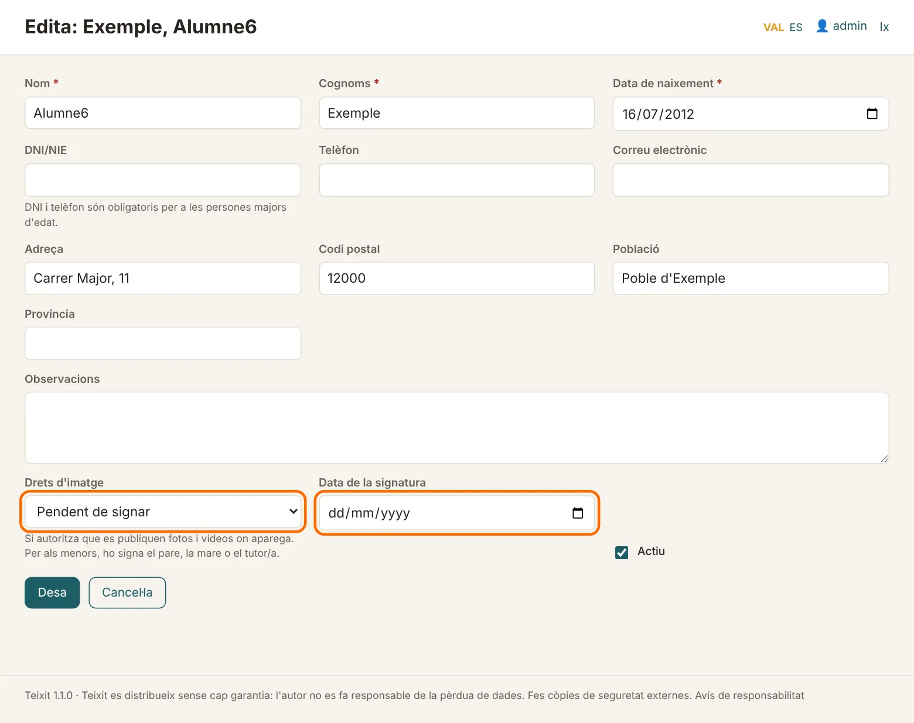

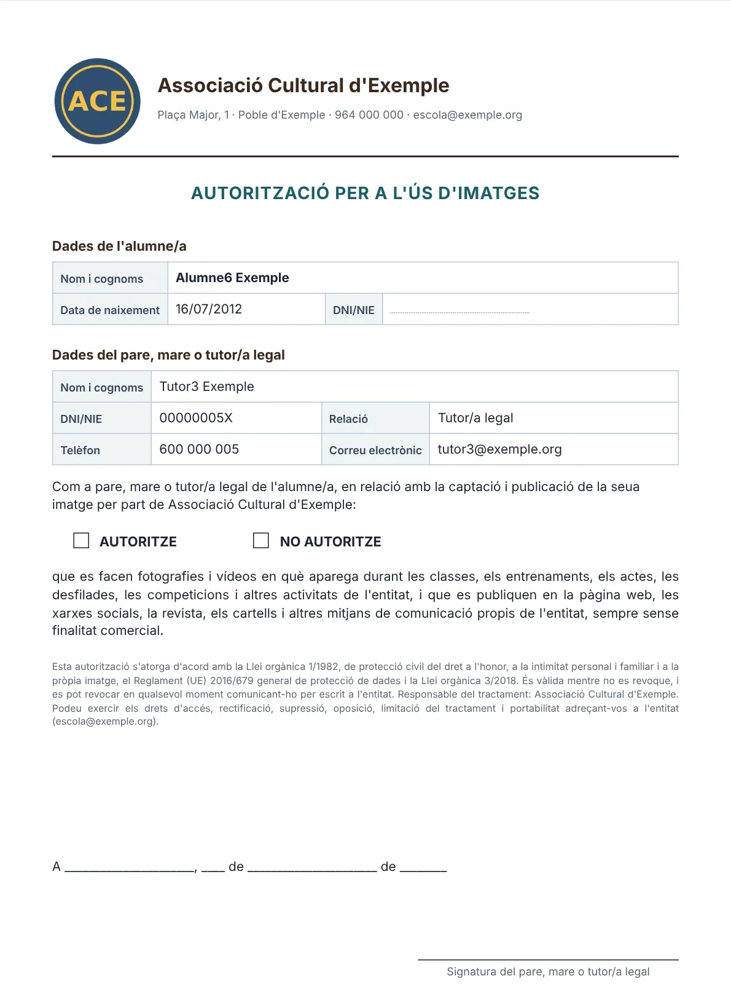

Per a repartir-los, a **Llistats i informes → Drets d'imatge** pots imprimir de colp els fulls de tots els pendents o els d'un grup (apartat 16). Al llistat de **Persones**, el filtre **Alumnes sense consentiment d'imatge signat** mostra quins participants en les activitats encara no l'han tornat.

> El text del full és un model. Revisa'l amb la junta i, si cal, afig-hi el que vulgues a **Configuració → Text addicional del full de consentiment**.

## 6. Socis

> En una **falla, gaiata o foguera**, este apartat es diu **Cens**, i els tipus de soci, **categories del cens**. En una **AMPA**, es diu **Famílies associades**. Funciona igual.

### Tipus de soci

Cada entitat té els tipus de soci que diuen els seus estatuts. Teixit en porta uns quants per a començar, segons el tipus d'entitat:

| Tipus d'entitat | Tipus inicials |
|---|---|
| Associació cultural | Ordinari, juvenil, protector, d'honor |
| Falla, gaiata o foguera | Adult, juvenil, infantil, d'honor |
| Club esportiu | Ordinari, esportista, protector, d'honor |
| AMPA o AFA | Família, col·laborador |
| Penya d'un club | Activitats i cursos, qualificacions |

Es poden canviar, afegir-ne i donar-ne de baixa: al llistat de socis, prem **Tipus de soci** (o **Categories del cens**).

- **Nom** i, si es vol, una **descripció** (per exemple, «Majors de 65 anys»).
- **Ordre**: en quin lloc ix als llistats i al full d'alta.
- **Al full d'alta**: si qui es fa soci el pot triar. Els que nomena l'entitat (d'honor…) normalment no hi van.

Un tipus que ja tenen alguns socis o que té tarifa no es pot eliminar: es posa de **baixa** i deixa d'aparéixer en els socis nous.

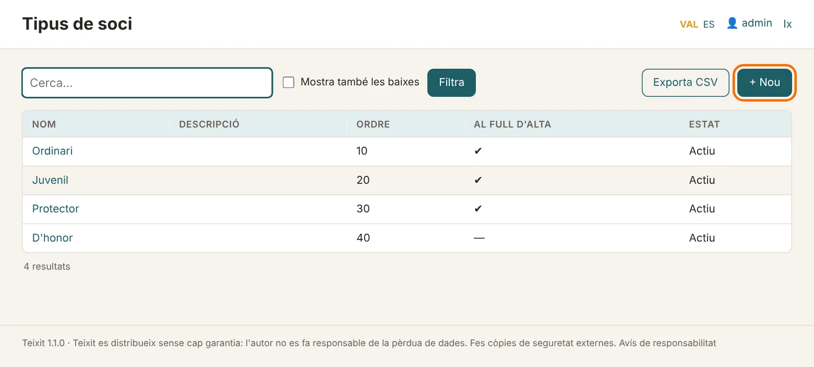

### Alta d'un soci

1. Busca o dona d'alta la **persona** (apartat 5).
2. A la seua fitxa, en l'apartat **Socis**, prem **+ Afig**.
3. Escriu el **número de soci**, tria el **tipus** i comprova la **data d'alta**.
4. Si les quotes es cobraran pel banc, escriu l'**IBAN** (si encara no el té a la seua fitxa de persona).
5. Prem **Desa**.

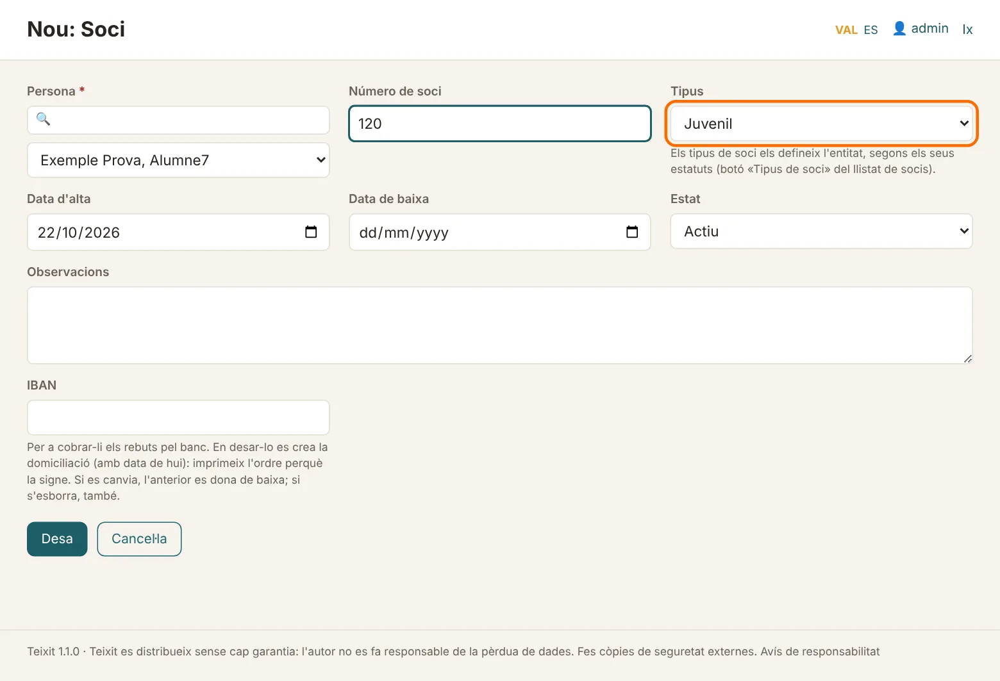

### Llistat de socis

El menú **Socis** mostra tots els socis actius. Pots buscar pel nom o pel número i exportar la llista a CSV.

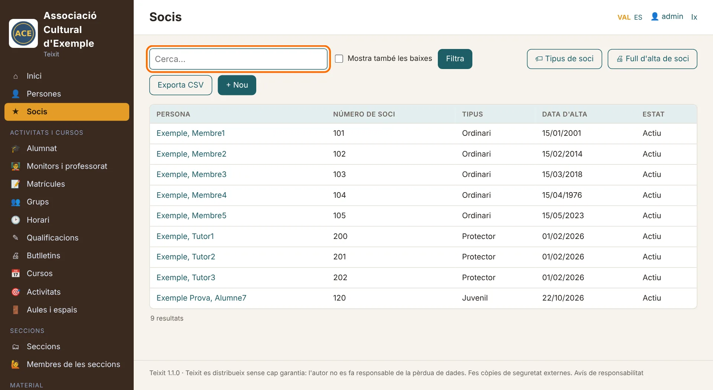

**Full d'alta de soci.** Al llistat de socis, **Full d'alta de soci** fa un full en blanc per a qui vol fer-se soci: dades personals, tipus de soci (amb la quota, si hi ha tarifes), forma de pagament, ordre de domiciliació SEPA, autorització d'imatge, signatura i la informació de protecció de dades. Els textos de dalt i del peu es poden canviar a **Configuració**.

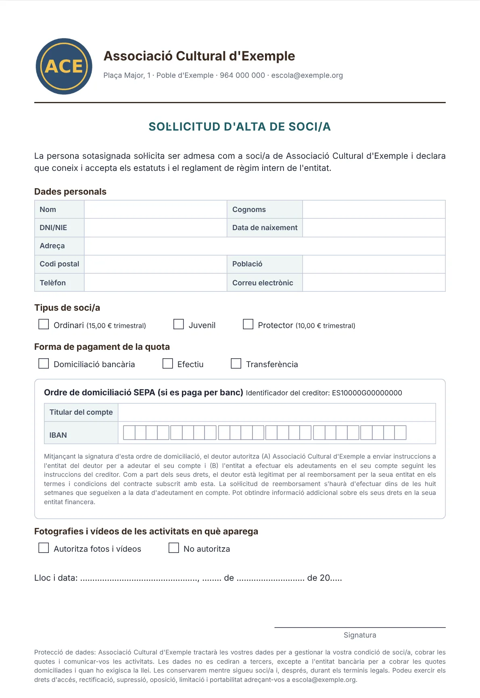

### Baixa d'un soci

1. Obri el soci i prem **Edita**.
2. Canvia l'**estat** a **Baixa** i posa la **data de baixa**.
3. Prem **Desa**.

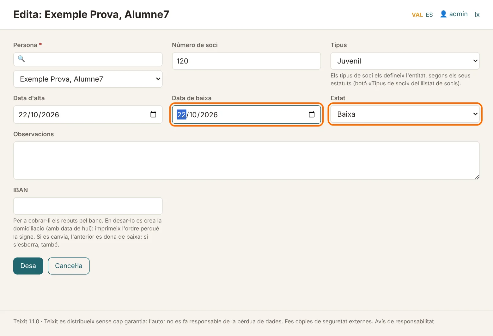

El soci desapareix del llistat, però es conserva amb el seu historial.

## 7. Junta directiva i actes

### 7.1 La junta

Menú **Junta directiva** (en la secció del menú que porta el nom del tipus d'entitat: Associació, Comissió, Club o AMPA). Mostra la junta actual i les anteriors. Per a posar un càrrec, prem **+ Afig un càrrec**: tria la persona, el càrrec (president/a, vicepresident/a, secretari/ària, tresorer/a, vocal…), una descripció si cal («Vocal de festes») i la data d'inici. La data de fi es deixa buida mentre el càrrec està vigent.

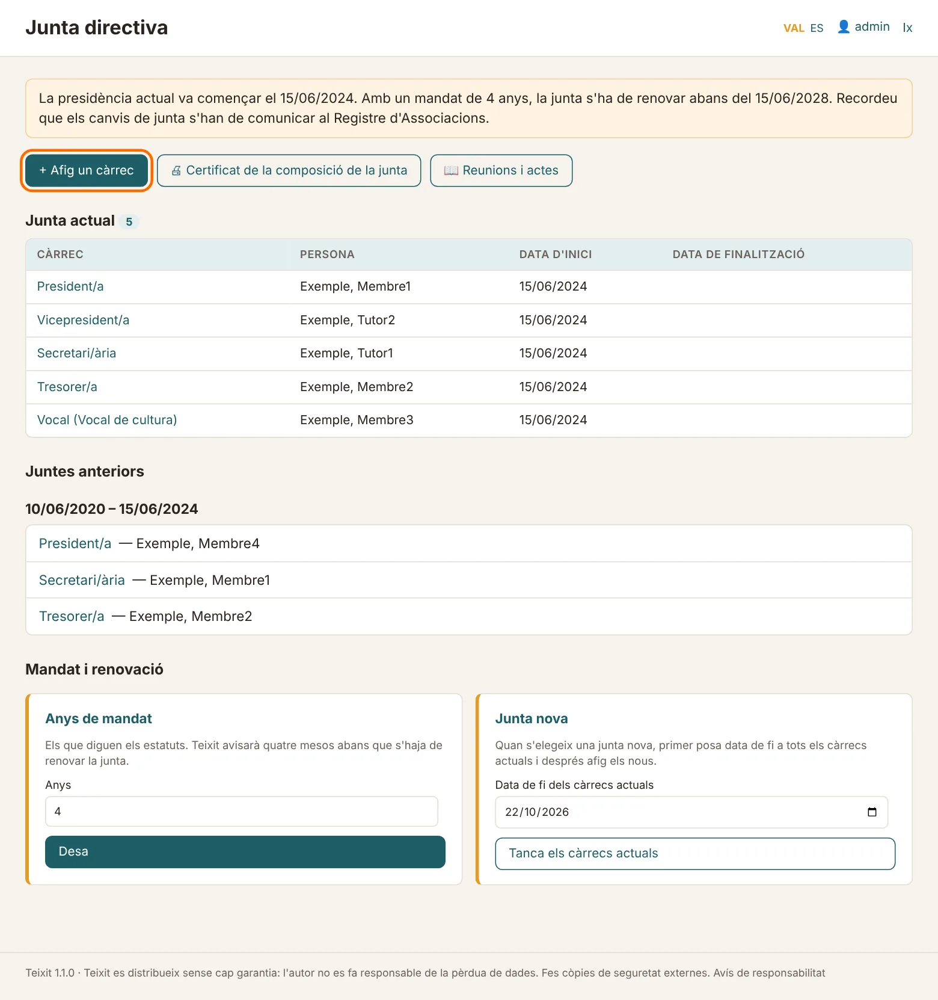

- **Anys de mandat:** posa els que diguen els estatuts. Teixit avisarà a l'inici quatre mesos abans que s'haja de renovar la junta.
- **Junta nova:** quan s'elegeix una junta nova, prem **Tanca els càrrecs actuals** amb la data de l'elecció i després afig els càrrecs nous. Els anteriors queden a l'historial. Recordeu que els canvis de junta s'han de comunicar al Registre d'Associacions.
- **Certificat de la composició de la junta:** per al banc, el registre o una subvenció.

Els **certificats** (de soci, de membre d'una secció, de matrícula i de la junta) i les **actes** els signa la secretaria amb el vistiplau de la presidència de la junta actual. Si cal que els signe una altra persona, es posa a **Configuració**.

### 7.2 Reunions i actes

Menú **Reunions i actes → + Nou**. Tria si és una reunió de la **junta** o una **assemblea** (ordinària o extraordinària), i posa la data, l'hora (en les assemblees, també la de segona convocatòria), el lloc i l'**ordre del dia**, un punt per línia.

A la fitxa de la reunió hi ha tres documents per a imprimir:

1. **Convocatòria**, amb l'ordre del dia numerat.
2. **Acta**. Després de la reunió, edita-la i completa els **assistents**, el **desenvolupament** i els **acords** (un per línia), i marca-la com a celebrada. En les reunions de junta, si no poses els assistents, l'acta posa la junta actual.
3. **Certificat d'un acord**: tria l'acord i Teixit fa el certificat que demanen sovint el banc o les administracions.

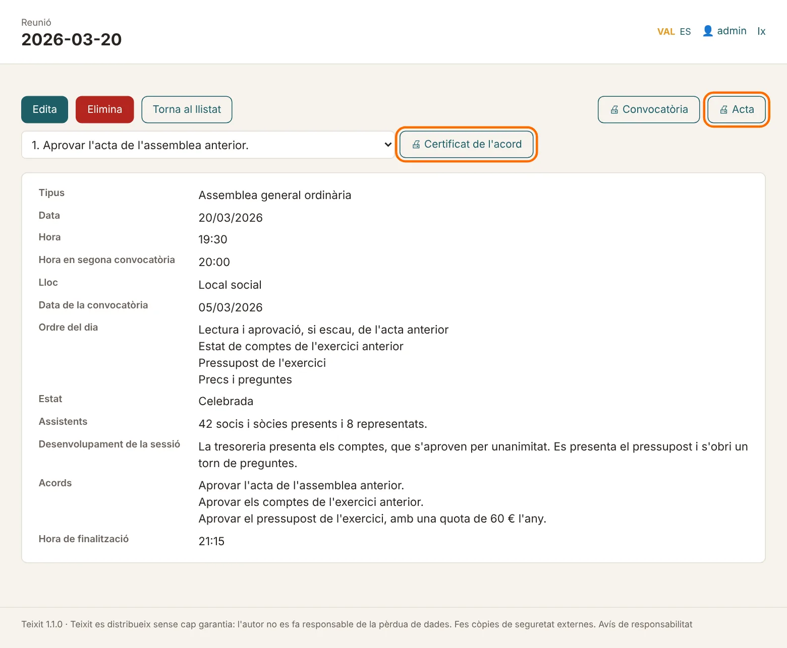

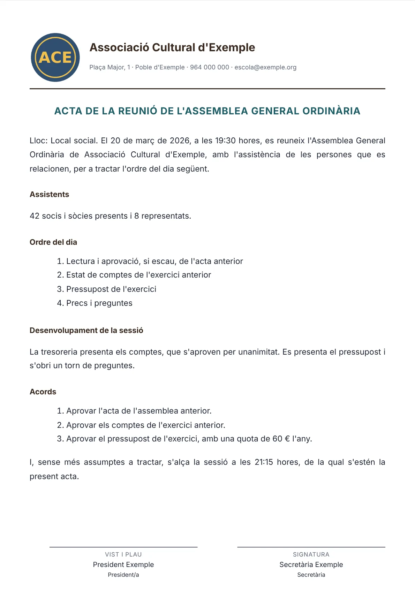

## 8. Economia: quotes, activitats i rebuts

L'apartat **Economia** del menú porta els diners de l'entitat: les quotes dels socis, la matrícula i les quotes de les activitats, els rebuts, les remeses al banc i la loteria. **Resum econòmic** mostra el que hi ha per cobrar, el que s'ha cobrat enguany, els rebuts retornats pel banc i qui deu diners.

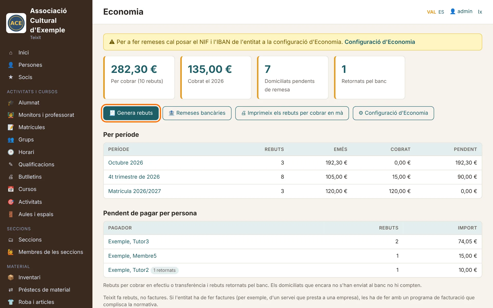

> Teixit fa **rebuts**, no factures. Si l'entitat ha de fer una factura (per exemple, d'un servei que presta a una empresa), l'ha de fer amb un programa de facturació que complisca la normativa, o la gestoria.

### 8.1 Tarifes: el preu de cada cosa

Menú **Economia → Tarifes**. Cada tarifa té un nom (el que apareixerà al rebut), un tipus, una periodicitat i un import:

- **Quota de soci**: anual, semestral, trimestral o mensual. Es pot fer una per a cada **tipus de soci** (apartat 6). Si se'n deixa una sense tipus, val per als tipus que no en tinguen una de pròpia. Els socis d'un tipus sense tarifa (per exemple, els d'honor) no paguen.
- **Matrícula**: una sola vegada per curs i alumne, si les activitats tenen matrícula.
- **Activitats**: mensual, trimestral o anual. Si es posa una **activitat**, es cobra a cada alumne inscrit en algun grup d'eixa activitat. Si no, es cobra una vegada per alumne (una quota fixa).

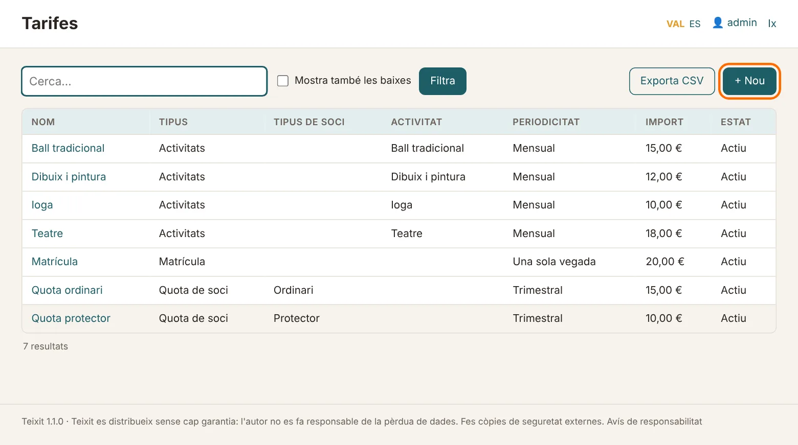

### 8.2 Dades del banc i descomptes

Les dades bancàries de l'entitat i els descomptes de les activitats els configura l'administrador/a (**Manual d'administració**). A la fitxa de cada alumne sí que pots posar un **descompte propi** (família nombrosa, beca…) i **qui paga** les activitats, si no és el tutor principal.

### 8.3 Generar els rebuts

Menú **Economia → Genera rebuts**. Hi ha dues opcions:

- **Quotes de soci**: tria l'any i el període (per exemple, el 1r trimestre). Es fa un rebut per a cada soci d'alta en eixe període.
- **Activitats i cursos**: tria el curs i el període: la **matrícula**, un **mes**, una **avaluació** o el **curs complet**. Es fa **un rebut per família**: si el mateix pare o mare paga dos germans, va tot en un rebut, amb una línia per activitat i els descomptes.

Prem **Previsualitza**: Teixit mostra qui pagarà, el detall i l'import, i avisa dels alumnes que no tenen qui pague. Si està bé, prem **Crea**. Si tornes a generar el mateix període, no es duplica res: els que ja existeixen apareixen com a «Ja generat».

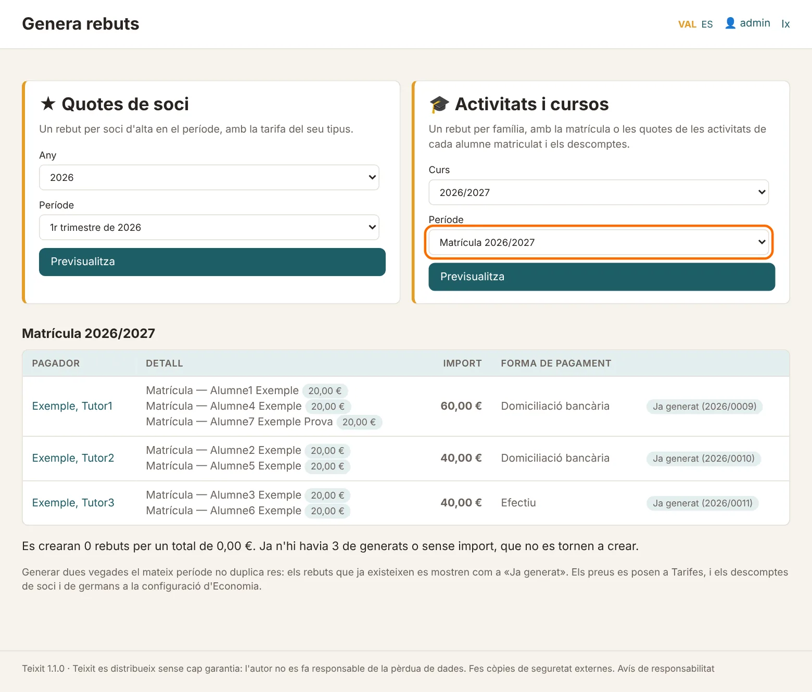

Els rebuts de qui té una **domiciliació** activa es cobraran pel banc; els altres, en **efectiu**. També es pot fer un rebut a mà amb **Rebuts → + Nou** (per exemple, un donatiu o la venda d'una samarreta).

### 8.4 Domiciliacions bancàries

Per a cobrar un rebut pel banc, qui paga ha d'haver signat l'**ordre de domiciliació** (el mandat SEPA). La manera més senzilla és escriure l'**IBAN a la fitxa de la persona o del soci**: en desar, Teixit crea la domiciliació amb la data de hui. Si després es canvia l'IBAN, l'anterior es dona de baixa i se'n crea una de nova (s'ha de tornar a signar); si s'esborra, es dona de baixa. També es pot fer des de **Economia → Domiciliacions → + Nou**, on es pot posar la data de signatura i un titular del compte diferent. Teixit comprova que l'IBAN és correcte i li posa una referència. Només es pot domiciliar a nom d'un major d'edat. Als llistats, l'IBAN només es veu en part.

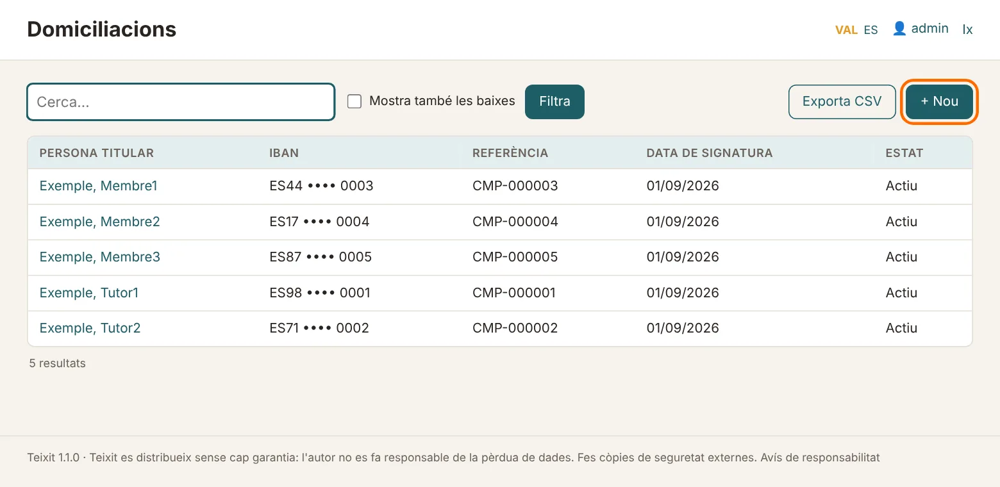

A la fitxa de la domiciliació, **Imprimeix l'ordre de domiciliació** fa el full per a signar. L'entitat ha de guardar-lo signat mentre es cobre i 14 mesos més.

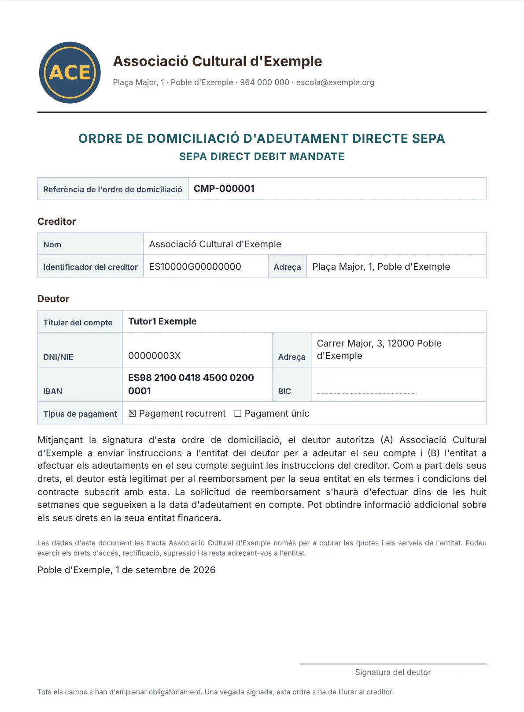

### 8.5 Remeses: cobrar pel banc

Menú **Economia → Remeses bancàries**. Apareixen els rebuts domiciliats pendents de cobrar (també els que el banc ha retornat). Tria'ls, posa la **data de cobrament** (molts bancs demanen almenys dos dies hàbils) i prem **Prepara la remesa**.

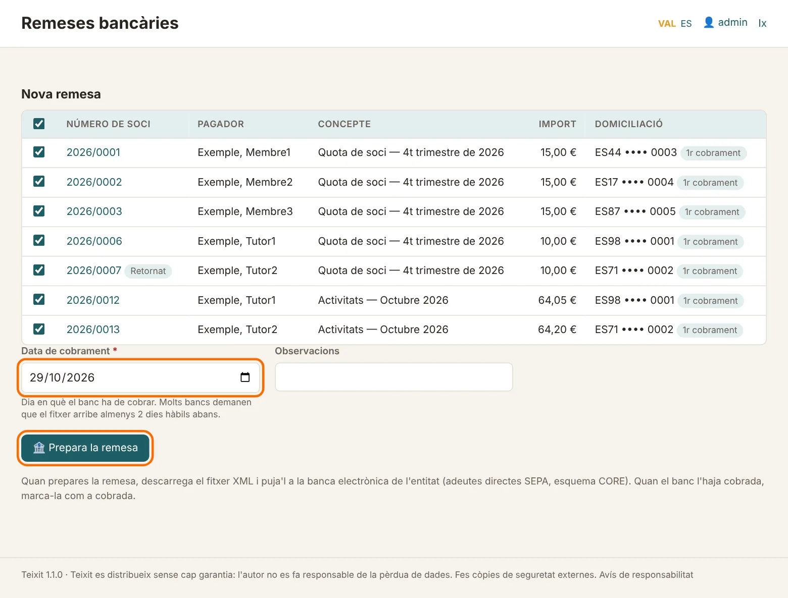

Després:

1. Prem **Descarrega el fitxer per al banc (XML)**.
2. Entra a la banca electrònica de l'entitat i puja'l a l'apartat d'adeutaments directes SEPA (esquema CORE). Si el banc rebutja el fitxer, canvia el **format** a la configuració d'Economia i torna a descarregar-lo.
3. Quan el banc l'haja cobrada, prem **Marca-la com a cobrada**: tots els rebuts queden pagats.

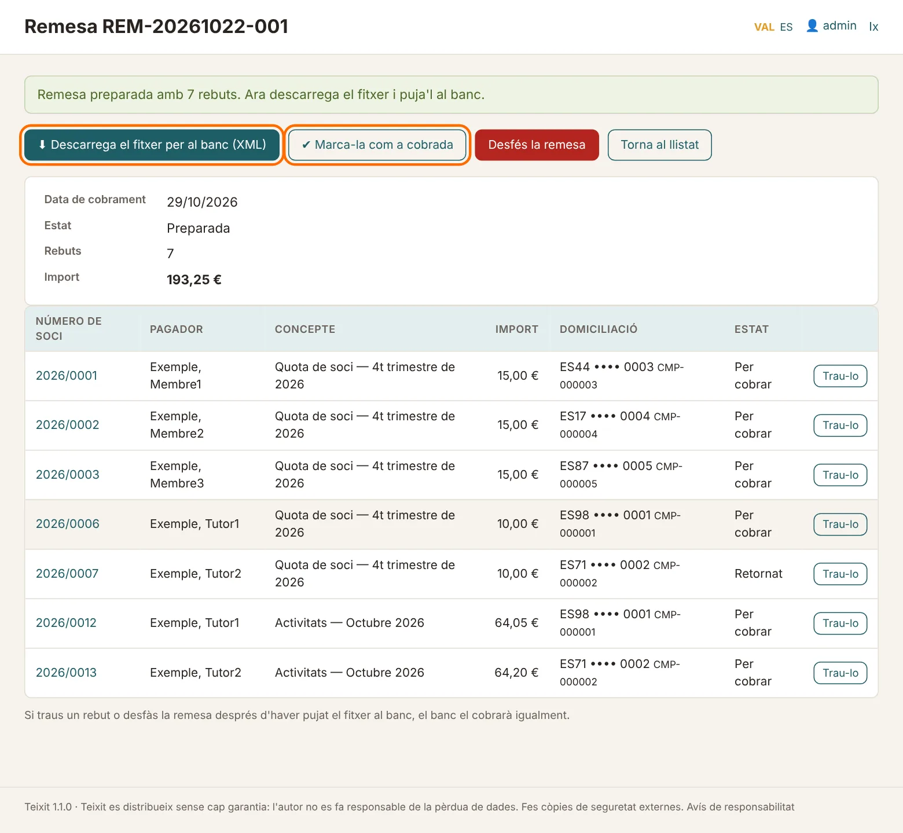

Si el banc **retorna** un rebut, obri'l i prem **Retornat pel banc**. Tornarà a estar per cobrar: el pots cobrar en mà o posar-lo en la remesa següent. Mentre una remesa no s'ha pujat al banc, se'n pot traure un rebut o desfer-la.

### 8.6 Cobrar en mà i imprimir rebuts

Obri el rebut, tria com s'ha pagat (**efectiu** o **transferència**) i la data, i prem **Pagat**. Amb **Imprimeix el rebut** es fa el rebut amb el logotip; si està pagat, porta el segell «PAGAT». Des del **Resum econòmic**, **Imprimeix els rebuts per cobrar en mà** els fa tots de colp, dos per full.

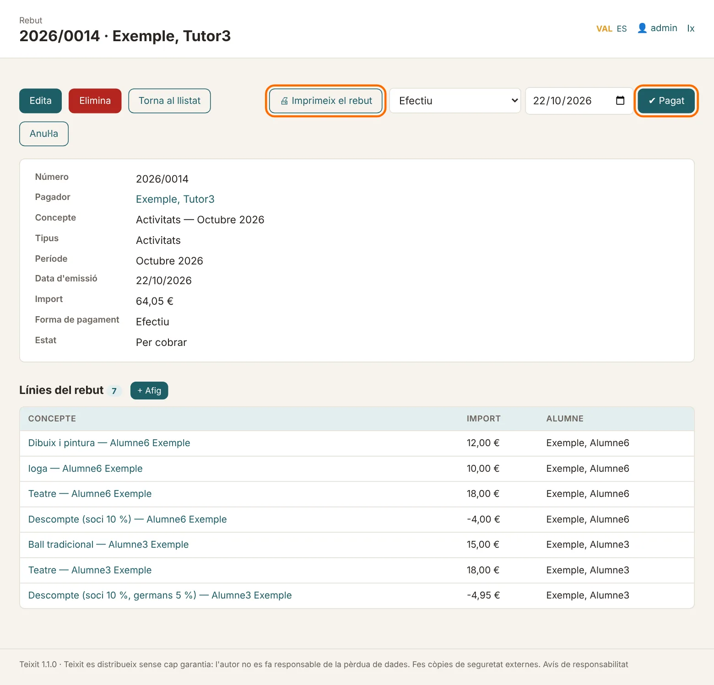

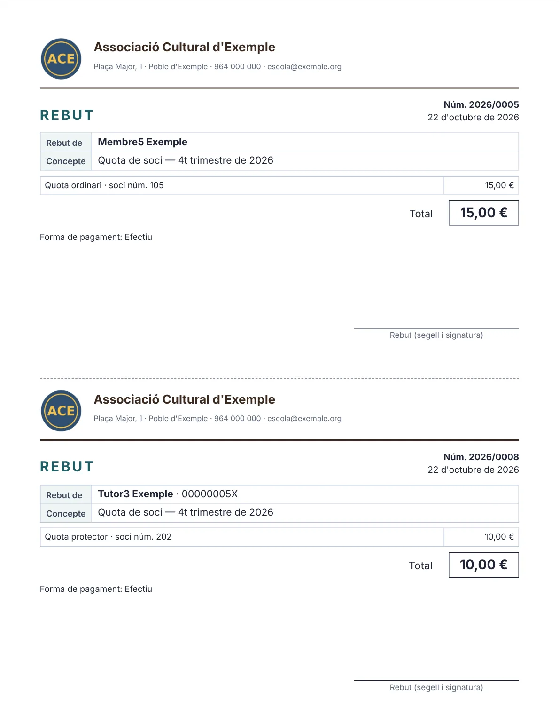

Al llistat de **Rebuts**, els filtres mostren els que estan per cobrar, els retornats, els que cal cobrar en mà o els domiciliats que encara no són en cap remesa. A baix es veu el total. A la fitxa de cada persona hi ha els seus rebuts i la seua domiciliació.

### 8.7 Llibre de caixa

Menú **Economia → Llibre de caixa**. Mostra tots els ingressos i despeses de l'any, amb el saldo després de cada moviment. Moltes coses hi entren soles:

- els rebuts cobrats en efectiu (a la caixa) o per transferència (al banc);
- les remeses cobrades, en una sola línia, com apareixen al banc;
- els diners de la loteria que lliura cada talonari.

La resta (factures, subvencions, la quota de la federació…) s'apunta amb **+ Nou moviment**: data, ingrés o despesa, banc o caixa, categoria, concepte i import. A més de les categories generals, cada tipus d'entitat en té de pròpies: el **monument i el casal** en les falles, els **arbitratges i les llicències** en els clubs i les **activitats per a l'alumnat** en les AMPA. Al final de la pàgina es posa el **saldo inicial** de l'1 de gener del banc i de la caixa, perquè els saldos siguen els reals. Es pot vore només el banc o només la caixa, imprimir-lo i exportar-lo a CSV. El resum **per categories** serveix per a presentar els comptes a l'assemblea i per a la memòria.

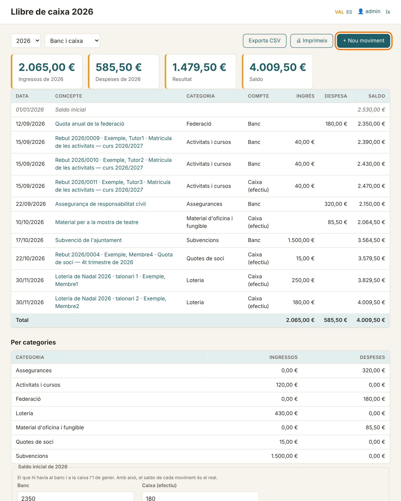

## 9. Loteria

Menú **Economia → Loteria → + Nou**. Escriu el nom del sorteig (per exemple, «Loteria de Nadal 2026»), la data, els **números**, el **preu** de cada participació, l'import que **juga** (la resta és el donatiu per a l'entitat) i quantes participacions porta cada talonari. A la fitxa, **Talonaris i liquidació** obri el resum.

### Repartir els talonaris

Tria la persona i quants talonaris s'endú, i prem **Reparteix talonaris**. Teixit els numera seguits: el talonari 1 porta les participacions 0001–0050, el 2 les 0051–0100, etc.

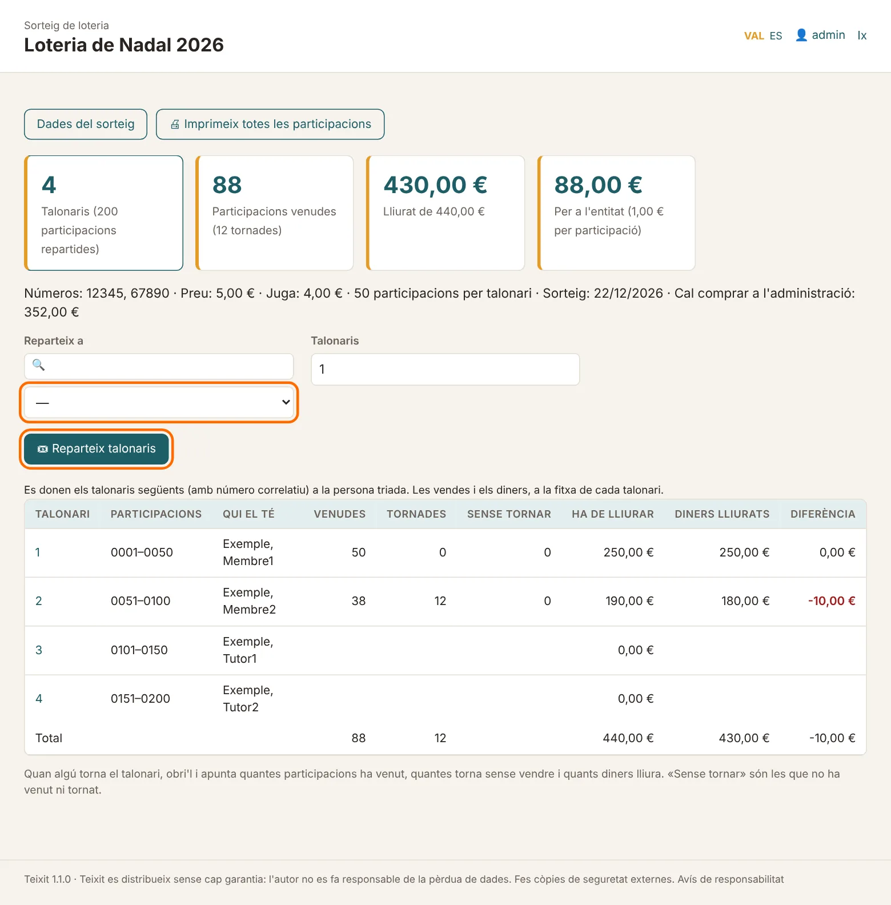

### Imprimir les participacions

A la fitxa de cada talonari, **Imprimeix les participacions** fa les seues 50 participacions (8 per full), amb el logotip, els números, el preu i el número de participació. Des del resum es poden imprimir totes de colp. El text legal del peu es canvia a la fitxa del sorteig.

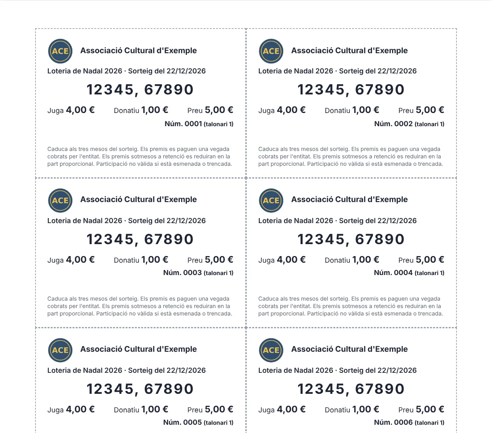

### Liquidar

Quan algú torna el talonari, obri'l i apunta quantes participacions ha **venut**, quantes **torna** sense vendre i quants **diners lliura**. El resum mostra el que falta per lliurar (en roig), quant cal comprar a l'administració de loteria i el que queda per a l'entitat.

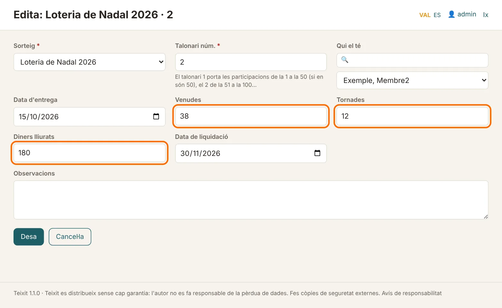

## 10. Seccions, equips o comissions

Una **secció** és un grup estable de l'entitat amb els seus membres: el grup de teatre, el de ball o els joves d'una associació; la secció de playback o la comissió infantil d'una falla. En un **club esportiu** es diuen **equips** i en una **AMPA**, **comissions** (menjador, festes, extraescolars…).

### Crear una secció

Menú **Seccions → + Nou**: el nom, el tipus si vols (en els clubs, la **categoria**: benjamí, aleví, infantil, cadet, juvenil, sènior…), una descripció i la data de creació.

### Afegir-hi una persona

1. Busca o dona d'alta la **persona** (apartat 5).
2. A la seua fitxa, en l'apartat **Membres de les seccions**, prem **+ Afig** (o fes-ho des de la fitxa de la secció).
3. Tria la **secció**, escriu la **funció o especialitat** si vols (vestuari, escenografia…; en els clubs, la **posició**) i tria el seu paper: **membre** o **responsable**, o **ajudant**. En els clubs, estos tres es diuen **esportista**, **entrenador/a** i **segon entrenador/a o delegat/da**.
4. Prem **Desa**.

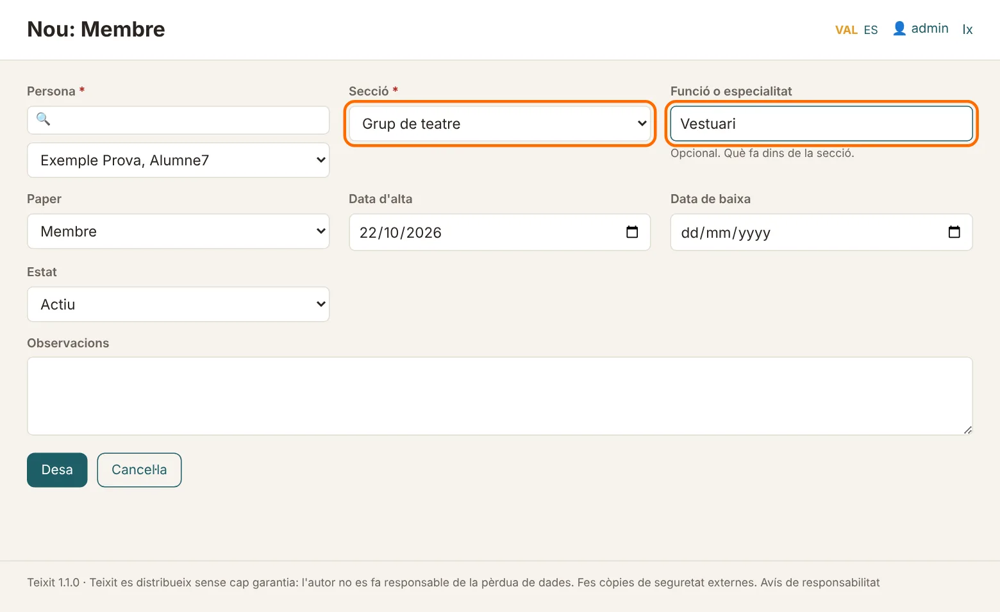

Una persona pot ser de diverses seccions: repeteix-ho per a cadascuna.

### Fitxa de la secció

Menú **Seccions** → obri la secció. Mostra tots els seus membres amb la funció i el paper de cadascú. Des d'ací també pots afegir membres amb **+ Afig**.

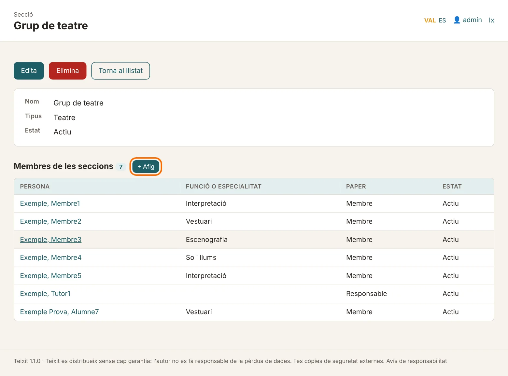

### Llicències federatives (clubs esportius)

En un club, cada membre d'un equip té, a més, el **número de llicència federativa** i la **data de caducitat**. Teixit avisa a l'inici de les llicències caducades o que caduquen en els pròxims 30 dies, i marca la fila del membre. Al llistat d'**Esportistes i tècnics** hi ha els filtres **Llicències caducades o que caduquen en 30 dies** i **Esportistes sense llicència**, per a preparar la tramitació amb la federació.

## 11. Activitats i cursos

Este mòdul serveix per a les activitats amb inscripció i horari: els **tallers i cursos** d'una associació, l'**escola esportiva** d'un club o les **extraescolars** d'una AMPA. Està desactivat en instal·lar una falla o un club; s'activa a **Mòduls i avisos**.

Abans d'inscriure ningú cal tindre el curs preparat. Ordre recomanat: **curs → activitats i aules → monitors → grups → horaris**.

### 11.1 El curs

1. Menú **Cursos → + Nou**.
2. Nom (per exemple `2026/2027`), data d'inici i de finalització.
3. Marca **Curs actual**. Només n'hi pot haver un.
4. Prem **Desa**. S'obri la fitxa del curs.

Si l'entitat fa servir les **qualificacions** (apartat 12), a la fitxa del curs crea també els **períodes d'avaluació** (`1r trimestre`, `2n trimestre`…), amb l'ordre 1, 2, 3.

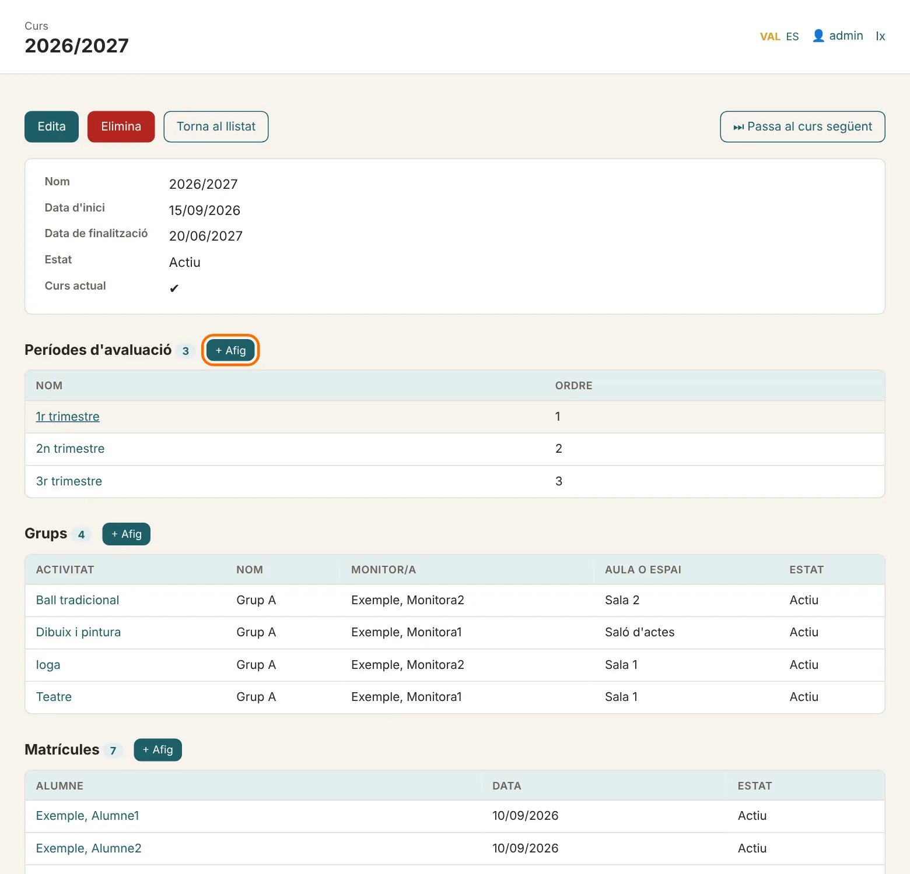

### 11.2 Activitats i aules

- Menú **Activitats → + Nou**: el nom (Teatre, Robòtica, Iniciació…) i, si vols, un tipus (taller, curs, esport…).
- Menú **Aules i espais → + Nou**: nom (Sala 1, Pista 2, Gimnàs…) i capacitat.

Només cal crear-les una vegada: es reutilitzen cada curs.

### 11.3 Monitors i professorat

Un monitor és una **persona** amb fitxa de monitor:

1. Dona d'alta la persona (apartat 5) o busca-la si ja existeix.
2. A la seua fitxa, en l'apartat **Monitors i professorat**, prem **+ Afig**.
3. Comprova la data d'alta i prem **Desa**.

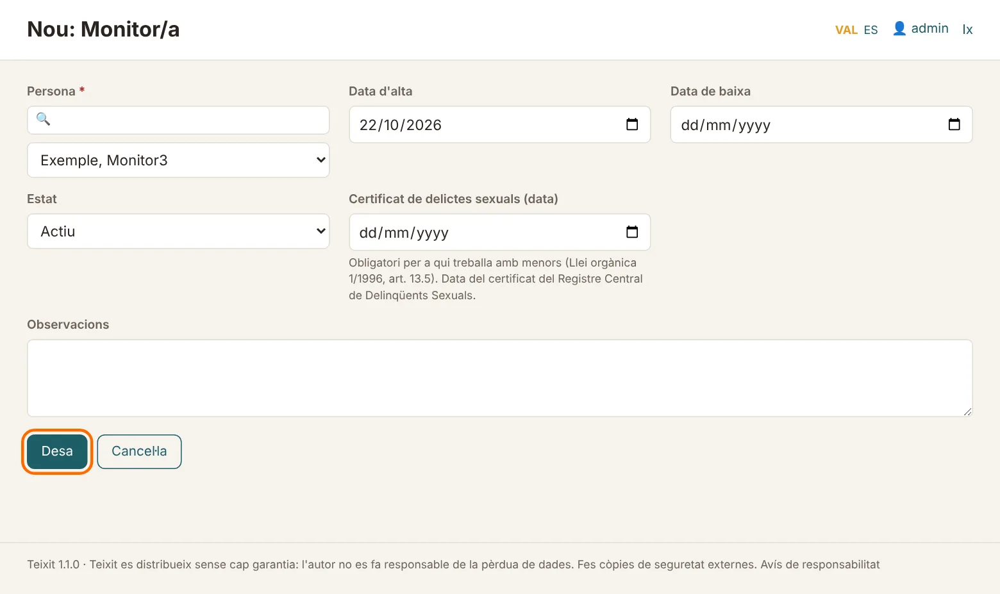

**Certificat de delictes de naturalesa sexual.** És obligatori per a tothom que treballa amb menors, també els voluntaris. A la fitxa de monitor, posa'n la **data**. Si falta el d'algun monitor en actiu, Teixit ho avisa a l'inici i el llistat té el filtre **Sense certificat de delictes sexuals**.

### 11.4 Grups i horaris

Un **grup** és una activitat d'un curs amb un monitor: per exemple *Teatre · Grup A*.

1. Menú **Grups → + Nou**.
2. Tria el **curs**, l'**activitat**, escriu el **nom** del grup i tria el **monitor** i l'**aula o espai**.
3. Prem **Desa**. S'obri la fitxa del grup.

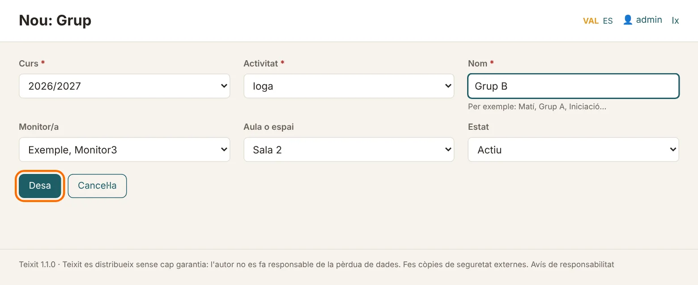

4. A l'apartat **Horari**, prem **+ Afig**, tria el **dia** i les hores d'inici i de fi, i prem **Desa**. Repeteix-ho si el grup es reunix més d'un dia.

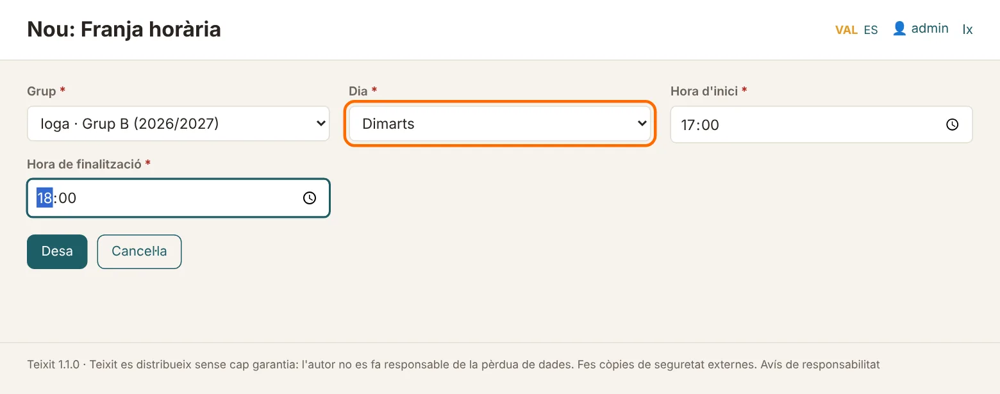

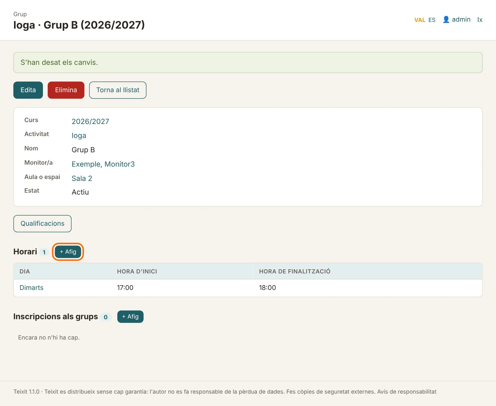

### 11.5 Horari general

El menú **Horari** mostra totes les activitats de la setmana. Pots filtrar per monitor o per aula per a imprimir l'horari de cadascú.

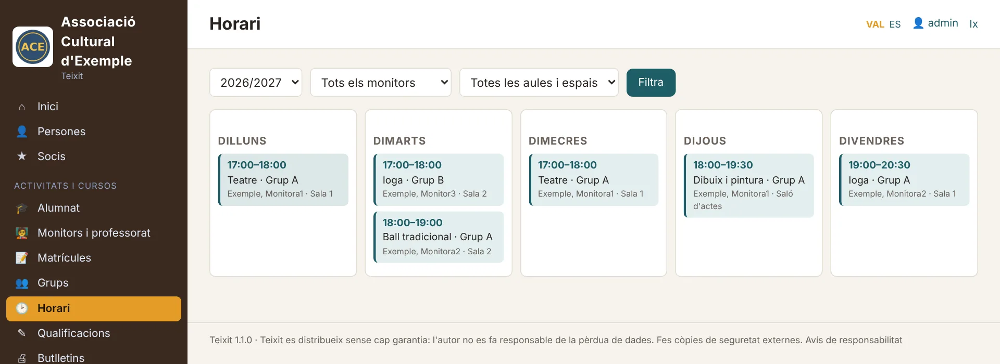

### 11.6 Inscriure un alumne (pas a pas)

Exemple complet: una xiqueta nova que s'apunta a dues activitats. El tutor legal (la mare o el pare) també ha d'estar donat d'alta com a persona.

**Pas 1. La persona.** Dona d'alta l'alumne com a **persona** (apartat 5). Si el tutor legal encara no està donat d'alta, dona'l d'alta també.

**Pas 2. La fitxa d'alumne.** A la fitxa de la persona, en l'apartat **Alumnat**, prem **+ Afig**. La persona ja ve triada: comprova la **data d'alta** i prem **Desa**.

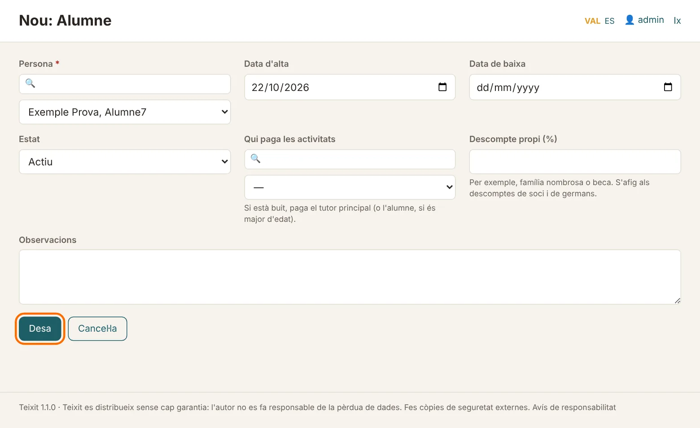

**Pas 3. El tutor legal.** A la fitxa de l'alumne, en l'apartat **Tutors legals**, prem **+ Afig**. Tria el pare, la mare o el tutor (escriu el nom a la lupa), la **relació** i marca **Principal** si és el contacte principal. Prem **Desa** i repeteix-ho si hi ha més d'un tutor.

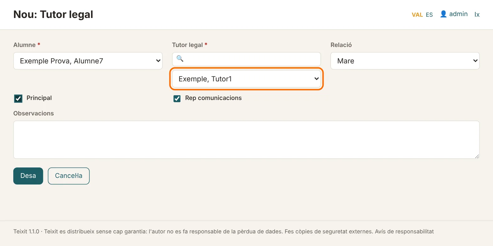

> Germans: tots dos alumnes poden tindre el mateix tutor. No cal donar-lo d'alta dues vegades.

**Pas 4. La matrícula del curs.** A la fitxa de l'alumne, en l'apartat **Matrícules**, prem **+ Afig**, comprova que el **curs** és l'actual i prem **Desa**.

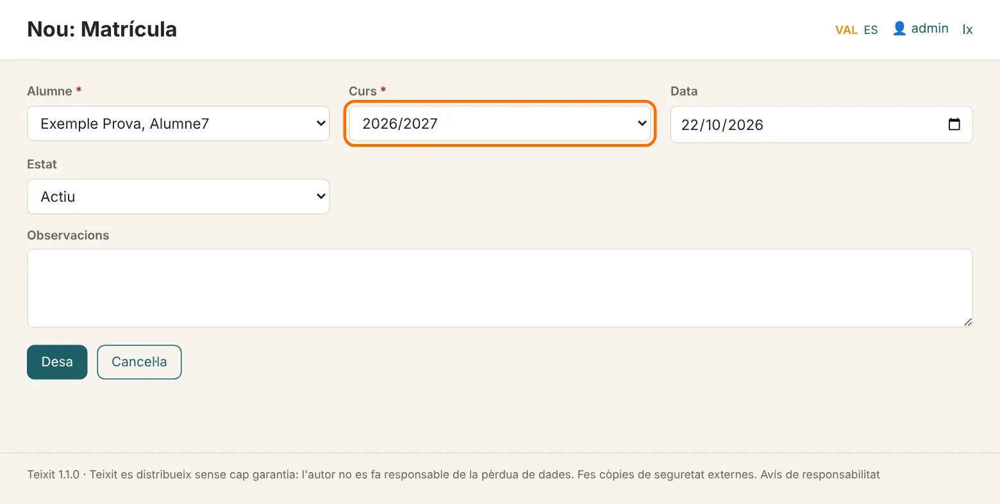

**Pas 5. Els grups.** A la fitxa de la matrícula, en l'apartat **Inscripcions als grups**, prem **+ Afig**, tria el **grup** i prem **Desa**. Repeteix-ho per a cada activitat.

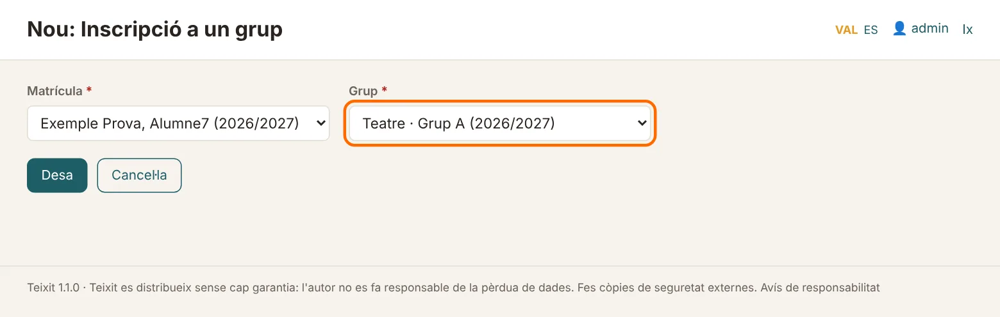

La fitxa de l'alumne mostra el resum del curs: grups, monitors i horari (i les notes, si l'entitat fa servir les qualificacions), els tutors legals i les matrícules de tots els cursos.

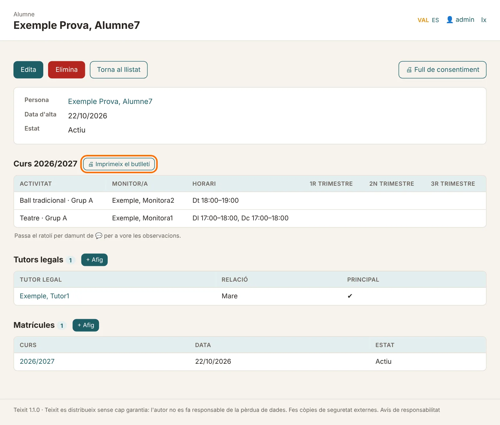

Quan un alumne deixa les activitats, edita la seua fitxa d'alumne i posa l'estat **Baixa** i la **data de baixa**. Si a més ja no és res de l'entitat, desmarca **Actiu** a la seua fitxa de persona.

### 11.7 Passar al curs següent

Quan s'acosta el curs nou no cal crear-ho tot des de zero:

1. Menú **Cursos**, obri el curs que acaba i prem **⏭ Passa al curs següent**.
2. Comprova el **nom** i les **dates** del curs nou (Teixit els proposa: un any més).
3. Tria què es copia: els **grups** amb el monitor i l'aula, l'**horari** i, si n'hi ha, els **períodes d'avaluació**. Si vols, també pots **matricular ja els alumnes que continuen** (sense grups).
4. Deixa marcat **Marca el curs nou com a curs actual** i, si vols, **Tanca** el curs anterior.
5. Prem **Crea el curs nou**.

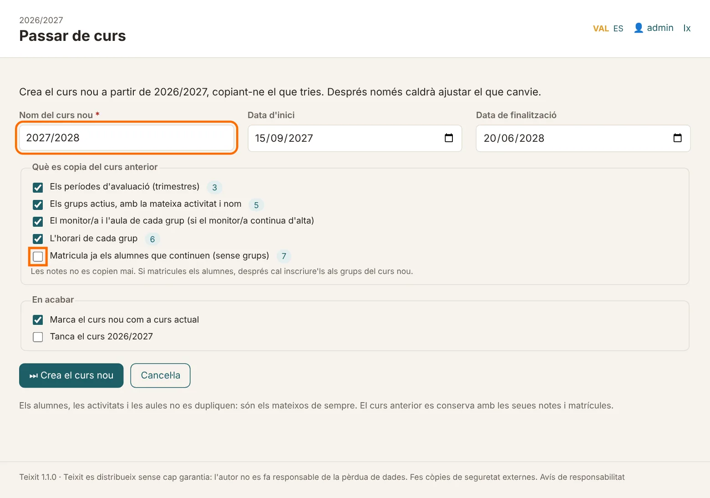

Després només cal ajustar el que canvie (un grup nou, un altre monitor…) i inscriure els alumnes als grups. El curs anterior es conserva sencer.

## 12. Qualificacions i butlletins

Este mòdul és per a les entitats que avaluen les activitats (una escola de dansa, d'idiomes o de música d'una associació). Només està actiu en instal·lar una associació cultural, i necessita **Activitats i cursos**.

### Introduir les notes

1. Menú **Qualificacions**.
2. Tria el **grup** i l'**avaluació** (1r trimestre, 2n trimestre…).
3. Escriu la nota de cada alumne. És text lliure: `7`, `8,5`, `Notable`, `Apte`…
4. Si el monitor ha passat observacions, escriu-les a **Observacions acadèmiques**. Ixen al butlletí.
5. Prem **Desa**.

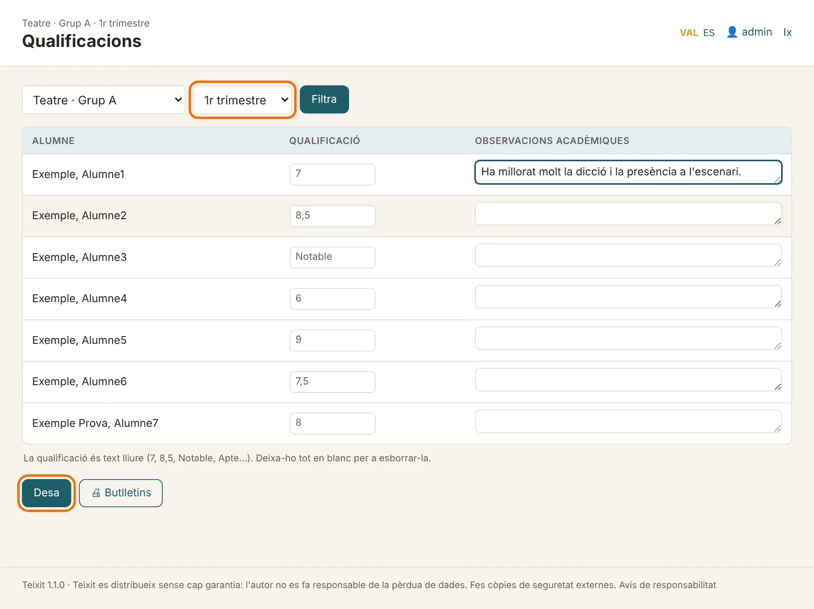

Per a esborrar una nota, deixa en blanc la nota i les observacions i desa.

### Butlletins

1. Menú **Butlletins** (o el botó **Butlletins** de la pàgina de qualificacions, o **Imprimeix el butlletí** de la fitxa d'un alumne).
2. Tria l'**avaluació**. El butlletí mostra les notes d'esta avaluació i de les anteriors.
3. Tria **de qui**: tot l'alumnat matriculat, l'alumnat d'un grup o un sol alumne.
4. Si vols, escriu un **text al peu** (per exemple, la data de la mostra de final de trimestre). Es recorda per a la pròxima vegada.
5. Prem **Prepara els butlletins**: s'obri un full A4 per alumne. Prem **Imprimeix el butlletí** (dalt de tot).

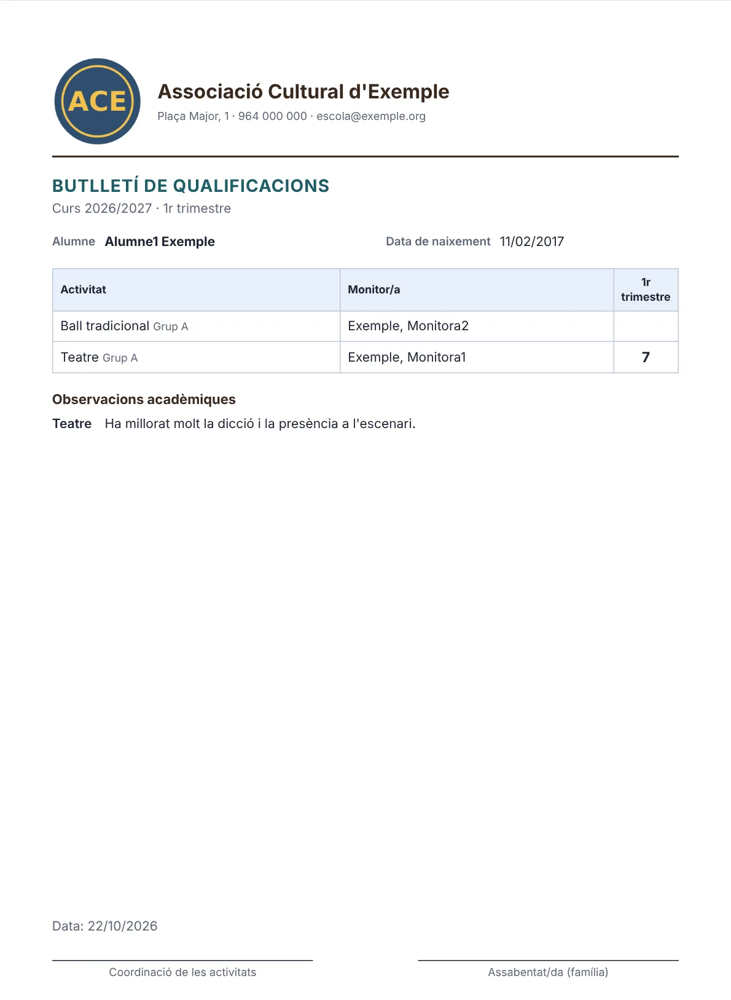

> Per a guardar-los en PDF (per a enviar-los per correu), tria **Microsoft Print to PDF** com a impressora.

## 13. Inventari i roba

### Alta de material

1. Menú **Inventari → + Nou**.
2. Omple el **número d'inventari** i el **tipus** (obligatoris: carpa, equip de so, porteries…) i la resta de dades: marca, model, número de sèrie, estat, ubicació i data d'adquisició.
3. Prem **Desa**.

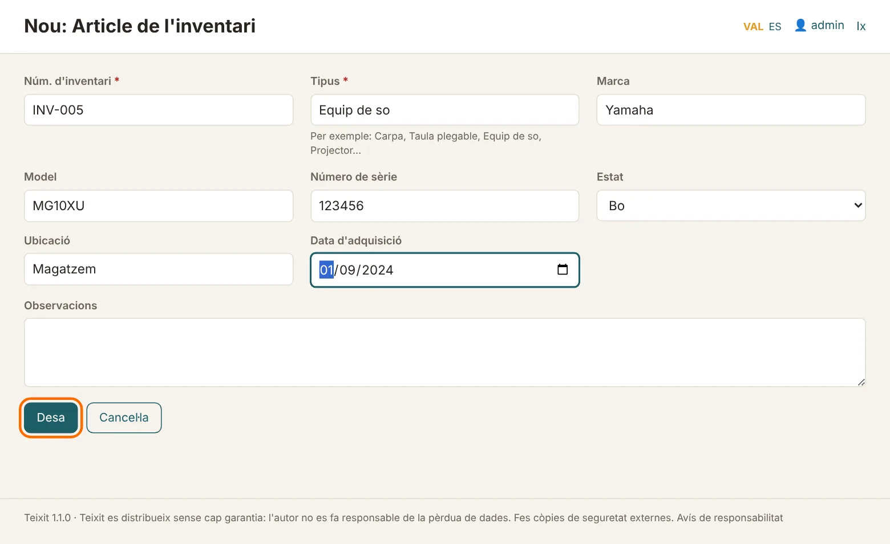

A la fitxa de cada article hi ha l'historial de **préstecs** i de **manteniments** (reparacions, revisions…).

### Deixar material (préstec)

1. A la fitxa del material, en l'apartat **Préstecs de material**, prem **+ Afig**.
2. Tria la **persona**, comprova la **data d'entrega** i posa la **devolució prevista**, l'estat en què s'entrega i la fiança si n'hi ha.
3. Prem **Desa**.

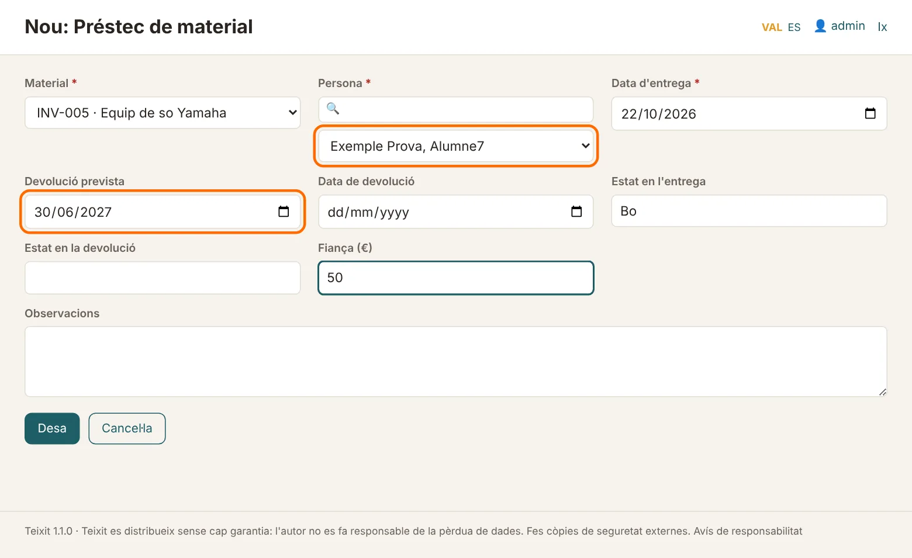

Un mateix article no es pot deixar a dues persones alhora. Quan el tornen, obri el préstec, prem **Edita**, posa la **data de devolució** i l'**estat en la devolució** i desa: torna a estar disponible.

Menú **Préstecs de material**: amb el filtre pots vore els **préstecs actius** o només els que tenen la **devolució vençuda**. Els vençuts també apareixen a l'inici.

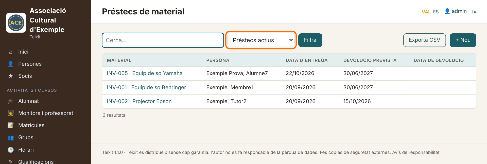

### Roba i articles

Menú **Roba i articles** (**Equipacions i roba** en els clubs): samarretes, dessuadores, brusons, mocadors, equipacions, xandalls, gorres… amb el que s'ha comprat i el que queda de cada talla.

1. **+ Article**: el nom («Samarreta de l'associació»), el tipus, les **talles** separades per comes en l'ordre en què s'han de mostrar (8, 10, 12, S, M, L, XL; buit si no en té, com un mocador) i el preu de venda, si es ven.
2. **+ Compra**: quan arriben de la botiga, l'article, la talla, la quantitat, el preu i el proveïdor.
3. **+ Lliurament**: quan es dona a algú, la persona, la talla i si és una **venda** (se la queda i la paga; l'import es proposa amb el preu de l'article), un **préstec** (l'ha de tornar) o **gratuït**.

Quan es torna un préstec, s'edita el lliurament i es posa la **data de devolució**: la peça torna a estar disponible.

La pantalla mostra, per a cada article i talla, el **total** de peces que té l'entitat (les comprades, menys les venudes i les gratuïtes), les que estan **en préstec** i les **disponibles**. Si d'una talla s'han lliurat més de les que consten com a comprades, el número ix en roig: falta apuntar alguna compra. Els lliuraments de cada persona apareixen també a la seua fitxa.

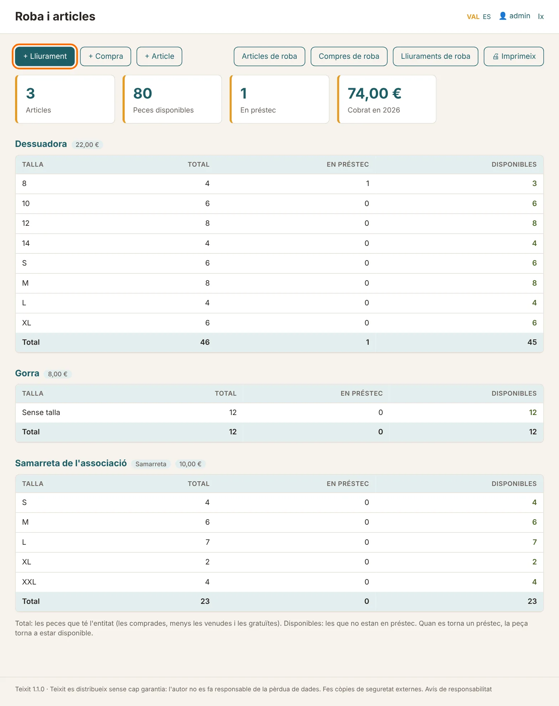

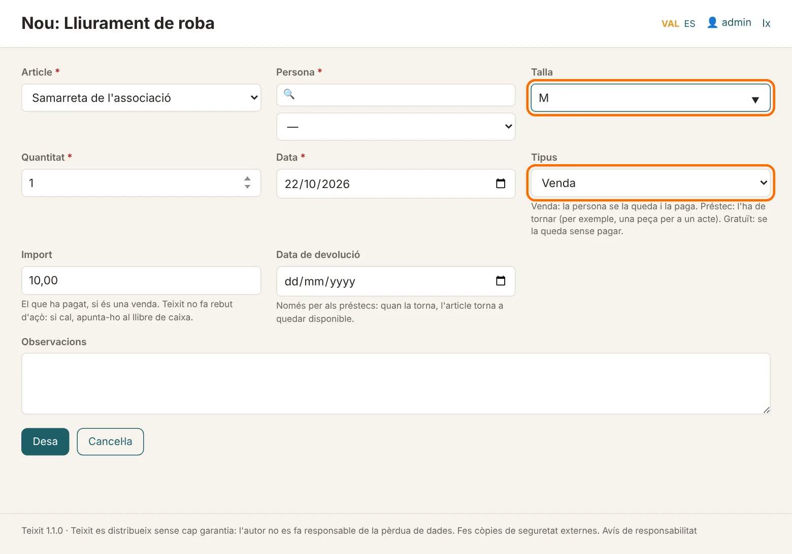

> Teixit no fa rebuts de les vendes de roba. Si cal, apunta els diners al llibre de caixa (apartat 8.7).

## 14. Documents de l'entitat

Menú **Documents**. Ací es guarden els estatuts, el reglament de règim intern, les actes signades, la inscripció al registre, el CIF, les pòlisses d'assegurança, els contractes, els convenis, les llicències i permisos…

Per a afegir-ne un, prem **+ Nou**, escriu el títol, tria el tipus i el **fitxer** (PDF, imatge, Word, Excel, LibreOffice o text, fins a 20 MB). Si és d'una persona (un contracte, per exemple), tria-la: apareixerà també a la seua fitxa. Si el document caduca (una assegurança, una llicència, un conveni), posa la **data de caducitat**: Teixit avisarà a l'inici 60 dies abans.

El fitxer es guarda **dins de Teixit**, no en una carpeta a part. Així entra a les còpies de seguretat (i, si les xifreu, també va xifrat). A canvi, les còpies ocupen més si hi guardeu molts documents grans.

### Registre d'activitats de tractament (RGPD)

Des del llistat de documents, **Registre d'activitats de tractament (RGPD)** fa el document que el Reglament de protecció de dades demana a les entitats. Teixit el prepara amb les dades que tracta l'entitat (només dels mòduls actius) i les mesures de seguretat que té configurades. És un model orientatiu: reviseu-lo, adapteu-lo i guardeu-lo signat amb la documentació de l'entitat.

## 15. Comunicats

Menú **Comunicats**. Teixit no envia correus ni es connecta a Internet: prepara les adreces perquè envieu el comunicat des del correu de l'entitat.

1. Tria **a qui**: els socis, la junta, els monitors, les famílies de l'alumnat o d'un grup, els membres d'una secció o tothom.
2. Prem **Copia les adreces** i apega-les al camp **CCO** (còpia oculta) del correu, perquè ningú no veja les adreces dels altres. Si són poques, **Obri el correu amb les adreces en CCO** ho fa directament.
3. Escriu i envia el correu des del vostre programa de correu.
4. Torna a Teixit i **registra el comunicat** amb l'assumpte: queda constància de què s'ha enviat, quan i a qui.

Les persones del grup que no tenen correu apareixen en una llista a part, per a avisar-les d'una altra manera.

## 16. Llistats, certificats i memòria

Menú **Documents i dades → Llistats i informes**. Cada llistat es pot vore a la pantalla, **imprimir** (o guardar en PDF) i **exportar a CSV** per a obrir-lo amb Excel.

### Socis per número i membres per funció

- **Socis per número**: tots els socis d'alta, ordenats pel número, amb DNI i contacte. Pots triar un tipus de soci.
- **Membres per funció**: tria una secció i ix la llista agrupada per funció o especialitat (en els clubs, per **posició**).

### Alumnes d'un grup

Tria el curs i el grup. Ix cada alumne amb l'edat, el pare, la mare o el tutor/a i els seus telèfons i correus. És el llistat que necessiten els monitors. En groc, els que no autoritzen fotos.

### Drets d'imatge

Qui pot eixir en fotos i vídeos: el resum (quants autoritzen, quants no i quants falten) i la llista, amb els que no autoritzen en groc. Abans d'un acte, imprimeix-la per a qui fa les fotos. El botó **Fulls de consentiment dels pendents** imprimeix els fulls que falten.

### Etiquetes per a les circulars

1. Tria **per a qui**: socis, famílies de l'alumnat (els tutors que reben comunicacions), membres de les seccions o totes les persones.
2. Tria el **format** del full d'etiquetes (ho diu la capsa: 24, 21 o 14 per full).
3. Si el full ja està començat, indica quantes etiquetes **ja s'han gastat**.
4. Prem **Prepara les etiquetes** i imprimeix amb la **mida real (100 %)** i **sense marges**.

> Fes primer una prova en paper normal amb **Mostra les vores** i posa-la damunt del full d'etiquetes a contrallum.

### Antiguitat i insígnies

Tria l'**any** i els **anys que es premien** (per defecte 25 i 50). Ix qui els complix eixe any, com a soci i com a membre d'una secció. Marca **Mostra també la llista completa** per a vore tothom ordenat per antiguitat.

L'antiguitat es compta des de la data d'alta. Per als membres de les seccions, des de la primera alta en qualsevol secció.

### Memòria anual i subvencions

Tria el curs. Ix el que solen demanar l'ajuntament, la Diputació o la Generalitat: participants en les activitats per edat (amb menors i majors), per activitat i per població, monitors i grups, membres de cada secció (amb els menors), socis per tipus i les altes i baixes de l'any.

### Certificats

A la fitxa d'un **soci**, d'un **membre d'una secció** o d'una **matrícula** hi ha el botó **🖨 Certificat**. Ix un certificat en A4 amb el logotip, les dades de la persona i la data de hui, preparat per a signar. Serveix per a beques, ajudes, la feina…

Qui signa els certificats i la població que hi ix els posa l'administrador/a a la configuració (**Manual d'administració**). Si no s'hi ha posat ningú, s'agafa de la junta actual.

## 17. Importar dades des d'Excel

Si l'entitat ja té els socis o l'alumnat en un Excel, no cal tornar-los a escriure. Menú **Documents i dades → Importa dades**.

### Pas 1. El fitxer

1. Tria què vols importar: **Persones**, **Socis** (amb el número, el tipus i la data d'alta; el tipus es busca pel nom) o **Alumnat** (amb el pare, la mare o el tutor/a, si el full els porta).
2. Tria el fitxer: Excel (**.xlsx**) o **CSV**. Si és un .xls antic, obri'l amb Excel i guarda'l com a .xlsx.
3. Deixa marcat **La primera fila té els títols de les columnes** si és el cas, i prem **Següent**.

Si comences de zero, baixa una **plantilla**, omple-la i puja-la.

### Pas 2. Què és cada columna

Teixit reconeix les columnes habituals (Nom, Cognoms, DNI, Telèfon, Data de naixement…) i ja les deixa triades. Comprova-les i corregeix les que falten. Si el nom i els cognoms estan junts, tria **Nom i cognoms junts**. Les columnes que no tries no s'importen.

Si el full porta el **compte bancari** (IBAN o el número antic de 20 xifres), Teixit crea la domiciliació de cada persona major d'edat; en importar alumnat, la del pare, la mare o el tutor/a. Si hi ha una columna amb la **data de signatura** de la domiciliació, també l'agafa. A les persones que ja tenen una domiciliació amb un altre IBAN no se'ls canvia.

### Pas 3. Revisar i importar

Abans d'importar res, Teixit mostra cada fila:

| Estat | Què vol dir | Què es fa |
|---|---|---|
| **Nova** | No està a Teixit | Es crea |
| **Ja existeix** | Mateix DNI, o mateix nom i data de naixement | No es duplica: només es completen les dades que li falten |
| **Possible duplicat** | Mateix nom, però no es pot assegurar | Marca **És la mateixa persona** si ho és; si no, es crea nova |
| **Repetida al fitxer** / **Error** | Està dues vegades o no té nom | No s'importa |

A la columna **Avisos** veuràs, per exemple, dates que no s'entenen o persones a qui falten dades obligatòries (quedaran en groc, com sempre).

Prem **Importa**. Abans d'importar, Teixit fa una còpia de seguretat («Abans d'importar»): si el resultat no és el que esperaves, l'administrador/a la pot restaurar (Manual d'administració).

## 18. Còpies de seguretat

Totes les dades estan en un sol fitxer. Teixit en fa còpies automàticament:

| Quan | Tipus |
|---|---|
| La primera vegada que s'utilitza cada dia | Automàtica (diària) |
| En tancar Teixit, si hi ha hagut canvis | Automàtica (en tancar) |
| Quan prems **Fes una còpia ara** | Manual |
| Just abans de restaurar | Abans de restaurar |
| Just abans d'importar dades | Abans d'importar |
| En obrir per primera vegada una versió nova de Teixit | Abans d'actualitzar |

Menú **Administració → Còpies de seguretat**:

### Fer i baixar còpies

- **Fes una còpia ara**: fa una còpia en el moment. Convé fer-ne una abans d'un canvi gran.
- **Baixa** (a la llista): descarrega una còpia, per exemple per a guardar-la en un USB.

Triar la carpeta externa (USB o núvol), xifrar les còpies, decidir quant de temps es guarden i **restaurar** una còpia ho fa l'administrador/a (**Manual d'administració**).

> Les còpies contenen dades personals, també de menors. Guarda-les en un lloc segur.

## 19. Usuaris i contrasenyes

### Canviar la teua contrasenya

Cada usuari pot canviar la seua quan vulga:

1. Al menú, a baix de tot, prem **Compte i contrasenya** (o fes clic en el teu nom d'usuari, dalt a la dreta).
2. Escriu la **contrasenya actual**.
3. Escriu la **contrasenya nova** dues vegades (almenys 8 caràcters).
4. Prem **Desa**.

Si no recordes l'actual, no la pots canviar ací: demana a l'administrador/a que et pose una contrasenya nova.

## 20. Ajuda

El menú **Ajuda** mostra este manual dins del programa. Els botons de dalt obrin el manual i la guia d'instal·lació en PDF, el registre de canvis, la privacitat i el resum de la llicència. L'administrador/a hi veu, a més, una pestanya amb el **Manual d'administració**.

**Hi ha versió nova?** obri al navegador la pàgina de l'última versió de Teixit. Teixit no es connecta a Internet ni comprova res sol: compara el número d'eixa pàgina amb el teu, que apareix just davall. Si és més alt, avisa l'administrador/a: la versió nova s'instal·la damunt i les dades es conserven.

## 21. Preguntes freqüents

**Ens hem equivocat de tipus d'entitat. Cal tornar a instal·lar?** No. L'administrador/a el canvia a **Configuració** i, si cal, activa o desactiva els mòduls (Manual d'administració). Les dades no es perden.

**He donat d'alta una persona dues vegades. Què faig?** Si la segona no té res vinculat, obri-la i prem **Elimina**. Si ja té coses vinculades, edita-les perquè apunten a la persona bona i després elimina la repetida.

**Per què una persona apareix en groc?** Li falten dades obligatòries: normalment, ha fet 18 anys i no té DNI o telèfon. Completa-les (apartat 5).

**No trobe algú al llistat.** Pot estar de baixa: marca **Mostra també les baixes**.

**No em deixa eliminar una cosa.** Té historial relacionat. Posa-la de baixa o com a inactiva (apartat 3).

**No veig el menú d'activitats (o de loteria, o de roba).** Està desactivat: l'administrador/a el pot activar a **Administració → Mòduls i avisos**.

**Un alumne no apareix en un grup.** Comprova que té matrícula en el curs actual, en estat Actiu, i que està inscrit en aquell grup (apartat 11.6, pas 5).

**L'administrador/a ha oblidat la contrasenya.** Prem **Recupera l'accés** a la pantalla d'entrada i utilitza el codi de recuperació. Si no el trobes, també hi ha una manera sense codi (Manual d'administració).

**Hem de passar a Teixit els socis que tenim en Excel.** Utilitza **Importa dades** (apartat 17): no cal escriure'ls a mà, i les persones que ja hi ha no es dupliquen.

**Qui pot eixir en les fotos?** **Llistats i informes → Drets d'imatge** (apartat 16).

**Com cobrem les quotes pel banc?** Posa les dades bancàries de l'entitat, crea la domiciliació de cada pagador, genera els rebuts i prepara una remesa: Teixit fa el fitxer que es puja a la banca electrònica (apartat 8).

**Teixit fa factures?** No, fa rebuts. Les factures s'han de fer amb un programa de facturació que complisca la normativa (Verifactu).

**Teixit envia les nostres dades a algun lloc?** No. Tot es queda a l'ordinador i, si la configureu, a la carpeta externa de còpies. Ho explica la declaració de privacitat: menú **Ajuda → Privacitat**.

**He d'estar connectat a Internet?** No.

**On estan les dades?** A la carpeta `data` del programa (`data\teixit.db`). La ruta exacta es veu a **Configuració**.

**Com passe Teixit a un altre ordinador?** Instal·la Teixit a l'ordinador nou i, a **Còpies de seguretat → Restaura des d'un fitxer**, carrega l'última còpia.
