# Manual de usuario de Teixit

## 1. Antes de empezar

Teixit es un programa de gestión para asociaciones y entidades sin ánimo de lucro: personas, socios, junta directiva y actas, cuotas y recibos, remesas bancarias, lotería, libro de caja, documentos, comunicados, secciones o equipos, actividades y cursos, inventario, ropa y copias de seguridad. Funciona en **un solo ordenador con Windows o Linux**, sin Internet, y tiene dos cuentas. Esta tabla resume qué puede hacer cada una:

| Qué se puede hacer | Administrador/a | Usuario/a |
|---|:---:|:---:|
| Personas, socios y tipos de socio | ✔ | ✔ |
| Secciones o equipos, actividades y cursos, monitores y matrículas | ✔ | ✔ |
| Inventario, préstamos y ropa | ✔ | ✔ |
| Cuotas, recibos, domiciliaciones, remesas y lotería | ✔ | ✔ |
| Libro de caja | ✔ | ✔ |
| Junta, actas, documentos y comunicados | ✔ | ✔ |
| Listados, certificados e importación desde Excel | ✔ | ✔ |
| Hacer y descargar copias de seguridad | ✔ | ✔ |
| Cambiar la propia contraseña | ✔ | ✔ |
| Configuración de la entidad, tipo de entidad, logotipo, módulos y avisos | ✔ | — |
| Datos bancarios y descuentos de las actividades | ✔ | — |
| Crear y gestionar las cuentas | ✔ | — |
| Registro de actividad | ✔ | — |
| Restaurar y eliminar copias, carpeta externa y cifrado | ✔ | — |
| Recuperar el acceso con el código de recuperación | ✔ | — |

Este manual es para las personas que llevan la gestión diaria. La configuración inicial, los datos de la entidad, las cuentas, la restauración de copias y las actualizaciones las hace el administrador/a: están en el **Manual de administración**.

### Tipo de entidad

Al instalarlo, Teixit pregunta qué tipo de entidad es. El tipo cambia **los nombres de algunos apartados**, **los módulos que se activan** y **los tipos de socio iniciales**. Todo se puede cambiar después.

| Tipo | Para quién | Cómo se llaman las cosas |
|---|---|---|
| **Asociación cultural** | Asociaciones culturales, vecinales, juveniles, de mayores, comparsas… | Socios, **secciones** (teatro, baile…), actividades y cursos. |
| **Falla, gaiata u hoguera** | Comisiones falleras, gaiatas, hogueras, comparsas y filaes. | El **censo** (con categorías: adulto, juvenil, infantil…), secciones, ropa (blusones, pañuelos…) y lotería. |
| **Club deportivo** | Clubes y escuelas deportivas. | Socios, **equipos** con categorías, deportistas y técnicos, **licencias federativas**, equipaciones y escuela deportiva. |
| **AMPA o AFA** | Asociaciones de madres y padres del alumnado. | **Familias asociadas**, **comisiones** (comedor, fiestas…) y **extraescolares**. |
| **Peña de un club** | Peñas de aficionados de un club de fútbol o de otro deporte. | Socios, **comisiones** (viajes, fiestas, animación…), ropa y merchandising (camisetas, bufandas…), lotería y desplazamientos en la caja. |

> En este manual, el botón o el campo que hay que usar en cada paso aparece **marcado en naranja** en las capturas. Las capturas son de una asociación cultural: en otros tipos de entidad, algunos apartados tienen otro nombre (por ejemplo, «Equipos» en lugar de «Secciones»).

> ⚠ **Aviso de responsabilidad.** Teixit es software libre y se distribuye tal cual, sin ninguna garantía (licencia AGPL-3.0). El autor no se hace responsable de la pérdida de datos ni de ningún otro daño, directo o indirecto, que pueda derivarse del uso del programa, de un error, de una actualización o de una configuración incorrecta. Cada entidad es responsable de sus datos y de hacer copias de seguridad periódicas en un lugar externo (USB o nube).

### Abrir y cerrar Teixit

1. Haz doble clic en el icono **Teixit** del escritorio o del menú Inicio.
2. Al cabo de unos segundos, se abre **la ventana de Teixit**. Es una ventana del programa, como la de cualquier otro: no hace falta ningún navegador.
3. Para terminar, **cierra la ventana** (la ✕ de arriba a la derecha). Teixit hará una copia de seguridad si ha habido cambios y se detendrá.

Si vuelves a abrir Teixit mientras ya está abierto, se muestra la ventana que ya tenías. Los documentos para imprimir (certificados, actas, listados, recibos…) se abren en otra ventana de Teixit, y los archivos que se descargan (CSV, copias) van a la carpeta **Descargas**. Para abrir la **carpeta de datos**, haz clic en el icono de arriba a la izquierda de la ventana (o pulsa Alt+Espacio) y elige **Carpeta de datos de Teixit**.

La ventana usa el componente WebView2, que traen Windows 10 y 11. En el raro ordenador que no lo tenga, Teixit se abre con Microsoft Edge o Google Chrome o, si tampoco, en el navegador habitual con una ventana pequeña que **no debes cerrar** mientras trabajas.

> **En Linux**, la ventana usa WebKitGTK, que el paquete .deb instala si hace falta. Si no está, Teixit prueba Chromium, Google Chrome, Microsoft Edge o Brave y, si tampoco, se abre el navegador habitual con una ventana de terminal: no la cierres mientras trabajas, y para terminar pulsa **Ctrl+C** o ciérrala.

> Teixit y Compàs (el programa para sociedades musicales del mismo autor) se pueden tener instalados en el mismo ordenador: cada uno tiene sus datos.

### Entrar

Escribe tu usuario y la contraseña y pulsa **Entrar**. Abajo puedes elegir el idioma.

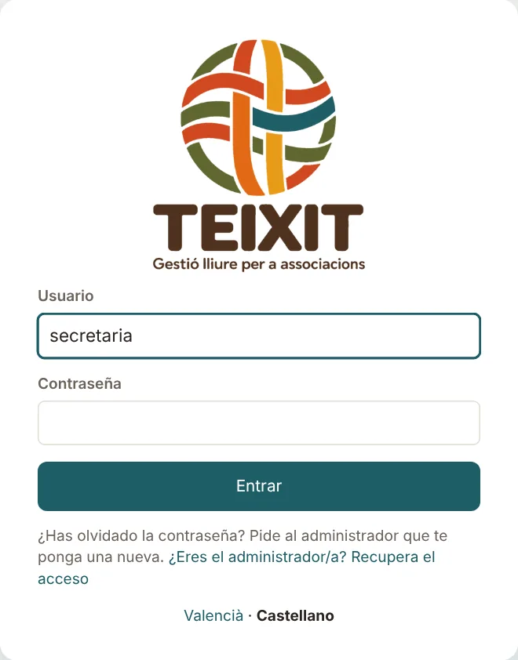

Si olvidas la contraseña, el administrador te puede poner una nueva. Si quien la ha olvidado es el administrador/a, pulsa **Recupera el acceso** (ver el Manual de administración).

### La primera vez

La primera vez que se abre Teixit, el administrador/a elige el tipo de entidad, hace la **configuración inicial** y crea las cuentas (**Manual de administración**). Después, cada persona entra con su usuario y su contraseña.

## 2. La pantalla principal

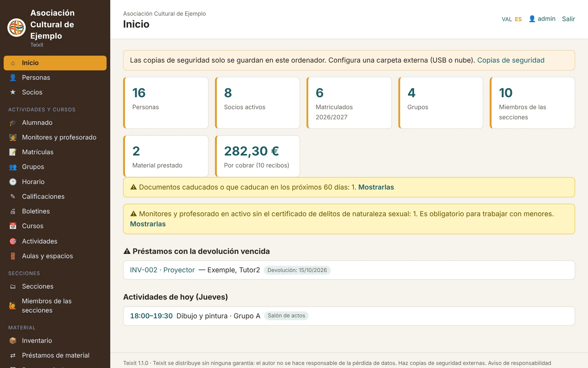

- **Menú lateral** (izquierda): todas las secciones, agrupadas en Actividades y cursos, Secciones (o Equipos, o Comisiones), Material, Economía, la entidad (junta, actas, documentos y comunicados), Documentos y datos (listados, informes e importación) y Administración. Solo aparecen los módulos activos.
- **Arriba a la derecha**: cambio de idioma (`VAL` / `ES`), tu nombre de usuario (para cambiar la contraseña) y **Salir**.
- **Inicio**: un resumen con el número de personas, socios, miembros de las secciones, matriculados en las actividades, material prestado y lo que hay por cobrar. Haz clic en cualquier cifra para ir a la lista.
- **Avisos**: la renovación de la junta, los documentos que caducan, los monitores sin certificado de delitos sexuales, las licencias federativas que caducan (en los clubes), el material prestado con la devolución vencida, las actividades de hoy y los avisos de copias de seguridad.

## 3. Cómo se trabaja con Teixit

Todas las secciones funcionan igual. Si aprendes una, las sabes todas.

### Listados

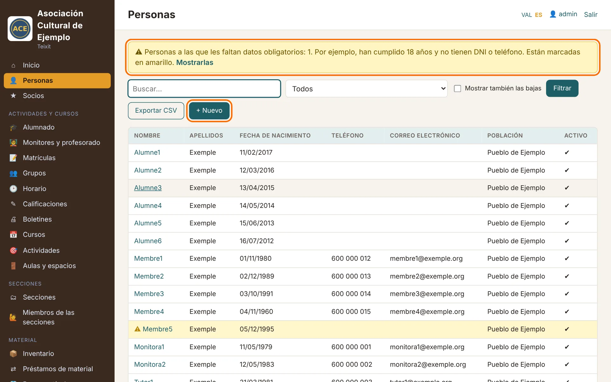

- **Buscar**: escribe un nombre, apellido, teléfono… y pulsa **Filtrar**.
- **Mostrar también las bajas**: por defecto se ocultan las personas inactivas y las bajas.
- **Exportar CSV**: descarga la lista para abrirla con Excel o LibreOffice Calc.
- **+ Nuevo**: crea un elemento nuevo.
- Haz clic en cualquier fila para abrir su **ficha**.

### Fichas

La ficha muestra todos los datos de un elemento y todo lo que está relacionado con él. Por ejemplo, la ficha de una persona muestra si es socia, si forma parte de una sección, si es de la junta, si participa en una actividad, si es monitora o tutora de alguien…

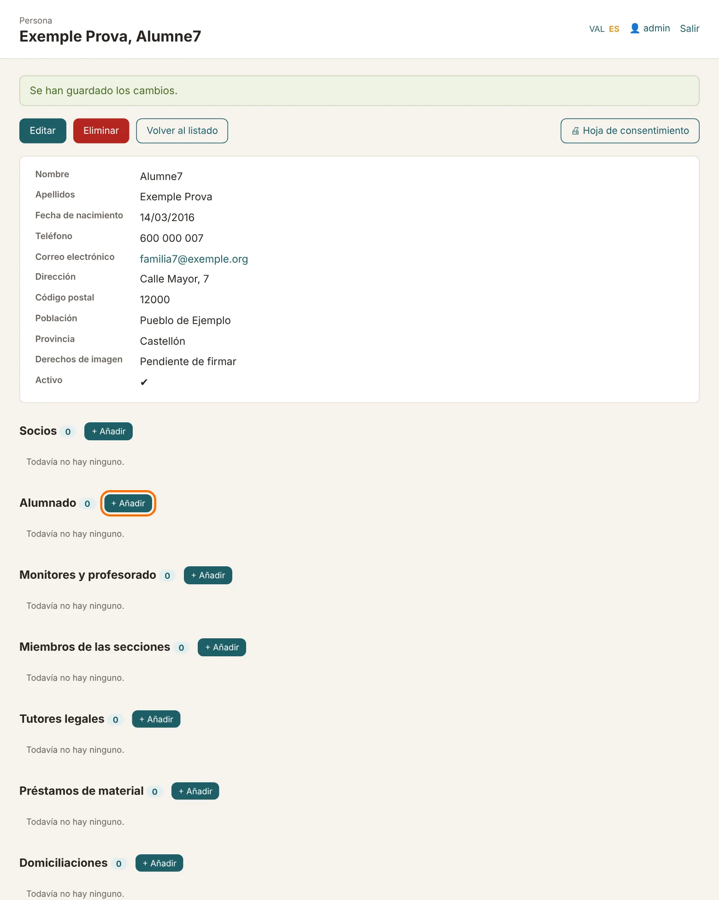

- **Editar**: cambia los datos.
- **Eliminar**: solo se puede si no tiene nada relacionado (ver «Bajas» más abajo).
- **+ Añadir** de cada apartado: crea un elemento **ya vinculado** a esta ficha. Es la manera más rápida de trabajar.

### Formularios

- Los campos con asterisco (*) son obligatorios.
- En los desplegables largos (personas, grupos…) hay una **lupa** encima: escribe en ella para filtrar las opciones.
- Pulsa **Guardar** para guardar o **Cancelar** para volver sin guardar.

### Bajas: por qué no se elimina nada

Teixit no deja eliminar nada que tenga historial (recibos, matrículas, préstamos…), para que no se pierda información. En lugar de eliminar:

- una **persona** que ya no tiene relación con la entidad: edítala y desmarca **Activo**;
- un **socio, miembro de una sección, alumno o monitor**: edítalo, pon el **estado «Baja»** y la **fecha de baja**.

Las bajas desaparecen de los listados, pero se pueden volver a ver marcando **Mostrar también las bajas**.

## 4. Configuración de la entidad

Los datos de la entidad, el tipo de entidad, el logotipo, los módulos que se usan y los avisos del inicio los configura el administrador/a (**Manual de administración**). Si en tu entidad no ves algún apartado de este manual (las actividades, la lotería, la ropa…), seguramente está desactivado.

## 5. Personas

> **Una persona se introduce una sola vez.** Ser socio, miembro de una sección, alumno, monitor, tutor legal o cargo de la junta son *funciones* que se añaden a su ficha. Antes de crear una, **búscala** en el listado por si ya existe.

1. Menú **Personas → + Nuevo**.
2. Rellena los datos obligatorios y el resto que tengas (correo, dirección…):

| Dato | Obligatorio |
|---|---|
| Nombre, apellidos y fecha de nacimiento | Siempre |
| DNI/NIE y teléfono | Solo si la persona es **mayor de edad** (18 años o más) |

3. Deja marcado **Activo**.
4. Pulsa **Guardar**.

Al poner una fecha de nacimiento de mayor de edad, los campos DNI y teléfono pasan a ser obligatorios y aparece el asterisco al lado.

Si la persona es mayor de edad y pagará recibos por el banco (un socio, o el padre o la madre de un alumno), escribe su **IBAN**. Teixit crea la domiciliación (apartado 8.4). También se puede escribir el número de cuenta antiguo de 20 cifras: Teixit lo convierte en IBAN.

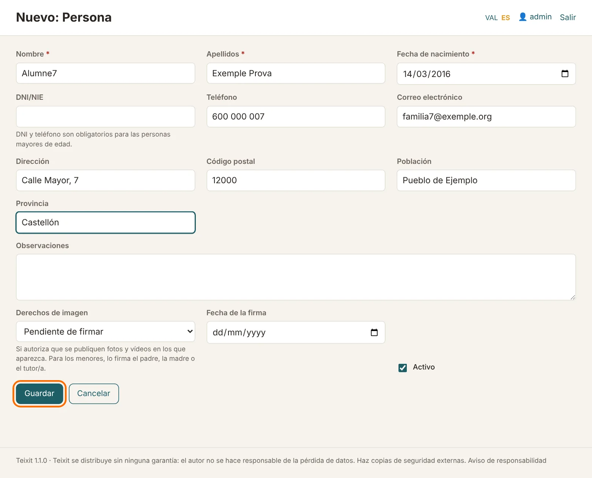

Se abre la **ficha de la persona**, con un apartado para cada función: socios, miembros de las secciones, alumnado, monitores, tutores legales (cuando es tutor de alguien), cargos de la junta, préstamos de material, recibos…

### Cuando un menor cumple 18 años

De los menores no hace falta tener el DNI ni el teléfono. Cuando una persona cumple 18 años y no tiene esos datos, Teixit lo avisa:

- Encima del listado de **Personas** aparece un **aviso amarillo** con el número de personas a las que faltan datos.
- Su fila se marca **en amarillo** con el símbolo ⚠. Si pasas el ratón por encima, dice qué datos faltan.
- En su ficha también aparece el aviso, con un enlace para editarla.

Pulsa **Mostrarlas** (o elige el filtro **Faltan datos obligatorios**) para ver solo esas personas. Abre cada una, pulsa **Editar**, completa el DNI y el teléfono y guarda. El aviso desaparece cuando ya no falta ninguno.

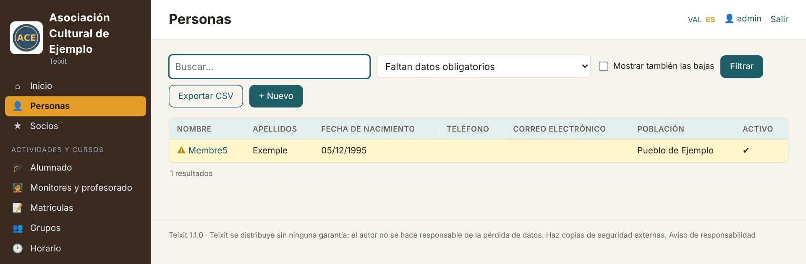

### Derechos de imagen (fotos y vídeos)

Antes de publicar fotos o vídeos en la web o las redes, la entidad debe tener la autorización de cada persona; para los menores, la del padre, la madre o el tutor/a.

1. Abre la ficha de la persona y pulsa **🖨 Hoja de consentimiento**. Sale una hoja A4 con los datos de la persona (y del tutor/a, si es menor), el texto de la autorización y el espacio para firmar.
2. Cuando la devuelvan firmada, edita la persona y, en **Derechos de imagen**, elige **Autoriza fotos y vídeos** o **No autoriza**. Si no pones la **fecha de la firma**, se pone la de hoy.

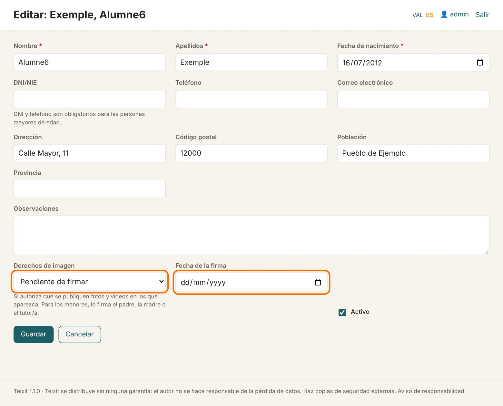

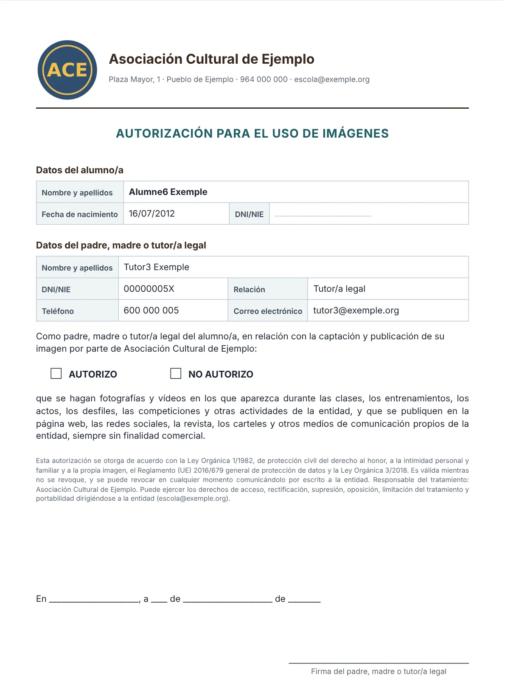

Para repartirlas, en **Listados e informes → Derechos de imagen** puedes imprimir de golpe las hojas de todos los pendientes o las de un grupo (apartado 16). En el listado de **Personas**, el filtro **Alumnos sin consentimiento de imagen firmado** muestra qué participantes en las actividades aún no la han devuelto.

> El texto de la hoja es un modelo. Revísalo con la junta y, si hace falta, añade lo que quieras en **Configuración → Texto adicional de la hoja de consentimiento**.

## 6. Socios

> En una **falla, gaiata u hoguera**, este apartado se llama **Censo**, y los tipos de socio, **categorías del censo**. En un **AMPA**, se llama **Familias asociadas**. Funciona igual.

### Tipos de socio

Cada entidad tiene los tipos de socio que dicen sus estatutos. Teixit trae unos cuantos para empezar, según el tipo de entidad:

| Tipo de entidad | Tipos iniciales |
|---|---|
| Asociación cultural | Ordinario, juvenil, protector, de honor |
| Falla, gaiata u hoguera | Adulto, juvenil, infantil, de honor |
| Club deportivo | Ordinario, deportista, protector, de honor |
| AMPA o AFA | Familia, colaborador |
| Peña de un club | Actividades y cursos, calificaciones |

Se pueden cambiar, añadir otros y darlos de baja: en el listado de socios, pulsa **Tipos de socio** (o **Categorías del censo**).

- **Nombre** y, si se quiere, una **descripción** (por ejemplo, «Mayores de 65 años»).
- **Orden**: en qué lugar sale en los listados y en la hoja de alta.
- **En la hoja de alta**: si quien se hace socio lo puede elegir. Los que nombra la entidad (de honor…) normalmente no van.

Un tipo que ya tienen algunos socios o que tiene tarifa no se puede eliminar: se pone de **baja** y deja de aparecer en los socios nuevos.

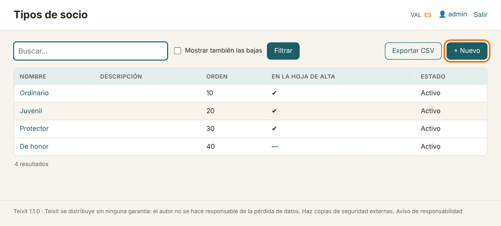

### Alta de un socio

1. Busca o da de alta la **persona** (apartado 5).
2. En su ficha, en el apartado **Socios**, pulsa **+ Añadir**.
3. Escribe el **número de socio**, elige el **tipo** y comprueba la **fecha de alta**.
4. Si las cuotas se cobrarán por el banco, escribe el **IBAN** (si todavía no lo tiene en su ficha de persona).
5. Pulsa **Guardar**.

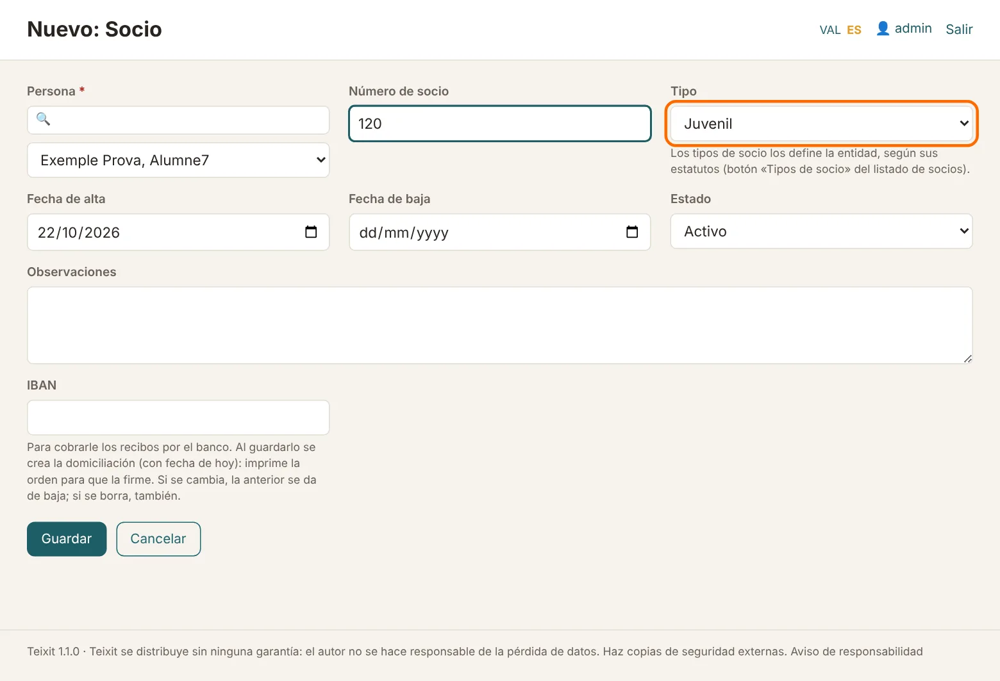

### Listado de socios

El menú **Socios** muestra todos los socios activos. Puedes buscar por el nombre o por el número y exportar la lista a CSV.

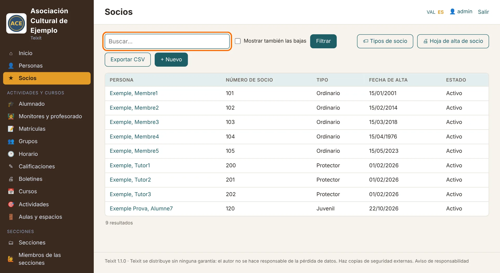

**Hoja de alta de socio.** En el listado de socios, **Hoja de alta de socio** hace una hoja en blanco para quien quiere hacerse socio: datos personales, tipo de socio (con la cuota, si hay tarifas), forma de pago, orden de domiciliación SEPA, autorización de imagen, firma y la información de protección de datos. Los textos de arriba y del pie se pueden cambiar en **Configuración**.

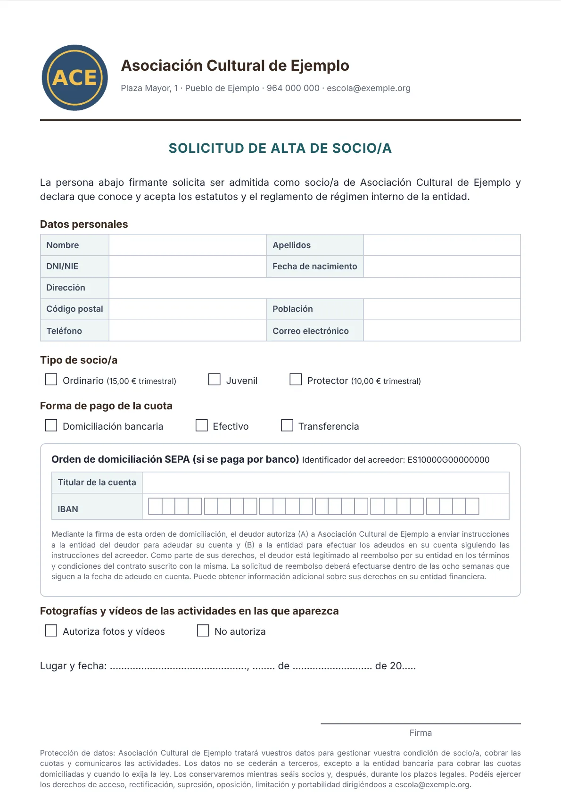

### Baja de un socio

1. Abre el socio y pulsa **Editar**.
2. Cambia el **estado** a **Baja** y pon la **fecha de baja**.
3. Pulsa **Guardar**.

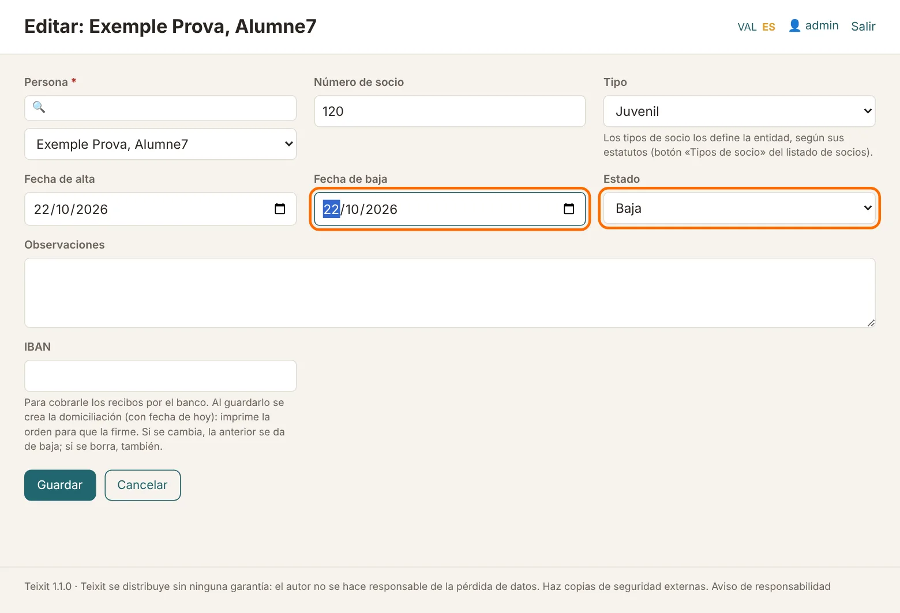

El socio desaparece del listado, pero se conserva con su historial.

## 7. Junta directiva y actas

### 7.1 La junta

Menú **Junta directiva** (en la sección del menú que lleva el nombre del tipo de entidad: Asociación, Comisión, Club o AMPA). Muestra la junta actual y las anteriores. Para poner un cargo, pulsa **+ Añade un cargo**: elige la persona, el cargo (presidente/a, vicepresidente/a, secretario/a, tesorero/a, vocal…), una descripción si hace falta («Vocal de fiestas») y la fecha de inicio. La fecha de fin se deja vacía mientras el cargo está vigente.

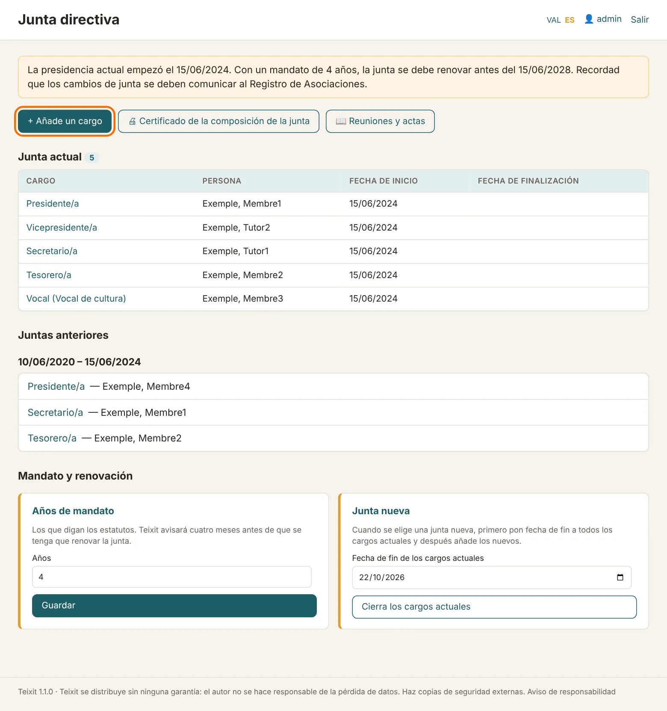

- **Años de mandato:** pon los que digan los estatutos. Teixit avisará en el inicio cuatro meses antes de que haya que renovar la junta.
- **Junta nueva:** cuando se elige una junta nueva, pulsa **Cierra los cargos actuales** con la fecha de la elección y después añade los cargos nuevos. Los anteriores quedan en el historial. Recordad que los cambios de junta se deben comunicar al Registro de Asociaciones.
- **Certificado de la composición de la junta:** para el banco, el registro o una subvención.

Los **certificados** (de socio, de miembro de una sección, de matrícula y de la junta) y las **actas** los firma la secretaría con el visto bueno de la presidencia de la junta actual. Si hace falta que los firme otra persona, se pone en **Configuración**.

### 7.2 Reuniones y actas

Menú **Reuniones y actas → + Nuevo**. Elige si es una reunión de la **junta** o una **asamblea** (ordinaria o extraordinaria), y pon la fecha, la hora (en las asambleas, también la de segunda convocatoria), el lugar y el **orden del día**, un punto por línea.

En la ficha de la reunión hay tres documentos para imprimir:

1. **Convocatoria**, con el orden del día numerado.
2. **Acta**. Después de la reunión, edítala y completa los **asistentes**, el **desarrollo** y los **acuerdos** (uno por línea), y márcala como celebrada. En las reuniones de junta, si no pones los asistentes, el acta pone la junta actual.
3. **Certificado de un acuerdo**: elige el acuerdo y Teixit hace el certificado que suelen pedir el banco o las administraciones.

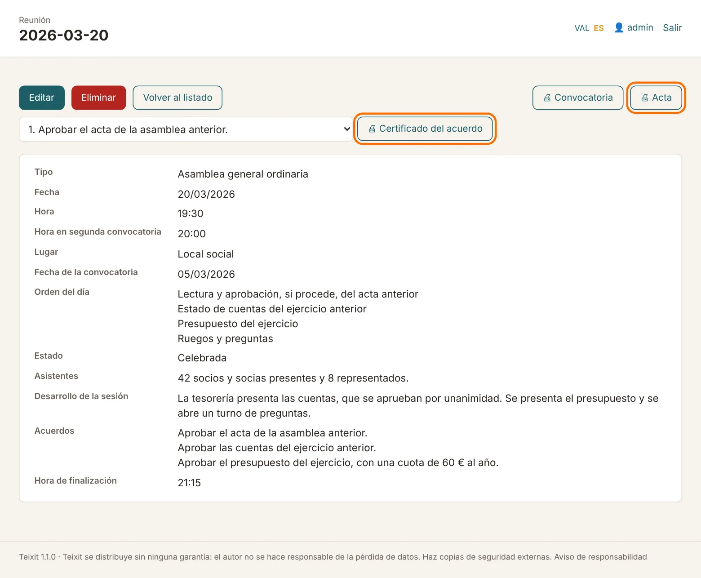

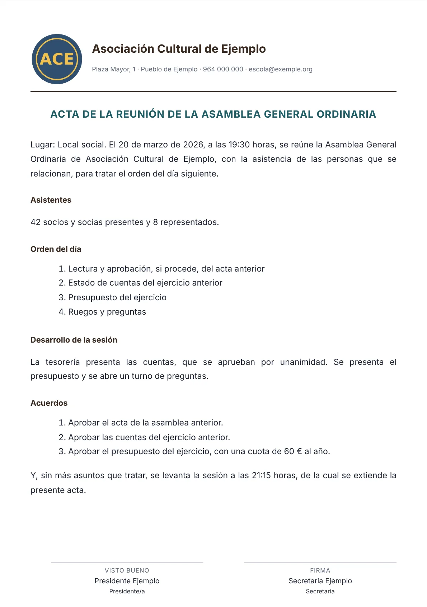

## 8. Economía: cuotas, actividades y recibos

El apartado **Economía** del menú lleva el dinero de la entidad: las cuotas de los socios, la matrícula y las cuotas de las actividades, los recibos, las remesas al banco y la lotería. **Resumen económico** muestra lo que hay por cobrar, lo que se ha cobrado este año, los recibos devueltos por el banco y quién debe dinero.

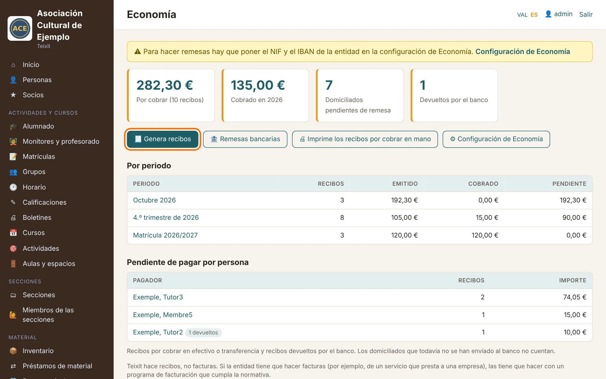

> Teixit hace **recibos**, no facturas. Si la entidad tiene que hacer una factura (por ejemplo, de un servicio que presta a una empresa), la debe hacer con un programa de facturación que cumpla la normativa, o la gestoría.

### 8.1 Tarifas: el precio de cada cosa

Menú **Economía → Tarifas**. Cada tarifa tiene un nombre (el que aparecerá en el recibo), un tipo, una periodicidad y un importe:

- **Cuota de socio**: anual, semestral, trimestral o mensual. Se puede hacer una para cada **tipo de socio** (apartado 6). Si se deja una sin tipo, vale para los tipos que no tengan una propia. Los socios de un tipo sin tarifa (por ejemplo, los de honor) no pagan.
- **Matrícula**: una sola vez por curso y alumno, si las actividades tienen matrícula.
- **Actividades**: mensual, trimestral o anual. Si se pone una **actividad**, se cobra a cada alumno inscrito en algún grupo de esa actividad. Si no, se cobra una vez por alumno (una cuota fija).

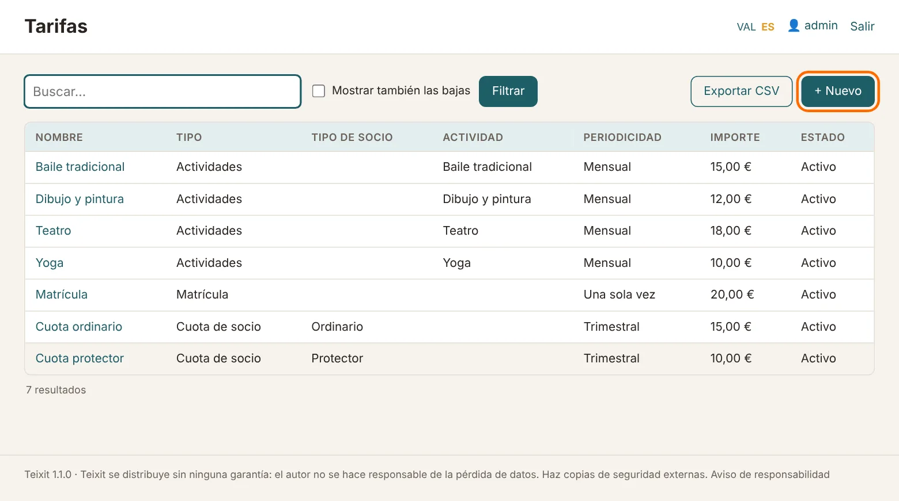

### 8.2 Datos del banco y descuentos

Los datos bancarios de la entidad y los descuentos de las actividades los configura el administrador/a (**Manual de administración**). En la ficha de cada alumno sí que puedes poner un **descuento propio** (familia numerosa, beca…) y **quién paga** las actividades, si no es el tutor principal.

### 8.3 Generar los recibos

Menú **Economía → Genera recibos**. Hay dos opciones:

- **Cuotas de socio**: elige el año y el periodo (por ejemplo, el 1.er trimestre). Se hace un recibo para cada socio de alta en ese periodo.
- **Actividades y cursos**: elige el curso y el periodo: la **matrícula**, un **mes**, una **evaluación** o el **curso completo**. Se hace **un recibo por familia**: si el mismo padre o madre paga dos hermanos, va todo en un recibo, con una línea por actividad y los descuentos.

Pulsa **Previsualiza**: Teixit muestra quién pagará, el detalle y el importe, y avisa de los alumnos que no tienen quién pague. Si está bien, pulsa **Crea**. Si vuelves a generar el mismo periodo, no se duplica nada: los que ya existen aparecen como «Ya generado».

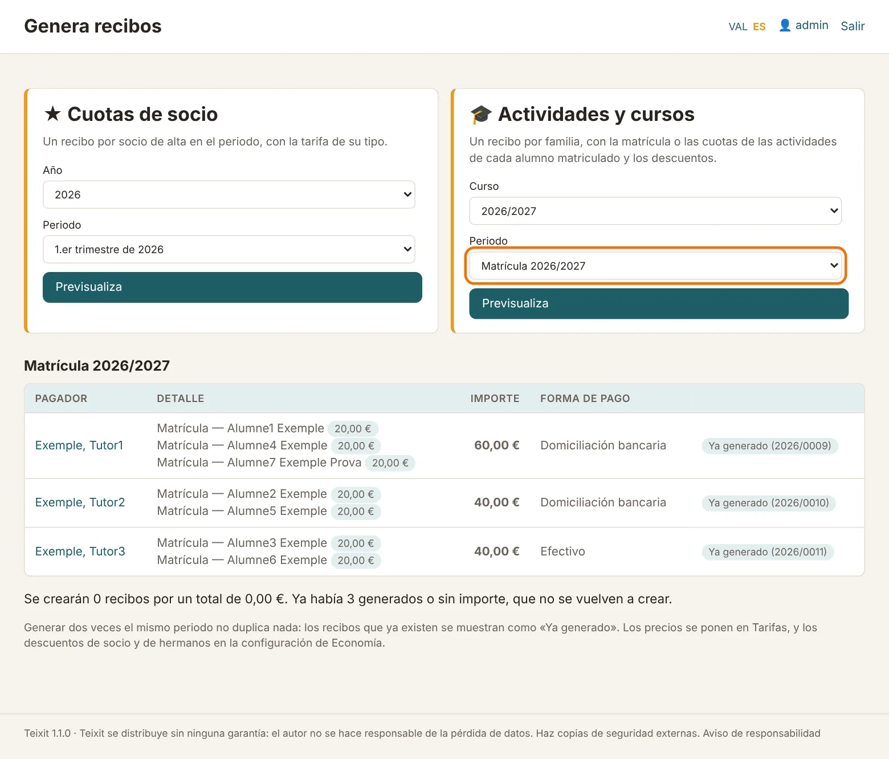

Los recibos de quien tiene una **domiciliación** activa se cobrarán por el banco; los otros, en **efectivo**. También se puede hacer un recibo a mano con **Recibos → + Nuevo** (por ejemplo, un donativo o la venta de una camiseta).

### 8.4 Domiciliaciones bancarias

Para cobrar un recibo por el banco, quien paga debe haber firmado la **orden de domiciliación** (el mandato SEPA). La manera más sencilla es escribir el **IBAN en la ficha de la persona o del socio**: al guardar, Teixit crea la domiciliación con la fecha de hoy. Si después se cambia el IBAN, la anterior se da de baja y se crea una nueva (se debe volver a firmar); si se borra, se da de baja. También se puede hacer desde **Economía → Domiciliaciones → + Nuevo**, donde se puede poner la fecha de firma y un titular de la cuenta distinto. Teixit comprueba que el IBAN es correcto y le pone una referencia. Solo se puede domiciliar a nombre de un mayor de edad. En los listados, el IBAN solo se ve en parte.

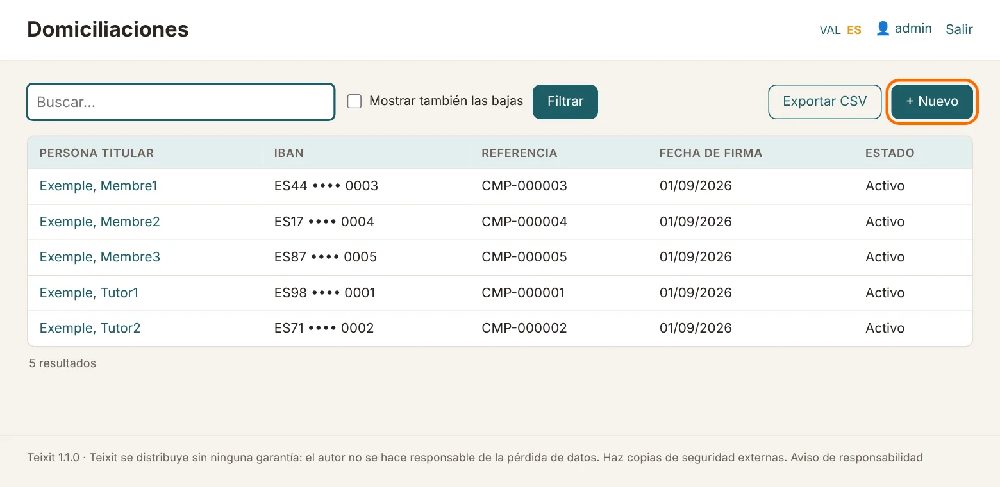

En la ficha de la domiciliación, **Imprime la orden de domiciliación** hace la hoja para firmar. La entidad debe guardarla firmada mientras se cobre y 14 meses más.

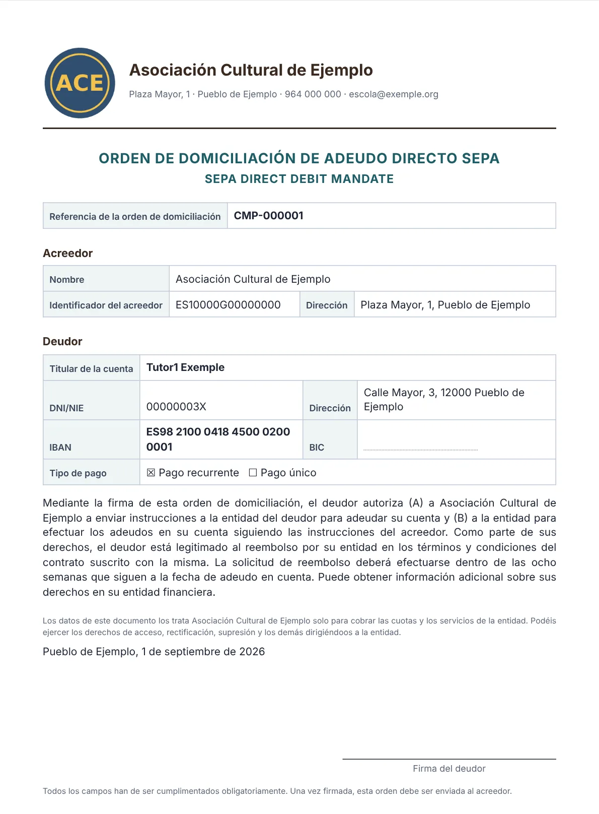

### 8.5 Remesas: cobrar por el banco

Menú **Economía → Remesas bancarias**. Aparecen los recibos domiciliados pendientes de cobrar (también los que el banco ha devuelto). Elígelos, pon la **fecha de cobro** (muchos bancos piden al menos dos días hábiles) y pulsa **Prepara la remesa**.

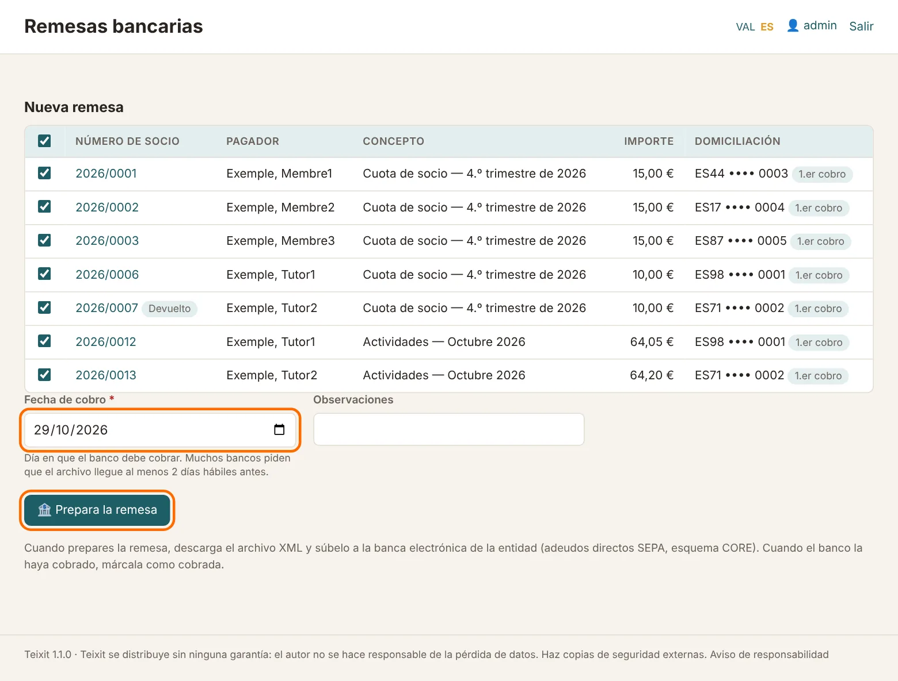

Después:

1. Pulsa **Descarga el archivo para el banco (XML)**.
2. Entra en la banca electrónica de la entidad y súbelo al apartado de adeudos directos SEPA (esquema CORE). Si el banco rechaza el archivo, cambia el **formato** en la configuración de Economía y vuelve a descargarlo.
3. Cuando el banco la haya cobrado, pulsa **Márcala como cobrada**: todos los recibos quedan pagados.

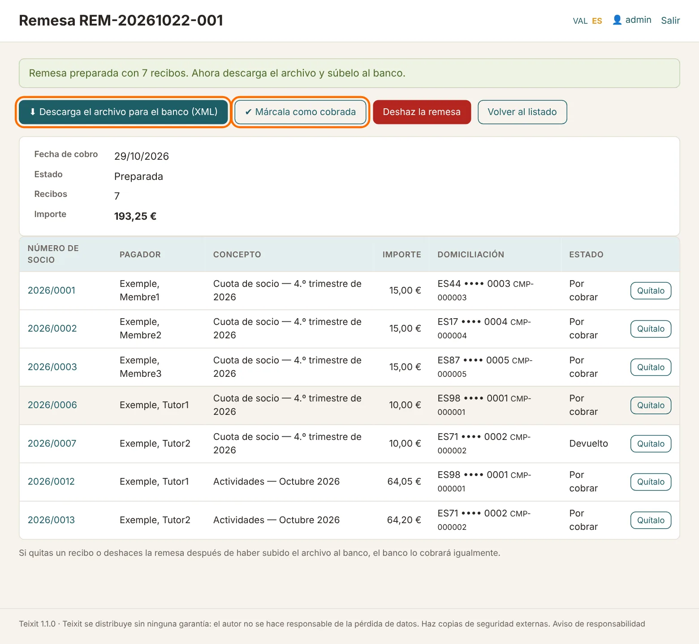

Si el banco **devuelve** un recibo, ábrelo y pulsa **Devuelto por el banco**. Volverá a estar por cobrar: lo puedes cobrar en mano o ponerlo en la remesa siguiente. Mientras una remesa no se ha subido al banco, se le puede quitar un recibo o deshacerla.

### 8.6 Cobrar en mano e imprimir recibos

Abre el recibo, elige cómo se ha pagado (**efectivo** o **transferencia**) y la fecha, y pulsa **Pagado**. Con **Imprime el recibo** se hace el recibo con el logotipo; si está pagado, lleva el sello «PAGADO». Desde el **Resumen económico**, **Imprime los recibos por cobrar en mano** los hace todos de golpe, dos por hoja.

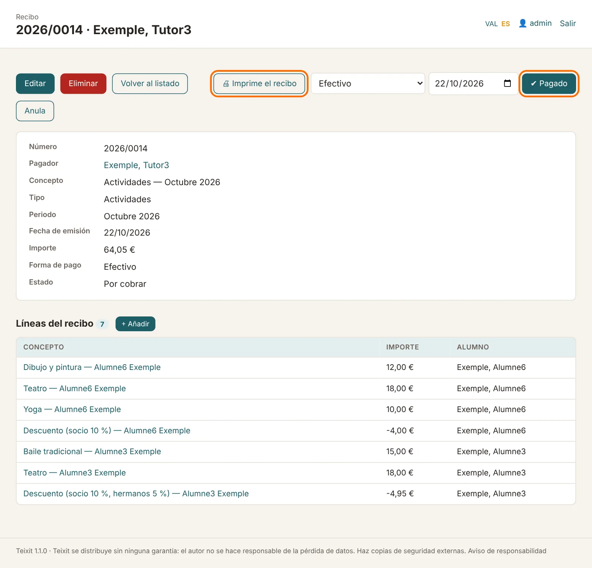

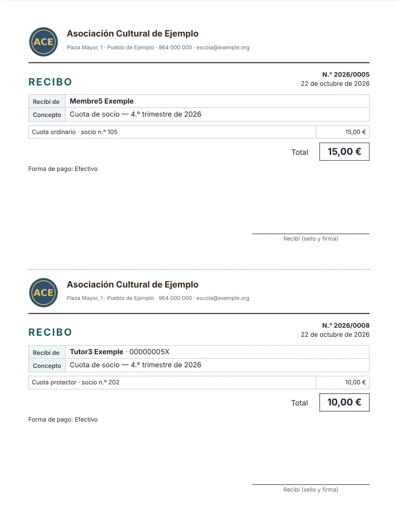

En el listado de **Recibos**, los filtros muestran los que están por cobrar, los devueltos, los que hay que cobrar en mano o los domiciliados que todavía no están en ninguna remesa. Abajo se ve el total. En la ficha de cada persona están sus recibos y su domiciliación.

### 8.7 Libro de caja

Menú **Economía → Libro de caja**. Muestra todos los ingresos y gastos del año, con el saldo después de cada movimiento. Muchas cosas entran solas:

- los recibos cobrados en efectivo (en la caja) o por transferencia (en el banco);
- las remesas cobradas, en una sola línea, como aparecen en el banco;
- el dinero de la lotería que entrega cada talonario.

El resto (facturas, subvenciones, la cuota de la federación…) se apunta con **+ Nuevo movimiento**: fecha, ingreso o gasto, banco o caja, categoría, concepto e importe. Además de las categorías generales, cada tipo de entidad tiene las suyas: el **monumento y el casal** en las fallas, los **arbitrajes y las licencias** en los clubes y las **actividades para el alumnado** en las AMPA. Al final de la página se pone el **saldo inicial** del 1 de enero del banco y de la caja, para que los saldos sean los reales. Se puede ver solo el banco o solo la caja, imprimirlo y exportarlo a CSV. El resumen **por categorías** sirve para presentar las cuentas en la asamblea y para la memoria.

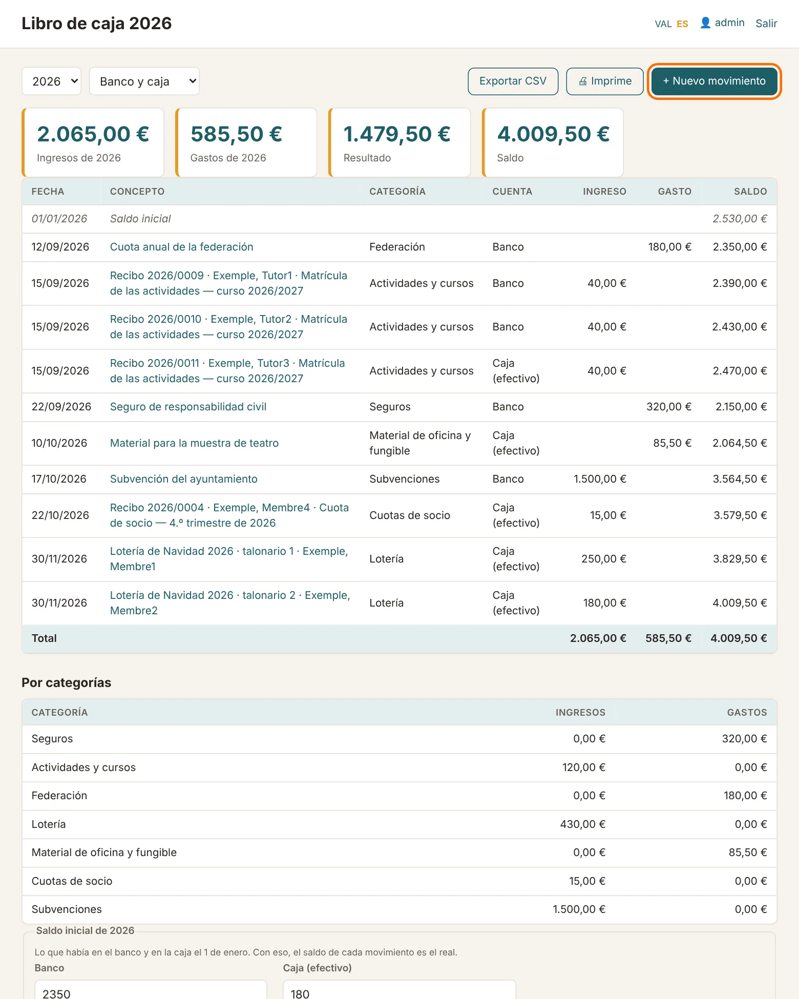

## 9. Lotería

Menú **Economía → Lotería → + Nuevo**. Escribe el nombre del sorteo (por ejemplo, «Lotería de Navidad 2026»), la fecha, los **números**, el **precio** de cada participación, el importe que **juega** (el resto es el donativo para la entidad) y cuántas participaciones lleva cada talonario. En la ficha, **Talonarios y liquidación** abre el resumen.

### Repartir los talonarios

Elige la persona y cuántos talonarios se lleva, y pulsa **Reparte talonarios**. Teixit los numera seguidos: el talonario 1 lleva las participaciones 0001–0050, el 2 las 0051–0100, etc.

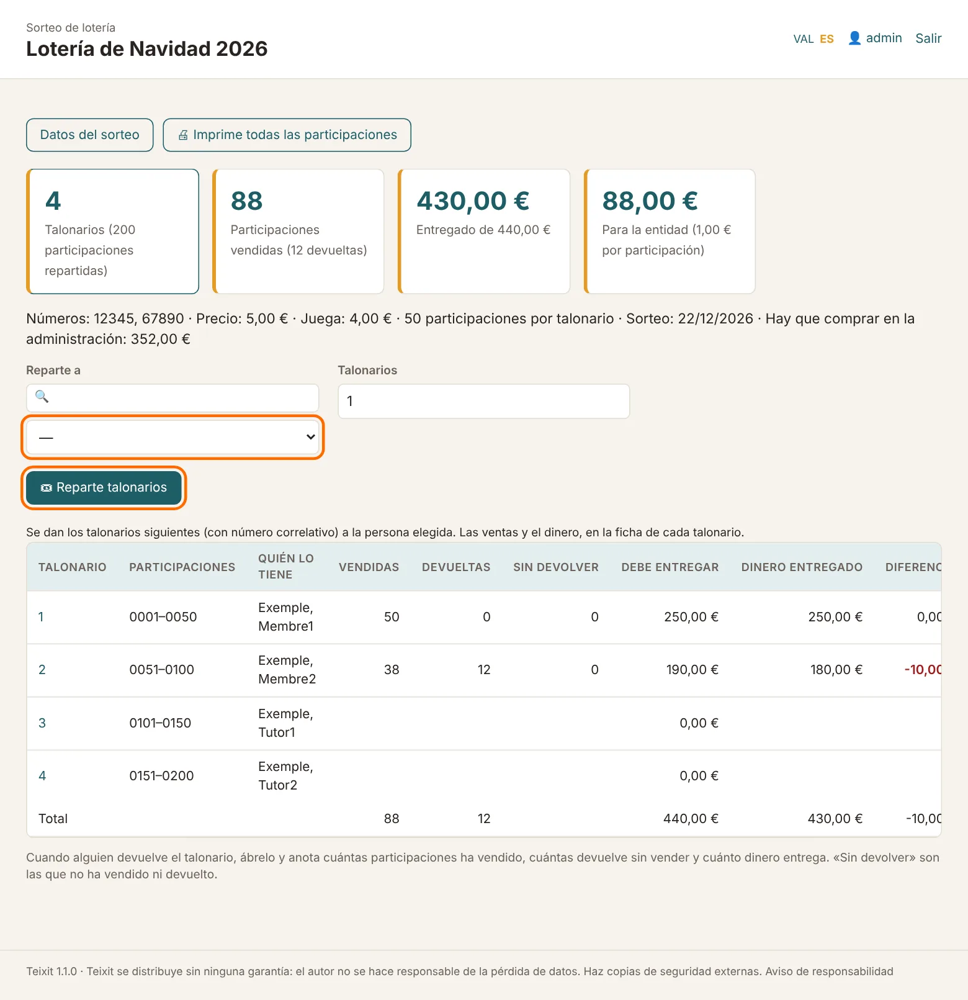

### Imprimir las participaciones

En la ficha de cada talonario, **Imprime las participaciones** hace sus 50 participaciones (8 por hoja), con el logotipo, los números, el precio y el número de participación. Desde el resumen se pueden imprimir todas de golpe. El texto legal del pie se cambia en la ficha del sorteo.

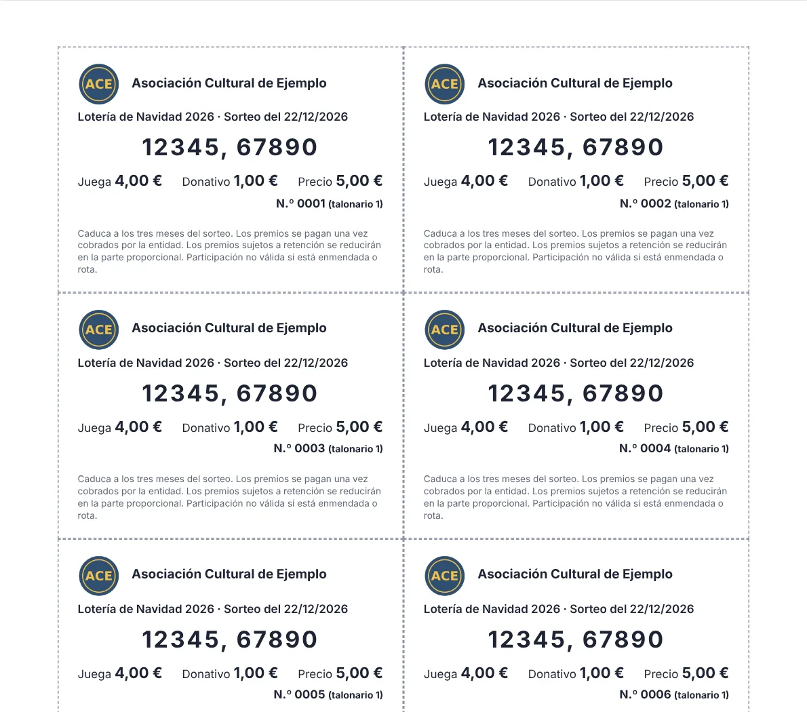

### Liquidar

Cuando alguien devuelve el talonario, ábrelo y apunta cuántas participaciones ha **vendido**, cuántas **devuelve** sin vender y cuánto **dinero entrega**. El resumen muestra lo que falta por entregar (en rojo), cuánto hay que comprar en la administración de lotería y lo que queda para la entidad.

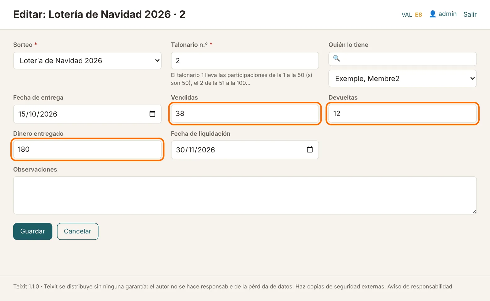

## 10. Secciones, equipos o comisiones

Una **sección** es un grupo estable de la entidad con sus miembros: el grupo de teatro, el de baile o los jóvenes de una asociación; la sección de playback o la comisión infantil de una falla. En un **club deportivo** se llaman **equipos** y en un **AMPA**, **comisiones** (comedor, fiestas, extraescolares…).

### Crear una sección

Menú **Secciones → + Nuevo**: el nombre, el tipo si quieres (en los clubes, la **categoría**: benjamín, alevín, infantil, cadete, juvenil, sénior…), una descripción y la fecha de creación.

### Añadir a una persona

1. Busca o da de alta la **persona** (apartado 5).
2. En su ficha, en el apartado **Miembros de las secciones**, pulsa **+ Añadir** (o hazlo desde la ficha de la sección).
3. Elige la **sección**, escribe la **función o especialidad** si quieres (vestuario, escenografía…; en los clubes, la **posición**) y elige su papel: **miembro**, **responsable** o **ayudante**. En los clubes, estos tres se llaman **deportista**, **entrenador/a** y **segundo entrenador/a o delegado/a**.
4. Pulsa **Guardar**.

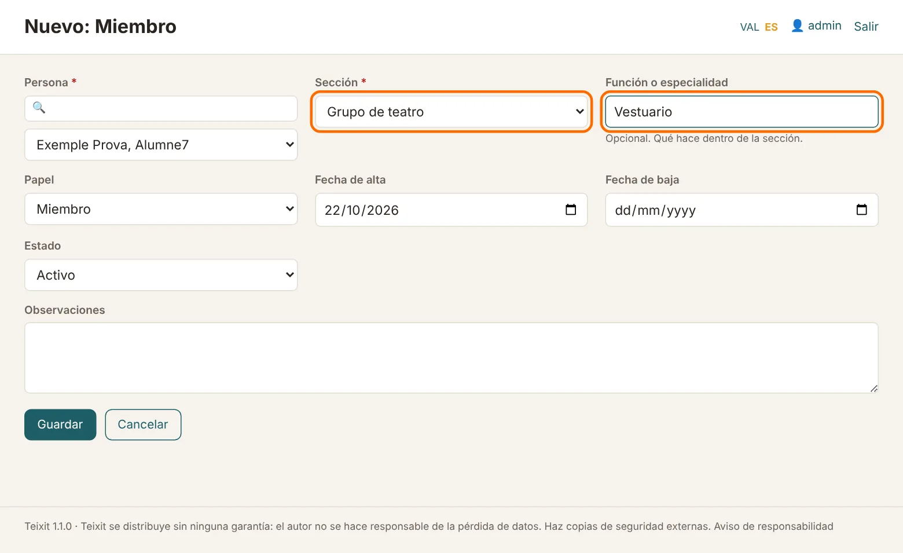

Una persona puede ser de varias secciones: repítelo para cada una.

### Ficha de la sección

Menú **Secciones** → abre la sección. Muestra todos sus miembros con la función y el papel de cada uno. Desde aquí también puedes añadir miembros con **+ Añadir**.

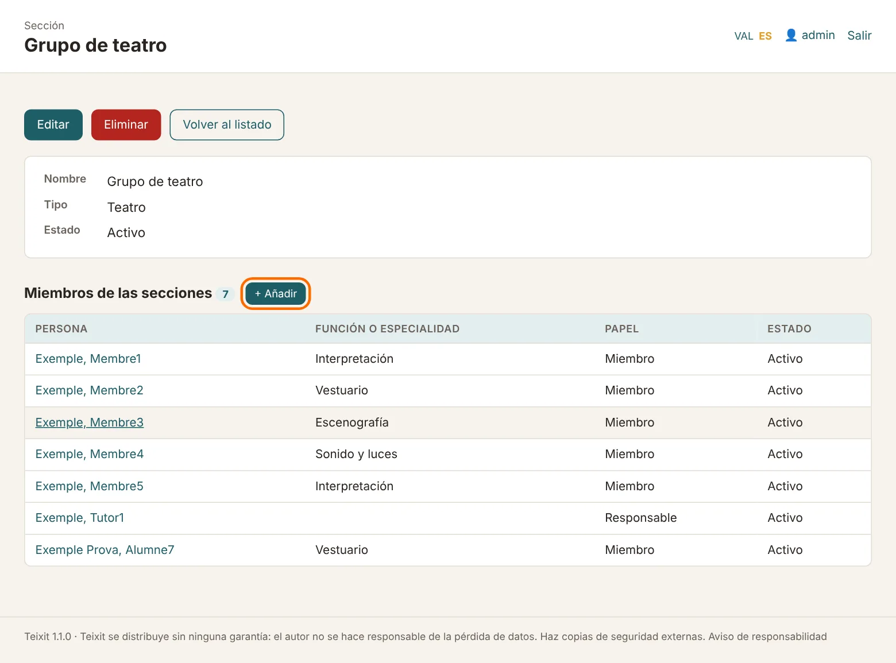

### Licencias federativas (clubes deportivos)

En un club, cada miembro de un equipo tiene, además, el **número de licencia federativa** y la **fecha de caducidad**. Teixit avisa en el inicio de las licencias caducadas o que caducan en los próximos 30 días, y marca la fila del miembro. En el listado de **Deportistas y técnicos** están los filtros **Licencias caducadas o que caducan en 30 días** y **Deportistas sin licencia**, para preparar la tramitación con la federación.

## 11. Actividades y cursos

Este módulo sirve para las actividades con inscripción y horario: los **talleres y cursos** de una asociación, la **escuela deportiva** de un club o las **extraescolares** de un AMPA. Está desactivado al instalar una falla o un club; se activa en **Módulos y avisos**.

Antes de inscribir a nadie hay que tener el curso preparado. Orden recomendado: **curso → actividades y aulas → monitores → grupos → horarios**.

### 11.1 El curso

1. Menú **Cursos → + Nuevo**.
2. Nombre (por ejemplo `2026/2027`), fecha de inicio y de finalización.
3. Marca **Curso actual**. Solo puede haber uno.
4. Pulsa **Guardar**. Se abre la ficha del curso.

Si la entidad usa las **calificaciones** (apartado 12), en la ficha del curso crea también los **periodos de evaluación** (`1.er trimestre`, `2.º trimestre`…), con el orden 1, 2, 3.

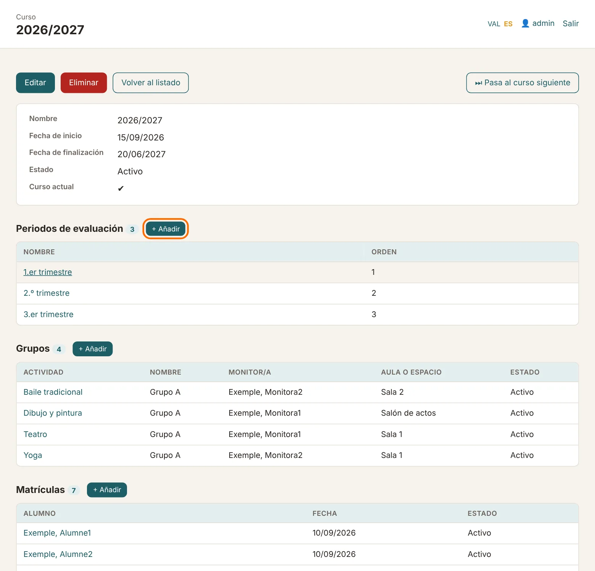

### 11.2 Actividades y aulas

- Menú **Actividades → + Nuevo**: el nombre (Teatro, Robótica, Iniciación…) y, si quieres, un tipo (taller, curso, deporte…).
- Menú **Aulas y espacios → + Nuevo**: nombre (Sala 1, Pista 2, Gimnasio…) y capacidad.

Solo hay que crearlas una vez: se reutilizan cada curso.

### 11.3 Monitores y profesorado

Un monitor es una **persona** con ficha de monitor:

1. Da de alta la persona (apartado 5) o búscala si ya existe.
2. En su ficha, en el apartado **Monitores y profesorado**, pulsa **+ Añadir**.
3. Comprueba la fecha de alta y pulsa **Guardar**.

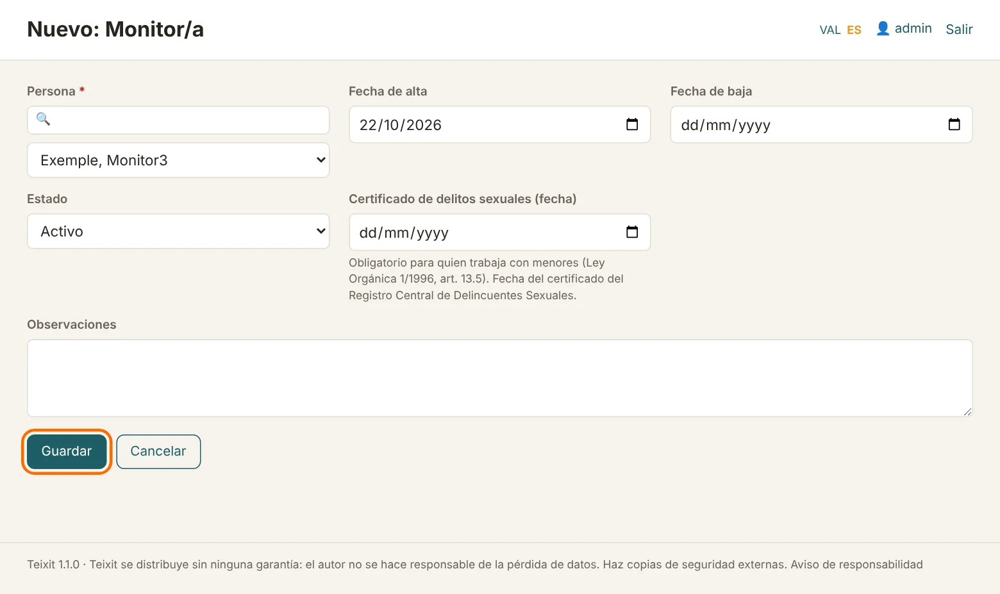

**Certificado de delitos de naturaleza sexual.** Es obligatorio para todo el que trabaja con menores, también los voluntarios. En la ficha de monitor, pon su **fecha**. Si falta el de algún monitor en activo, Teixit lo avisa en el inicio y el listado tiene el filtro **Sin certificado de delitos sexuales**.

### 11.4 Grupos y horarios

Un **grupo** es una actividad de un curso con un monitor: por ejemplo *Teatro · Grupo A*.

1. Menú **Grupos → + Nuevo**.
2. Elige el **curso**, la **actividad**, escribe el **nombre** del grupo y elige el **monitor** y el **aula o espacio**.
3. Pulsa **Guardar**. Se abre la ficha del grupo.

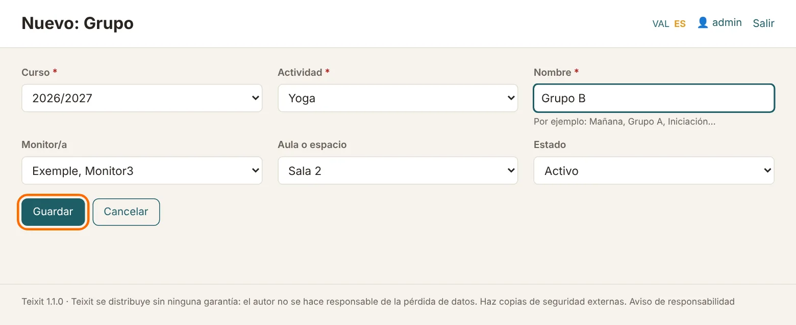

4. En el apartado **Horario**, pulsa **+ Añadir**, elige el **día** y las horas de inicio y de fin, y pulsa **Guardar**. Repítelo si el grupo se reúne más de un día.

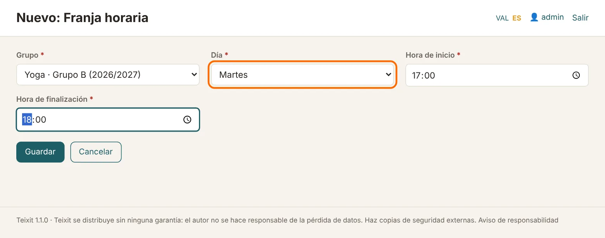

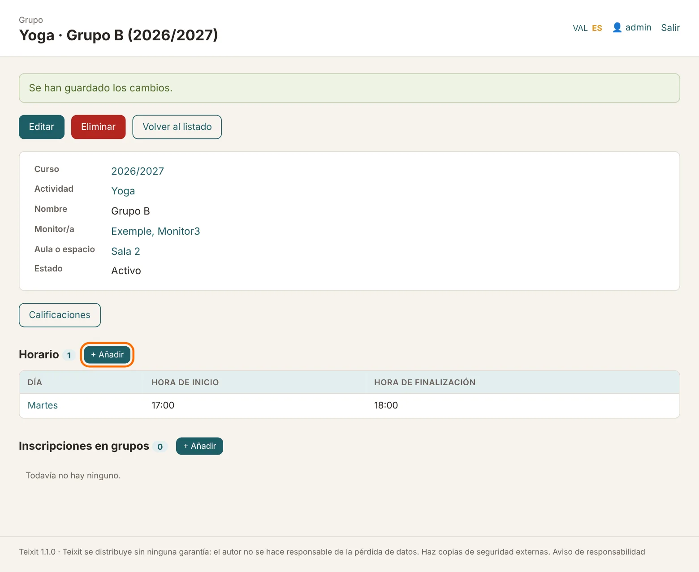

### 11.5 Horario general

El menú **Horario** muestra todas las actividades de la semana. Puedes filtrar por monitor o por aula para imprimir el horario de cada uno.

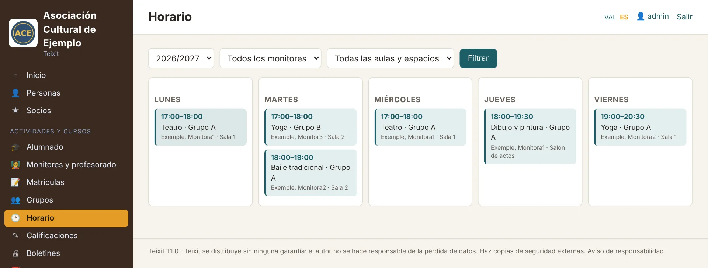

### 11.6 Inscribir a un alumno (paso a paso)

Ejemplo completo: una niña nueva que se apunta a dos actividades. El tutor legal (la madre o el padre) también debe estar dado de alta como persona.

**Paso 1. La persona.** Da de alta al alumno como **persona** (apartado 5). Si el tutor legal todavía no está dado de alta, dalo de alta también.

**Paso 2. La ficha de alumno.** En la ficha de la persona, en el apartado **Alumnado**, pulsa **+ Añadir**. La persona ya viene elegida: comprueba la **fecha de alta** y pulsa **Guardar**.

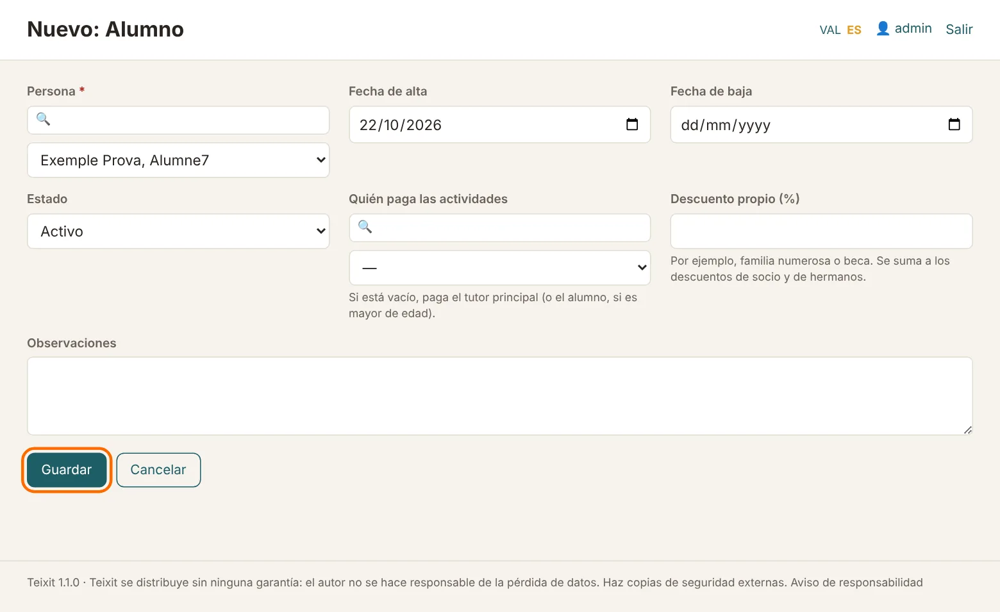

**Paso 3. El tutor legal.** En la ficha del alumno, en el apartado **Tutores legales**, pulsa **+ Añadir**. Elige al padre, la madre o el tutor (escribe el nombre en la lupa), la **relación** y marca **Principal** si es el contacto principal. Pulsa **Guardar** y repítelo si hay más de un tutor.

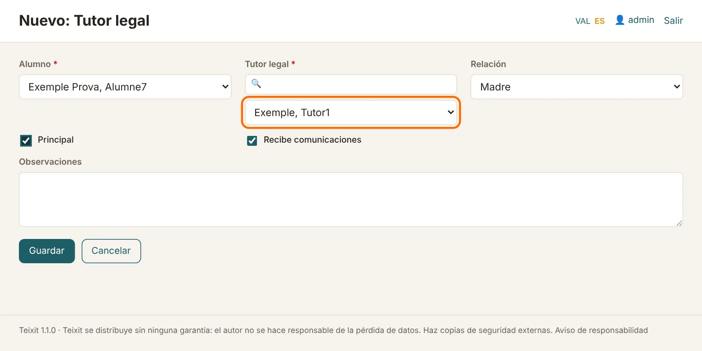

> Hermanos: los dos alumnos pueden tener el mismo tutor. No hace falta darlo de alta dos veces.

**Paso 4. La matrícula del curso.** En la ficha del alumno, en el apartado **Matrículas**, pulsa **+ Añadir**, comprueba que el **curso** es el actual y pulsa **Guardar**.

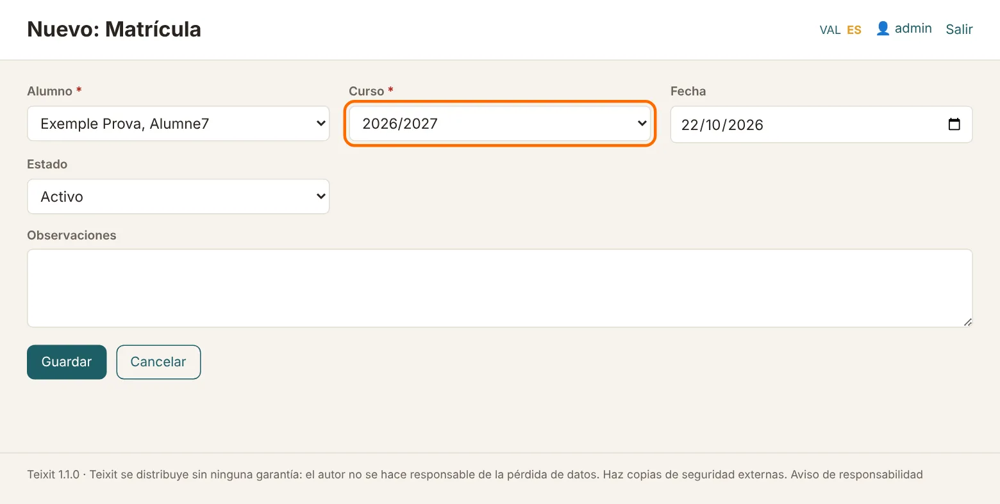

**Paso 5. Los grupos.** En la ficha de la matrícula, en el apartado **Inscripciones en grupos**, pulsa **+ Añadir**, elige el **grupo** y pulsa **Guardar**. Repítelo para cada actividad.

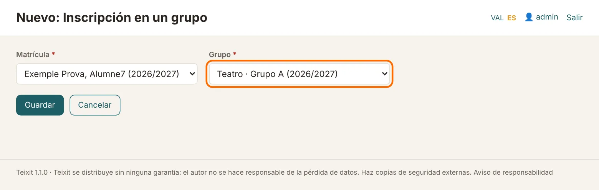

La ficha del alumno muestra el resumen del curso: grupos, monitores y horario (y las notas, si la entidad usa las calificaciones), los tutores legales y las matrículas de todos los cursos.

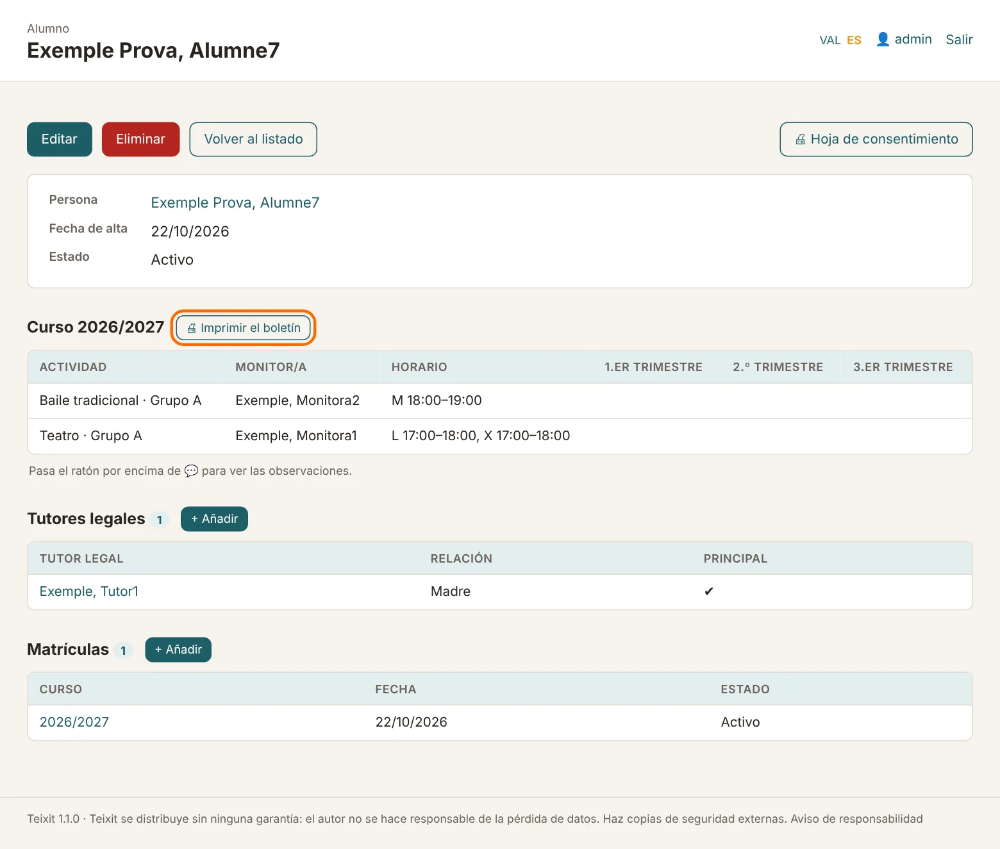

Cuando un alumno deja las actividades, edita su ficha de alumno y pon el estado **Baja** y la **fecha de baja**. Si además ya no es nada de la entidad, desmarca **Activo** en su ficha de persona.

### 11.7 Pasar al curso siguiente

Cuando se acerca el curso nuevo no hace falta crearlo todo desde cero:

1. Menú **Cursos**, abre el curso que acaba y pulsa **⏭ Pasa al curso siguiente**.
2. Comprueba el **nombre** y las **fechas** del curso nuevo (Teixit los propone: un año más).
3. Elige qué se copia: los **grupos** con el monitor y el aula, el **horario** y, si los hay, los **periodos de evaluación**. Si quieres, también puedes **matricular ya a los alumnos que continúan** (sin grupos).
4. Deja marcado **Marca el curso nuevo como curso actual** y, si quieres, **Cierra** el curso anterior.
5. Pulsa **Crea el curso nuevo**.

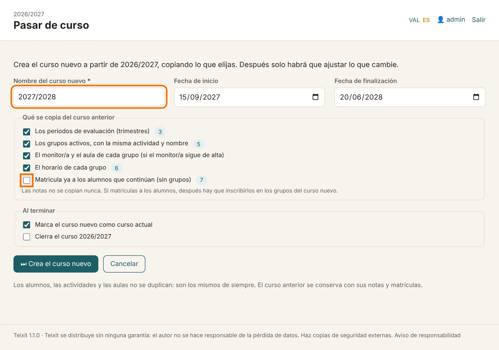

Después solo hay que ajustar lo que cambie (un grupo nuevo, otro monitor…) e inscribir a los alumnos en los grupos. El curso anterior se conserva entero.

## 12. Calificaciones y boletines

Este módulo es para las entidades que evalúan las actividades (una escuela de danza, de idiomas o de música de una asociación). Solo está activo al instalar una asociación cultural, y necesita **Actividades y cursos**.

### Introducir las notas

1. Menú **Calificaciones**.
2. Elige el **grupo** y la **evaluación** (1.er trimestre, 2.º trimestre…).
3. Escribe la nota de cada alumno. Es texto libre: `7`, `8,5`, `Notable`, `Apto`…
4. Si el monitor ha pasado observaciones, escríbelas en **Observaciones académicas**. Salen en el boletín.
5. Pulsa **Guardar**.

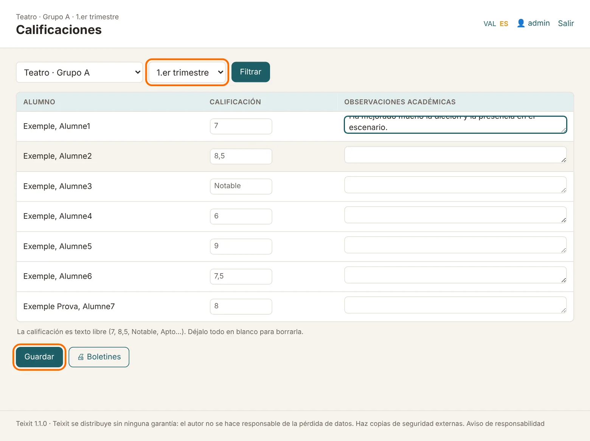

Para borrar una nota, deja en blanco la nota y las observaciones y guarda.

### Boletines

1. Menú **Boletines** (o el botón **Boletines** de la página de calificaciones, o **Imprimir el boletín** de la ficha de un alumno).
2. Elige la **evaluación**. El boletín muestra las notas de esta evaluación y de las anteriores.
3. Elige **de quién**: todo el alumnado matriculado, el alumnado de un grupo o un solo alumno.
4. Si quieres, escribe un **texto al pie** (por ejemplo, la fecha de la muestra de final de trimestre). Se recuerda para la próxima vez.
5. Pulsa **Preparar los boletines**: se abre una hoja A4 por alumno. Pulsa **Imprimir el boletín** (arriba del todo).

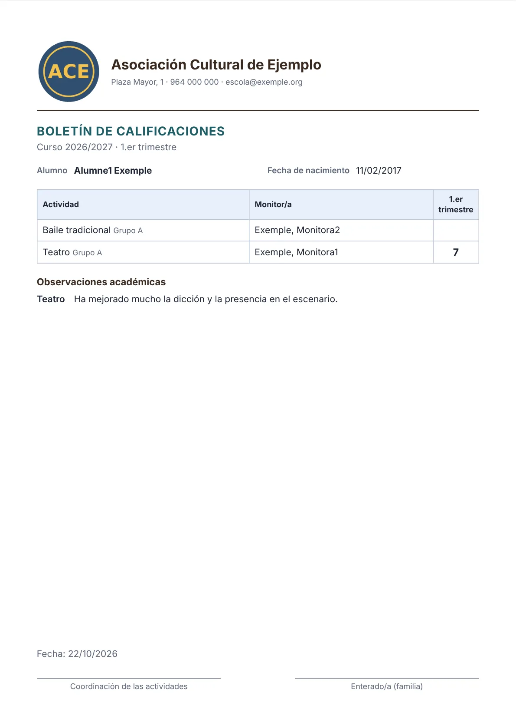

> Para guardarlos en PDF (para enviarlos por correo), elige **Microsoft Print to PDF** como impresora.

## 13. Inventario y ropa

### Alta de material

1. Menú **Inventario → + Nuevo**.
2. Rellena el **número de inventario** y el **tipo** (obligatorios: carpa, equipo de sonido, porterías…) y el resto de datos: marca, modelo, número de serie, estado, ubicación y fecha de adquisición.
3. Pulsa **Guardar**.

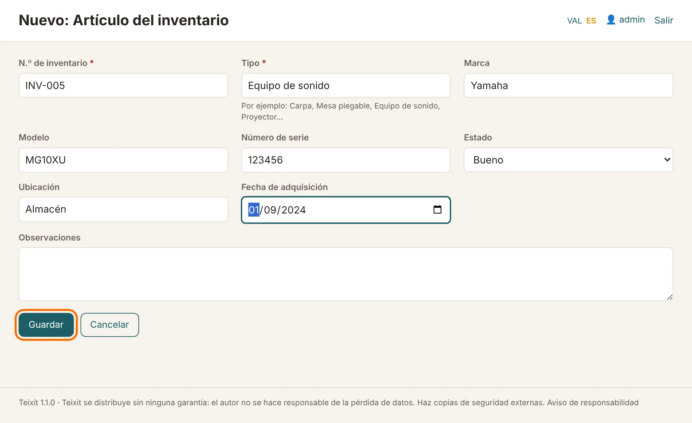

En la ficha de cada artículo está el historial de **préstamos** y de **mantenimientos** (reparaciones, revisiones…).

### Prestar material

1. En la ficha del material, en el apartado **Préstamos de material**, pulsa **+ Añadir**.
2. Elige la **persona**, comprueba la **fecha de entrega** y pon la **devolución prevista**, el estado en que se entrega y la fianza si la hay.
3. Pulsa **Guardar**.

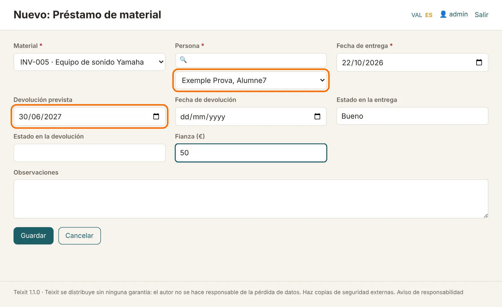

Un mismo artículo no se puede prestar a dos personas a la vez. Cuando lo devuelvan, abre el préstamo, pulsa **Editar**, pon la **fecha de devolución** y el **estado en la devolución** y guarda: vuelve a estar disponible.

Menú **Préstamos de material**: con el filtro puedes ver los **préstamos activos** o solo los que tienen la **devolución vencida**. Los vencidos también aparecen en el inicio.

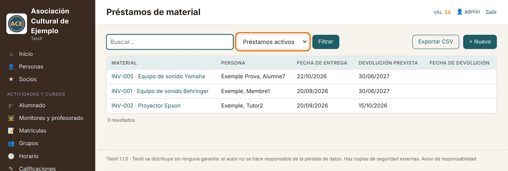

### Ropa y artículos

Menú **Ropa y artículos** (**Equipaciones y ropa** en los clubes): camisetas, sudaderas, blusones, pañuelos, equipaciones, chándales, gorras… con lo que se ha comprado y lo que queda de cada talla.

1. **+ Artículo**: el nombre («Camiseta de la asociación»), el tipo, las **tallas** separadas por comas en el orden en que se deben mostrar (8, 10, 12, S, M, L, XL; vacío si no tiene, como un pañuelo) y el precio de venta, si se vende.
2. **+ Compra**: cuando llegan de la tienda, el artículo, la talla, la cantidad, el precio y el proveedor.
3. **+ Entrega**: cuando se da a alguien, la persona, la talla y si es una **venta** (se la queda y la paga; el importe se propone con el precio del artículo), un **préstamo** (la tiene que devolver) o **gratuito**.

Cuando se devuelve un préstamo, se edita la entrega y se pone la **fecha de devolución**: la prenda vuelve a estar disponible.

La pantalla muestra, para cada artículo y talla, el **total** de prendas que tiene la entidad (las compradas, menos las vendidas y las gratuitas), las que están **en préstamo** y las **disponibles**. Si de una talla se han entregado más de las que constan como compradas, el número sale en rojo: falta apuntar alguna compra. Las entregas de cada persona aparecen también en su ficha.

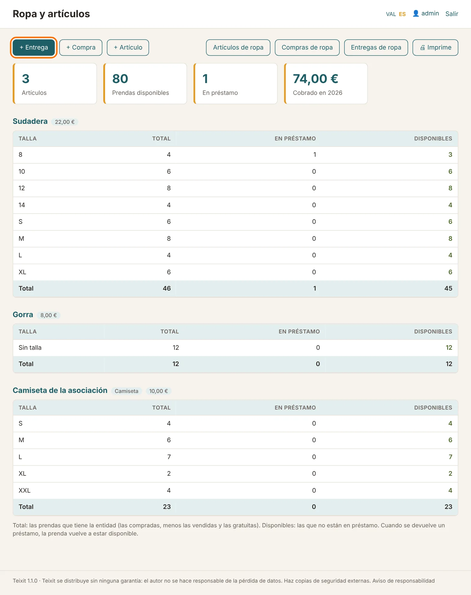

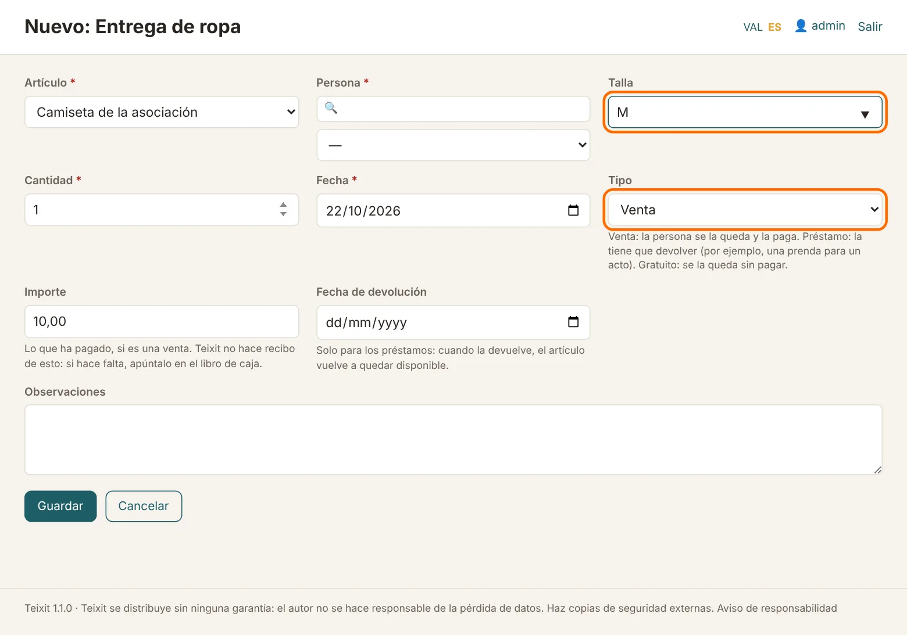

> Teixit no hace recibos de las ventas de ropa. Si hace falta, apunta el dinero en el libro de caja (apartado 8.7).

## 14. Documentos de la entidad

Menú **Documentos**. Aquí se guardan los estatutos, el reglamento de régimen interno, las actas firmadas, la inscripción en el registro, el CIF, las pólizas de seguro, los contratos, los convenios, las licencias y permisos…

Para añadir uno, pulsa **+ Nuevo**, escribe el título, elige el tipo y el **archivo** (PDF, imagen, Word, Excel, LibreOffice o texto, hasta 20 MB). Si es de una persona (un contrato, por ejemplo), elígela: aparecerá también en su ficha. Si el documento caduca (un seguro, una licencia, un convenio), pon la **fecha de caducidad**: Teixit avisará en el inicio 60 días antes.

El archivo se guarda **dentro de Teixit**, no en una carpeta aparte. Así entra en las copias de seguridad (y, si las ciframos, también va cifrado). A cambio, las copias ocupan más si guardáis muchos documentos grandes.

### Registro de actividades de tratamiento (RGPD)

Desde el listado de documentos, **Registro de actividades de tratamiento (RGPD)** hace el documento que el Reglamento de protección de datos pide a las entidades. Teixit lo prepara con los datos que trata la entidad (solo de los módulos activos) y las medidas de seguridad que tiene configuradas. Es un modelo orientativo: revisadlo, adaptadlo y guardadlo firmado con la documentación de la entidad.

## 15. Comunicados

Menú **Comunicados**. Teixit no envía correos ni se conecta a Internet: prepara las direcciones para que enviéis el comunicado desde el correo de la entidad.

1. Elige **a quién**: los socios, la junta, los monitores, las familias del alumnado o de un grupo, los miembros de una sección o todo el mundo.
2. Pulsa **Copia las direcciones** y pégalas en el campo **CCO** (copia oculta) del correo, para que nadie vea las direcciones de los demás. Si son pocas, **Abre el correo con las direcciones en CCO** lo hace directamente.
3. Escribe y envía el correo desde vuestro programa de correo.
4. Vuelve a Teixit y **registra el comunicado** con el asunto: queda constancia de qué se ha enviado, cuándo y a quién.

Las personas del grupo que no tienen correo aparecen en una lista aparte, para avisarlas de otra manera.

## 16. Listados, certificados y memoria

Menú **Documentos y datos → Listados e informes**. Cada listado se puede ver en la pantalla, **imprimir** (o guardar en PDF) y **exportar a CSV** para abrirlo con Excel.

### Socios por número y miembros por función

- **Socios por número**: todos los socios de alta, ordenados por el número, con DNI y contacto. Puedes elegir un tipo de socio.
- **Miembros por función**: elige una sección y sale la lista agrupada por función o especialidad (en los clubes, por **posición**).

### Alumnos de un grupo

Elige el curso y el grupo. Sale cada alumno con la edad, el padre, la madre o el tutor/a y sus teléfonos y correos. Es el listado que necesitan los monitores. En amarillo, los que no autorizan fotos.

### Derechos de imagen

Quién puede salir en fotos y vídeos: el resumen (cuántos autorizan, cuántos no y cuántos faltan) y la lista, con los que no autorizan en amarillo. Antes de un acto, imprímela para quien hace las fotos. El botón **Hojas de consentimiento de los pendientes** imprime las hojas que faltan.

### Etiquetas para las circulares

1. Elige **para quién**: socios, familias del alumnado (los tutores que reciben comunicaciones), miembros de las secciones o todas las personas.
2. Elige el **formato** de la hoja de etiquetas (lo dice la caja: 24, 21 o 14 por hoja).
3. Si la hoja ya está empezada, indica cuántas etiquetas **ya se han gastado**.
4. Pulsa **Prepara las etiquetas** e imprime con el **tamaño real (100 %)** y **sin márgenes**.

> Haz primero una prueba en papel normal con **Muestra los bordes** y ponla encima de la hoja de etiquetas a contraluz.

### Antigüedad e insignias

Elige el **año** y los **años que se premian** (por defecto 25 y 50). Sale quién los cumple ese año, como socio y como miembro de una sección. Marca **Muestra también la lista completa** para ver a todo el mundo ordenado por antigüedad.

La antigüedad se cuenta desde la fecha de alta. Para los miembros de las secciones, desde la primera alta en cualquier sección.

### Memoria anual y subvenciones

Elige el curso. Sale lo que suelen pedir el ayuntamiento, la Diputación o la Generalitat: participantes en las actividades por edad (con menores y mayores), por actividad y por población, monitores y grupos, miembros de cada sección (con los menores), socios por tipo y las altas y bajas del año.

### Certificados

En la ficha de un **socio**, de un **miembro de una sección** o de una **matrícula** está el botón **🖨 Certificado**. Sale un certificado en A4 con el logotipo, los datos de la persona y la fecha de hoy, preparado para firmar. Sirve para becas, ayudas, el trabajo…

Quién firma los certificados y la población que sale en ellos los pone el administrador/a en la configuración (**Manual de administración**). Si no se ha puesto a nadie, se toma de la junta actual.

## 17. Importar datos desde Excel

Si la entidad ya tiene los socios o el alumnado en un Excel, no hace falta volver a escribirlos. Menú **Documentos y datos → Importar datos**.

### Paso 1. El archivo

1. Elige qué quieres importar: **Personas**, **Socios** (con el número, el tipo y la fecha de alta; el tipo se busca por el nombre) o **Alumnado** (con el padre, la madre o el tutor/a, si la hoja los lleva).
2. Elige el archivo: Excel (**.xlsx**) o **CSV**. Si es un .xls antiguo, ábrelo con Excel y guárdalo como .xlsx.
3. Deja marcado **La primera fila tiene los títulos de las columnas** si es el caso, y pulsa **Siguiente**.

Si empiezas de cero, descarga una **plantilla**, rellénala y súbela.

### Paso 2. Qué es cada columna

Teixit reconoce las columnas habituales (Nombre, Apellidos, DNI, Teléfono, Fecha de nacimiento…) y ya las deja elegidas. Compruébalas y corrige las que falten. Si el nombre y los apellidos están juntos, elige **Nombre y apellidos juntos**. Las columnas que no elijas no se importan.

Si la hoja lleva la **cuenta bancaria** (IBAN o el número antiguo de 20 cifras), Teixit crea la domiciliación de cada persona mayor de edad; al importar alumnado, la del padre, la madre o el tutor/a. Si hay una columna con la **fecha de firma** de la domiciliación, también la toma. A las personas que ya tienen una domiciliación con otro IBAN no se les cambia.

### Paso 3. Revisar e importar

Antes de importar nada, Teixit muestra cada fila:

| Estado | Qué quiere decir | Qué se hace |
|---|---|---|
| **Nueva** | No está en Teixit | Se crea |
| **Ya existe** | Mismo DNI, o mismo nombre y fecha de nacimiento | No se duplica: solo se completan los datos que le faltan |
| **Posible duplicado** | Mismo nombre, pero no se puede asegurar | Marca **Es la misma persona** si lo es; si no, se crea nueva |
| **Repetida en el archivo** / **Error** | Está dos veces o no tiene nombre | No se importa |

En la columna **Avisos** verás, por ejemplo, fechas que no se entienden o personas a las que faltan datos obligatorios (quedarán en amarillo, como siempre).

Pulsa **Importa**. Antes de importar, Teixit hace una copia de seguridad («Antes de importar»): si el resultado no es el que esperabas, el administrador/a la puede restaurar (Manual de administración).

## 18. Copias de seguridad

Todos los datos están en un solo archivo. Teixit hace copias automáticamente:

| Cuándo | Tipo |
|---|---|
| La primera vez que se usa cada día | Automática (diaria) |
| Al cerrar Teixit, si ha habido cambios | Automática (al cerrar) |
| Cuando pulsas **Hacer una copia ahora** | Manual |
| Justo antes de restaurar | Antes de restaurar |
| Justo antes de importar datos | Antes de importar |
| Al abrir por primera vez una versión nueva de Teixit | Antes de actualizar |

Menú **Administración → Copias de seguridad**:

### Hacer y descargar copias

- **Haz una copia ahora**: hace una copia en el momento. Conviene hacer una antes de un cambio grande.
- **Descargar** (en la lista): descarga una copia, por ejemplo para guardarla en un USB.

Elegir la carpeta externa (USB o nube), cifrar las copias, decidir cuánto tiempo se guardan y **restaurar** una copia lo hace el administrador/a (**Manual de administración**).

> Las copias contienen datos personales, también de menores. Guárdalas en un lugar seguro.

## 19. Usuarios y contraseñas

### Cambiar tu contraseña

Cada usuario puede cambiar la suya cuando quiera:

1. En el menú, abajo del todo, pulsa **Cuenta y contraseña** (o haz clic en tu nombre de usuario, arriba a la derecha).
2. Escribe la **contraseña actual**.
3. Escribe la **contraseña nueva** dos veces (al menos 8 caracteres).
4. Pulsa **Guardar**.

Si no recuerdas la actual, no la puedes cambiar aquí: pide al administrador/a que te ponga una contraseña nueva.

## 20. Ayuda

El menú **Ayuda** muestra este manual dentro del programa. Los botones de arriba abren el manual y la guía de instalación en PDF, el registro de cambios, la privacidad y el resumen de la licencia. El administrador/a ve, además, una pestaña con el **Manual de administración**.

**¿Hay versión nueva?** abre en el navegador la página de la última versión de Teixit. Teixit no se conecta a Internet ni comprueba nada solo: compara el número de esa página con el tuyo, que aparece justo debajo. Si es más alto, avisa al administrador/a: la versión nueva se instala encima y los datos se conservan.

## 21. Preguntas frecuentes

**Nos hemos equivocado de tipo de entidad. ¿Hay que volver a instalar?** No. El administrador/a lo cambia en **Configuración** y, si hace falta, activa o desactiva los módulos (Manual de administración). Los datos no se pierden.

**He dado de alta una persona dos veces. ¿Qué hago?** Si la segunda no tiene nada vinculado, ábrela y pulsa **Eliminar**. Si ya tiene cosas vinculadas, edítalas para que apunten a la persona buena y después elimina la repetida.

**¿Por qué una persona aparece en amarillo?** Le faltan datos obligatorios: normalmente, ha cumplido 18 años y no tiene DNI o teléfono. Complétalos (apartado 5).

**No encuentro a alguien en el listado.** Puede estar de baja: marca **Mostrar también las bajas**.

**No me deja eliminar una cosa.** Tiene historial relacionado. Ponla de baja o como inactiva (apartado 3).

**No veo el menú de actividades (o de lotería, o de ropa).** Está desactivado: el administrador/a lo puede activar en **Administración → Módulos y avisos**.

**Un alumno no aparece en un grupo.** Comprueba que tiene matrícula en el curso actual, en estado Activo, y que está inscrito en ese grupo (apartado 11.6, paso 5).

**El administrador/a ha olvidado la contraseña.** Pulsa **Recupera el acceso** en la pantalla de entrada y usa el código de recuperación. Si no lo encuentras, también hay una manera sin código (Manual de administración).

**Tenemos que pasar a Teixit los socios que tenemos en Excel.** Usa **Importar datos** (apartado 17): no hace falta escribirlos a mano, y las personas que ya están no se duplican.

**¿Quién puede salir en las fotos?** **Listados e informes → Derechos de imagen** (apartado 16).

**¿Cómo cobramos las cuotas por el banco?** Pon los datos bancarios de la entidad, crea la domiciliación de cada pagador, genera los recibos y prepara una remesa: Teixit hace el archivo que se sube a la banca electrónica (apartado 8).

**¿Teixit hace facturas?** No, hace recibos. Las facturas se deben hacer con un programa de facturación que cumpla la normativa (Verifactu).

**¿Teixit envía nuestros datos a algún sitio?** No. Todo se queda en el ordenador y, si la configuráis, en la carpeta externa de copias. Lo explica la declaración de privacidad: menú **Ayuda → Privacidad**.

**¿Tengo que estar conectado a Internet?** No.

**¿Dónde están los datos?** En la carpeta `data` del programa (`data\teixit.db`). La ruta exacta se ve en **Configuración**.

**¿Cómo paso Teixit a otro ordenador?** Instala Teixit en el ordenador nuevo y, en **Copias de seguridad → Restaurar desde un archivo**, carga la última copia.
